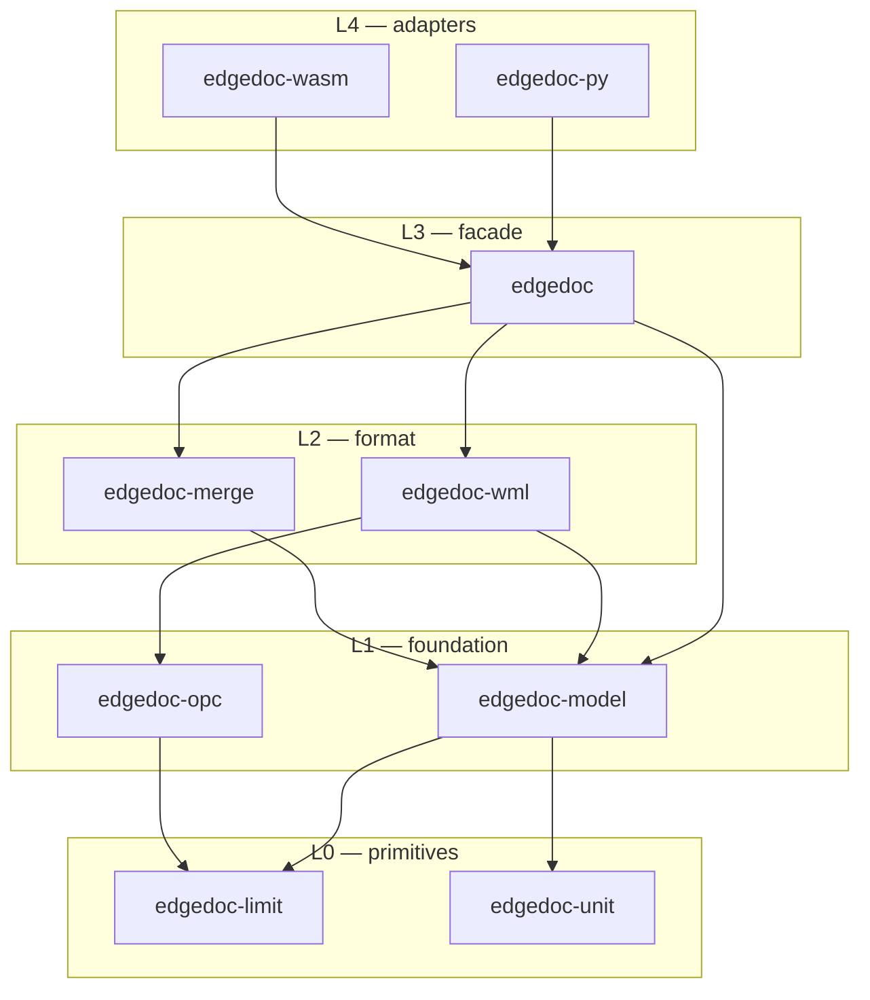

<div align="center">

# EdgeDoc

**Read, create, edit, merge, and save Word documents from Rust, Python, and the browser.**

[](https://github.com/raphaelmansuy/edgedoc/actions/workflows/ci.yml)
[](https://crates.io/crates/edgedoc)
[](https://docs.rs/edgedoc)
[](https://pypi.org/project/edgedoc/)
[](LICENSE)

</div>

A Word document is a package of parts, not a list of paragraphs. EdgeDoc reads that
package, changes the parts it owns, and copies every other part unchanged. A template
that leaves the library comes back with its macros, themes, charts, and numbering
intact.

The same Rust core feeds a crate, a PyPI wheel, and a WebAssembly module.

```rust
let mut doc = Document::builder()
    .core(CoreProps::new().title("Invoice"))
    .page(Page::a4().margins(Mm(20.0)))
    .paragraph(Paragraph::new().text("Invoice ").merge_field("Number"))
    .table(Table::new().header(["Description", "Qty", "Amount"]).row(["Widget", "2", "40.00"]))
    .build()?;
doc.save("invoice.docx")?;
```

## Contents

- [Why EdgeDoc](#why-edgedoc)
- [Install](#install)
- [Quick start](#quick-start)
- [Mail merge](#mail-merge)
- [Reading a document you did not write](#reading-a-document-you-did-not-write)
- [Example documents](#example-documents)
- [What is supported](#what-is-supported)
- [Commands](#commands)
- [Architecture](#architecture)
- [Python](#python)
- [WebAssembly](#webassembly)
- [Limits and safety](#limits-and-safety)
- [Documentation](#documentation)
- [Contributing](#contributing)
- [Licence](#licence)

## Why EdgeDoc

Most Word libraries keep a paragraph list and rebuild the file from it. The rebuilt
file opens, but it is no longer the approved template: the header loses its picture,
the numbering changes, and the macros disappear.

EdgeDoc holds the opposite rule. **The package is the document.** The library reads the
parts it models into a typed model and remembers the parts it does not model. It writes
only what changed. A save that follows no edit returns the original bytes.

This matters for the documents that a business actually sends: invoices, letters,
statements, and reports. Those documents carry an approved layout. A merge job must not
change the layout of its template.

## Install

```bash
cargo add edgedoc
```

```bash
pip install edgedoc
```

The WebAssembly module builds from this repository with `make wasm`. It is not yet
published to npm.

Rust 1.76 or later. The crate uses `quick-xml` and `zip`, and nothing else.

## Quick start

Create a document with a heading, a merge field, and a table.

```rust
use edgedoc::{CoreProps, Document, Mm, Paragraph, Pt, Style, Table};

let mut doc = Document::builder()
    .core(CoreProps::new().title("Invoice"))
    .page(edgedoc::Page::a4().margins(Mm(20.0)))
    .style(Style::paragraph("Heading1").size(Pt(16.0)).bold())
    .paragraph(
        Paragraph::new()
            .style("Heading1")
            .text("Invoice ")
            .merge_field("Number"),
    )
    .table(
        Table::new()
            .widths([Mm(90.0), Mm(30.0), Mm(40.0)])
            .header(["Description", "Qty", "Amount"])
            .row(["Widget", "2", "40.00"]),
    )
    .build()?;

doc.edit(edgedoc::EditOptions::default(), |edit| {
    edit.body().paragraph_after_last(|para| {
        para.text("Total: ")?;
        para.merge_field("Total")?;
        Ok(())
    })
})?;

doc.save("invoice.docx")?;
```

Lengths are typed. Pass `Pt`, `Mm`, `Cm`, `Inch`, `Twips`, or `Emu`. The model stores
twips for text and EMU for drawings, so a caller never passes a raw integer.

Text that needs more than one style uses a run:

```rust
use edgedoc::{Paragraph, Pt, RunBuilder};

let para = Paragraph::new()
    .text("Total due ")
    .run(RunBuilder::new().text("1,240.00").bold().size(Pt(14.0)).color("#1E3A8A"));
```

## Mail merge

A merge reads records, replaces every field, and joins the results. A preview and a merge both work from a copy, so the template stays
as it is.

```rust
use edgedoc::{CsvOptions, Document, Join, MergeKind, MissingField, Paragraph, Records, StoryRef};

let template = Document::builder()
    .paragraph(Paragraph::new().text("Dear ").merge_field("Name").text(","))
    .paragraph(Paragraph::new().text("Your balance is ").merge_field("Balance").text("."))
    .build()?;

let csv = b"Name,Balance\nAda Lovelace,120.00\nGrace Hopper,80.50\n";
let records = Records::from_csv(csv, &CsvOptions::default())?;

let letters = template
    .merge()
    .records(records)
    .kind(MergeKind::Letters)
    .missing(MissingField::Error)
    .finish()?
    .join(Join::Auto)?;

assert!(letters.plain_text(StoryRef::Body).contains("Dear Ada Lovelace,"));
letters.save("letters.docx")?;
```

You can filter, sort, and map the records before the merge:

```rust
use edgedoc::{Op, Record, Rule, SortKey};

let records = Records::from_csv(csv, &CsvOptions::default())?
    .filter(&[Rule::new("Balance", Op::NotBlank, "")])?
    .sort(&[SortKey::new("Name")])?;

let batch = template
    .merge()
    .records(records)
    .map_value("Balance", |record: &Record| format!("EUR {}", record.get("Balance").unwrap_or("0")))
    .finish()?;
```

A field result can be any text. A missing field is an error, a placeholder, or empty
text, and the caller chooses which.

For one call with no setup, `merge_letters_bytes` reads a template, merges a CSV, and
returns the bytes:

```rust
let out = Document::merge_letters_bytes(&template_bytes, b"Name\nAda\n")?;
```

### Field codes

| Code | Result |
|---|---|
| `MERGEFIELD Name` | The record value |
| `IF { MERGEFIELD Amount } > "100" "large" "small"` | One of two texts |
| `NEXT` | Continue on the next record in the same letter |
| `NEXTIF`, `SKIPIF` | Conditional record movement |
| `ADDRESSBLOCK`, `GREETINGLINE` | A postal block or a greeting from name parts |
| `DATE`, `TIME`, `CREATED`, `AUTHOR`, `TITLE` | Document and run data |

Numbers compare as numbers, so `7` equals `7.0`.

## Reading a document you did not write

```rust
use edgedoc::{Document, StoryRef};

let doc = Document::open("approved-template.docx")?;

println!("{}", doc.core_props().title);
println!("{:?}", doc.merge_field_names());
println!("{}", doc.plain_text(StoryRef::Body));

// An unedited save returns the original bytes.
let same = doc.write_bytes()?;
assert_eq!(same, std::fs::read("approved-template.docx")?);
```

An edit changes only the parts that the model owns:

```rust
let mut doc = Document::open("approved-template.docx")?;
doc.edit(edgedoc::EditOptions::default(), |edit| {
    edit.body().paragraph_at(0, |para| para.text("New opening line"))?;
    Ok(())
})?;
doc.save("updated.docx")?;
```

The header picture, the numbering definition, the theme, the macros, and the settings
survive that save.

## Markdown

`Document::to_markdown` turns the body into Markdown. Images stay in memory and the
Markdown points at `images/<file>`. Set a directory when the files should be written.
`link_prefix` is the path used in the image links, which can be a relative folder or a URL.

```rust
use edgedoc::{Document, MarkdownOptions};

let doc = Document::open("report.docx")?;
let exported = doc.to_markdown_with(
    &MarkdownOptions::new()
        .image_dir("out/media")
        .link_prefix("media"),
)?;

std::fs::write("out/report.md", &exported.markdown)?;
assert!(exported.markdown.contains("](media/"));
for image in &exported.images {
    let stored = image.stored_at.as_ref().expect("image file");
    assert_eq!(std::fs::read(stored)?, image.bytes);
}
```

Without `image_dir`, nothing is written and each [`edgedoc::ExportedImage`] still carries
`bytes` and the `markdown_path` to use when you store the file yourself.

An equation is LaTeX. Inline Office Math uses `$...$`. A displayed equation (`m:oMathPara`)
uses `$$` on its own lines.

## Example documents

The repository builds twelve real documents. `make examples` writes them to
`target/examples/`. Each one uses only the public API.

| File | What it shows |
|---|---|
| `invoice-template.docx` | A two-page branded invoice with a header logo, a footer with page numbers, merge fields, and a marker row for line items |
| `invoices/INV-….docx` | Four invoices. Each line-item table takes its rows from `table_at`, and each total comes from `map_value` |
| `report-template.docx` | A board report with a cover, a chart, a first-page header, and a merge field in the footer |
| `report.docx` | The report with one section per region. The footer names its own region |
| `letter-template.docx` | A letter with `GREETINGLINE`, a conditional paragraph, and a signature seal |
| `letters/….docx` | One letter per enterprise account, after a filter on the record list |
| `directory.docx` | Every recipient in a three-column label grid, with no page break between records |

```console
$ make examples
→ building the example documents
  invoice-template.docx                         8703 bytes
  invoices/INV-2026-0418.docx                   8248 bytes
  invoices/INV-2026-0419.docx                   8220 bytes
  invoices/INV-2026-0420.docx                   8257 bytes
  invoices/INV-2026-0421.docx                   8220 bytes
  report-template.docx                         11599 bytes
  report.docx                                  27495 bytes
  letter-template.docx                          6377 bytes
  letters/Hart-Amelia.docx                      6248 bytes
  letters/Petrov-Ivan.docx                      6240 bytes
  letters/Adeyemi-Joy.docx                      6234 bytes
  directory.docx                               17486 bytes

  12 documents in target/examples
```

Byte counts change with any edit, so treat the numbers above as a sample.

The generator lives in `crates/edgedoc-demos`. A test reads every output back through
the public reader, so a change that breaks a document fails the build.

`make verify` checks each document with the WordCraft reader, which is an independent
implementation. It fails when that reader rejects a file or gives different text after
it saves the file. `docs/13-word-validation.md` lists the rules it applies.

## What is supported

| Area | Status |
|---|---|
| DOCX, DOCM, DOTX, DOTM | Modeled. The save copies macros, and the library never runs them |
| Text, runs, character and paragraph formatting | Modeled |
| Tables, spans, merges, borders, shading, floating position | Modeled |
| Sections, columns, headers, footers, page numbering | Modeled |
| Bullet and number lists | Modeled. The writer generates the numbering part |
| Pictures, inline and floating | Modeled |
| Content controls, fields, bookmarks, hyperlinks | Modeled |
| Footnotes, endnotes, comments | Modeled as stories |
| Styles of every kind | Modeled |
| Themes, charts, equations, tracked changes | The save copies these parts |
| Strict markup | Read. Saved as Transitional |
| Flat OPC | Read. Saved as a package |
| Binary `.doc`, Word 2003 XML | Refused with an error code |
| Encrypted package | Detected. Decryption is not in this version |
| Pagination, PDF, spell check, VBA | Out of scope |

`docs/11-format-coverage.md` compares every row with WordCraft 0.14.0.
`docs/12-word-features.md` maps every modeled field to its test. Both tables are locked
by a test that fails when the table and the code disagree.

The separate `edgedoc-display` renderer adds paginated viewing in Rust and the browser. It is
still under development and does not yet render every Word feature. The
[rendering parity ledger](docs/display/20-rendering-parity.md) uses Wordcraft 0.15.1 as its reference
and distinguishes exercised behavior from remaining gaps; preserving a DOCX feature through a save does not imply rendering support.
The [differential gate](tools/wordcraft-parity/README.md) compares actual glyphs and pixels and
keeps unsupported cases failing.
The [expanded external corpus](tests/corpus/EXTERNAL.md) adds 75 pinned POI/docx4j files, including
a 45-page guide, plus 181 more pinned fixtures. [Image inspection and measured results](docs/display/22-expanded-corpus-parity.md)
record the fixes and remaining differences against Wordcraft.

## Commands

`make` prints the list. Every target names what it does.

```console
$ make
EdgeDoc — a Rust library for Word documents

Usage  make <target>

  help               Show this help

Everyday
  check              Run every check that CI runs
  test               Run every test
  test-quiet         Run every test and print only the summary
  lint               Run clippy with warnings denied
  fmt                Format the code
  fmt-check          Check formatting without writing

Documents
  examples           Build the example documents into target/examples
  open               Build the example documents and open the output folder
  assets             Redraw the PNG assets that the examples embed
  verify             Check every document with the WordCraft reader
  clean-examples     Remove the generated example documents

Documentation
  doc                Build the API documentation
  doc-open           Build the API documentation and open it
  docs-lint          Check the prose for Simplified Technical English errors

Packaging
  wasm               Build the WebAssembly module
  python             Build the Python wheel with maturin
  python-dev         Install the Python package into the current environment

Maintenance
  clean              Remove build output
  outdated           List dependencies that have a newer version
  audit              Check the dependencies for known vulnerabilities
```

`make check` is the one command to run before a commit. It runs the formatter check,
clippy with warnings denied, and every test.

## Architecture

One catalog, one field parser, one budget, one write path. A layer calls only the
layer below it.



`edgedoc-merge` does not read a ZIP package and `edgedoc-opc` does not know the
document model. A test enforces that rule.

## Python

The wheel exposes the same operations.

```python
import edgedoc

text = edgedoc.read_plain(open("invoice.docx", "rb").read())
out = edgedoc.merge_csv(open("template.docx", "rb").read(), b"Name\nAda\n")
```

```bash
make python-dev     # install into the current environment
make python         # build a wheel into target/wheels
```

## WebAssembly

The module takes bytes and returns bytes. No file system, no threads.

```javascript
import init, { readDocument, writeDocument, merge, preview } from "edgedoc-wasm";

await init();

const text = readDocument(templateBytes);
const merged = merge(templateBytes, csvBytes);
```

```bash
make wasm
```

## Limits and safety

| Guard | Value |
|---|---|
| One part, decompressed | 256 MiB |
| Whole package, decompressed | 512 MiB |
| ZIP entries | 20 000 |
| XML depth | 256 |
| XML elements | 8 000 000 |
| Table columns | 63 |
| Table nesting | 24 |
| Font size | 1 to 1638 pt |
| Password characters | 255 |

- The workspace forbids `unsafe` code.
- Each parser takes a `Budget`, so a hostile file fails before it allocates.
- The reader refuses a DTD and never resolves an external entity.
- The library never runs a macro, a field code, or a formula.
- `save` writes a temporary sibling, syncs it, then renames it. It refuses a symbolic
  link at the destination.
- An encrypted document returns `package.password_required`. There is no password
  guessing.

Error codes are stable and documented in `docs/07-adapters.md`.

## Documentation

| Chapter | Contents |
|---|---|
| [README](docs/README.md) | Index and the five whys |
| [01-intent](docs/01-intent.md) | Scope and version 1 limits |
| [02-references](docs/02-references.md) | Standards and conformance classes |
| [03-architecture](docs/03-architecture.md) | Crates, layering, and public types |
| [04-package](docs/04-package.md) | OPC, flavours, and encryption |
| [05-model-and-api](docs/05-model-and-api.md) | The model and the fluent API |
| [06-merge](docs/06-merge.md) | Field merge, filters, and labels |
| [07-adapters](docs/07-adapters.md) | Error codes, PyPI, and WebAssembly |
| [08-edge-cases](docs/08-edge-cases.md) | Boundary behaviour |
| [09-plan](docs/09-plan.md) | Implementation plan |
| [10-traceability](docs/10-traceability.md) | Requirement index |
| [11-format-coverage](docs/11-format-coverage.md) | Word coverage against WordCraft |
| [12-word-features](docs/12-word-features.md) | Every modeled field and its test |
| [13-word-validation](docs/13-word-validation.md) | The rules Word enforces, and how to check a file |
| [14-round-trip](docs/14-round-trip.md) | Every feature that must survive an edit, and its test |
| [15-adapters-audit](docs/15-adapters-audit.md) | The Python and WebAssembly surface, and its audit |

The specification follows ECMA-376 5th edition, ISO/IEC 29500-1:2016, MS-DOCX, and
MS-OI29500. `docs/02-references.md` holds the links.

## Author


Raphael Mansuy is a data engineering and AI strategist with more than 20 years of global
technology leadership experience. He works on democratizing data management and AI, and
helps organizations build scalable data platforms. His work covers resilient data
infrastructure, machine learning models, and coaching teams on practice. He leads a
startup studio in Hong Kong and writes about AI and data strategy.

EdgeDoc started from a simple observation: a Word library that rebuilds a document from a
paragraph list cannot keep an approved template. A package that is read and written part
by part is the smallest honest fix.

- LinkedIn: [linkedin.com/in/raphaelmansuy](https://www.linkedin.com/in/raphaelmansuy/)
- Repository: [github.com/raphaelmansuy/edgedoc](https://github.com/raphaelmansuy/edgedoc)
- Site: [raphaelmansuy.github.io/edgedoc](https://raphaelmansuy.github.io/edgedoc/)
- PyPI: [pypi.org/project/edgedoc](https://pypi.org/project/edgedoc/)
- crates.io: [crates.io/crates/edgedoc](https://crates.io/crates/edgedoc)

[Connect with Raphael on LinkedIn](https://www.linkedin.com/in/raphaelmansuy/).

### Recognition

Favikon ranks Raphael at **12** in
[Top 20 AI Experts in France in 2026](https://www.favikon.com/blog/top-ai-experts-france),
with a Favikon Authority Score of 7,012 points. The list covers the most visible AI
practitioners in France. The entry cites his 20 years of data and AI leadership, and his
work on scalable data platforms.

### Book

Co-author of
[**The Definitive Guide to Data Integration**](https://www.oreilly.com/library/view/the-definitive-guide/9781837631919/)
(Packt, 2024), with Pierre-Yves Bonnefoy, Emeric Chaize, Mehdi Tazi, and Stephane Heckel.
The subtitle is *Unlock the power of data integration to efficiently manage, transform,
and analyze data*.

### Other projects by Raphael

| Project | What it does |
|---|---|
| [**EdgeQuake**](https://edgequake.com/) | Graph-RAG in Rust. One binary, one Postgres, any LLM. It reads PDFs and text, builds a knowledge graph in PostgreSQL, and answers questions with sources. Six retrieval modes. Apache 2.0. |
| [**EdgeSQL**](https://github.com/raphaelmansuy/EdgeSQL) | Change SQL with a typed tree instead of string replacement, with a preview of the change before it applies. |
| [**EdgeCrab**](https://www.edgecrab.com/) | A personal and coding agent in one native Rust binary, with a ratatui terminal UI and a ReAct tool loop. 24 model providers and 17 messaging gateways. |
| [**EdgeWhisper**](https://edgewhisper.com/) | Voice dictation for macOS, powered by Voxtral from Mistral AI. It runs fully on the device, with no cloud and no data collection. |

## Contributing

Read [CONTRIBUTING.md](CONTRIBUTING.md). Run `make check` before a pull request. To
report a vulnerability, read [SECURITY.md](SECURITY.md).

## Licence

Copyright 2026 Raphael Mansuy.

Licensed under the Apache License, Version 2.0. See [LICENSE](LICENSE) for the full text
and [NOTICE](NOTICE) for the attribution of third-party components.
