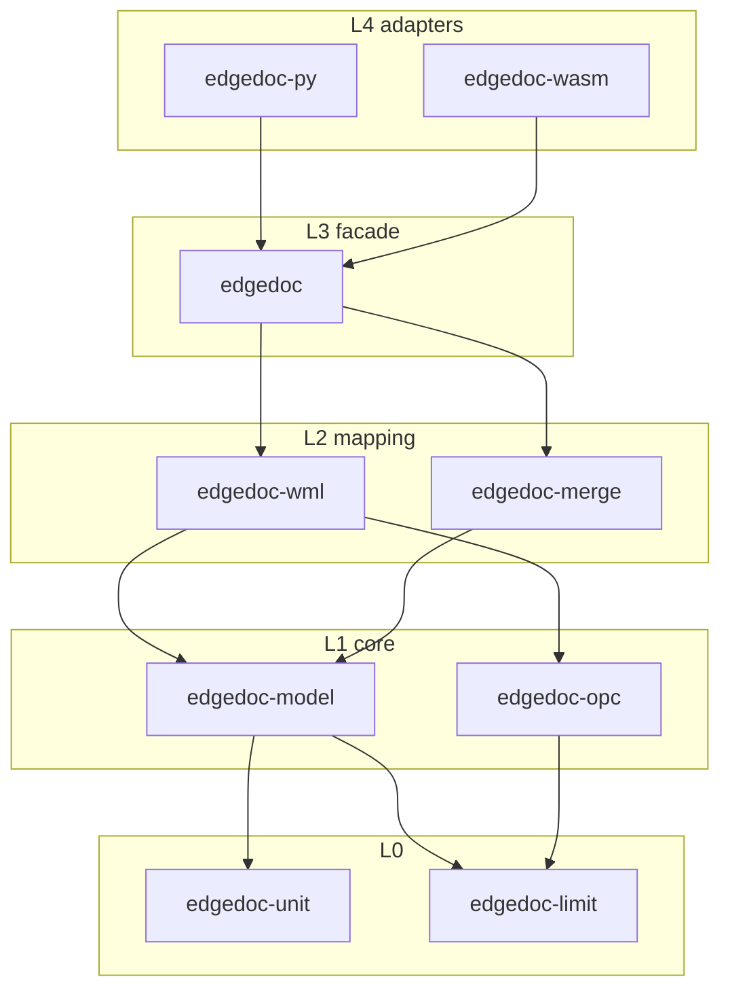
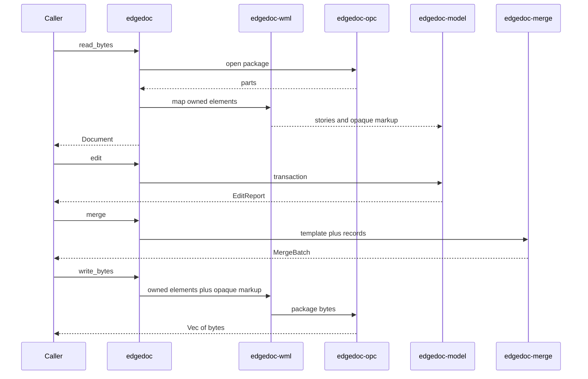
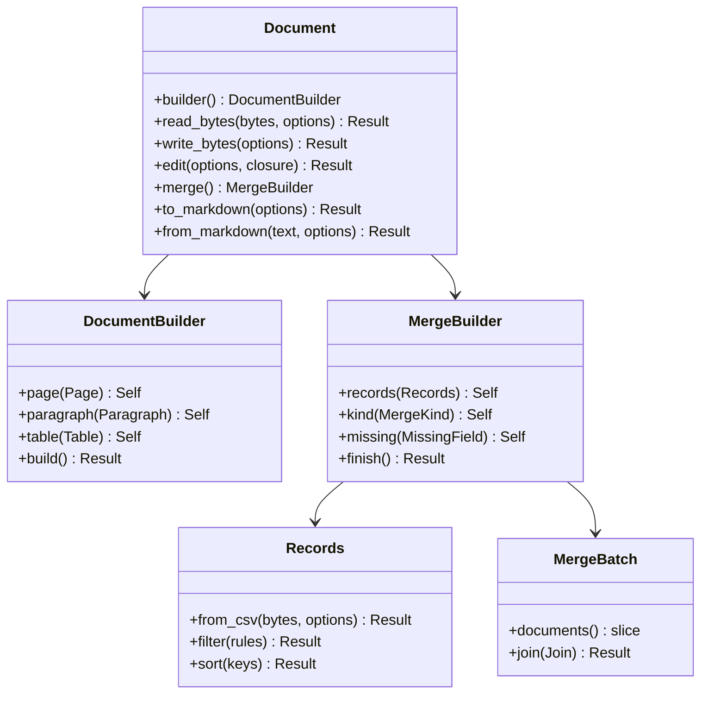

# Crates, SOLID, DRY, and safety limits.

> Part of the EdgeDoc specification. Date: 2026-11-04. Requirement ids are normative. See [the index](README.md).

## 6. Architecture

### 6.1 Crate layers

A crate may depend only on a lower layer. This is the WordCraft layer rule (`docs/architecture.md`, `cargo xtask layers`).

| Layer | Crate | Responsibility |
|---|---|---|
| L0 | `edgedoc-limit` | Budgets for bytes, depth, counts, and time |
| L0 | `edgedoc-unit` | Twips, EMU, points, millimetres. One length type |
| L1 | `edgedoc-model` | Stories, blocks, runs, fields, styles, opaque markup |
| L1 | `edgedoc-opc` | ZIP, content types, relationships. No document model |
| L2 | `edgedoc-wml` | Map between the model and WordprocessingML |
| L2 | `edgedoc-merge` | Records and field evaluation. No ZIP types |
| L3 | `edgedoc` | Facade. Builder, edit transaction, open, save, merge |
| L4 | `edgedoc-py` | PyO3 adapter |
| L4 | `edgedoc-wasm` | wasm-bindgen adapter |

`ED-A-01`. `edgedoc-merge` does not depend on `edgedoc-wml` or `edgedoc-opc`.

`ED-A-02`. Adapters call the facade. They do not parse XML. They do not evaluate fields.

### 6.1.1 Call sequence

### 6.1.2 Public types

### 6.2 SOLID

| Principle | Rule | Requirement |
|---|---|---|
| Single responsibility | One crate changes for one reason. OPC changes do not change merge | `ED-A-01` |
| Open/closed | A new field keyword is a new `FieldEval`. The walker does not grow a match arm | `ED-M-08` |
| Liskov | Every `PackageSource` yields the same `Package` type | `ED-P-04` |
| Interface segregation | `PackageSource`, `FieldEval`, and `StoryWriter` stay separate | `ED-A-03` |
| Dependency inversion | The facade depends on those traits. ZIP is one `PackageSource` | `ED-P-04` |

`ED-A-03`. The model crate does not define a trait that mentions ZIP, Python, or the browser.

### 6.3 DRY

`ED-A-04`. One catalog (`edgedoc-wml::catalog`) lists every owned element. The reader and the writer both match on that catalog. A test fails when the writer has an owned element the reader lacks.

`ED-A-05`. One parser (`edgedoc-model::fields::parse_instruction`) reads field instruction text. The reader, the builder, and the merge engine call it.

`ED-A-06`. One `Budget` type enforces every limit in section 7 of this file. Callers do not pass raw integers into each parser.

`ED-A-07`. One write path builds package bytes. Path save, the Python adapter, and the WebAssembly adapter call `Document::write_bytes`.

`ED-A-08`. Label products and envelope sizes are data tables. They are not functions. WordCraft already uses tables (`ENVELOPE_SIZES`, `LABEL_PRODUCTS`).

### 6.4 Copy-on-write model

`ED-T-01`. A block is `Arc<Block>`. A clone of a document copies the `Arc` values. An edit copies only the block it changes. WordCraft documents this pattern in `crates/doc/src/lib.rs`.

`ED-T-02`. `Document` is `Send + Sync`. Mutation uses `&mut Document`. The model has no `RefCell`. A revision counter may be `AtomicU64`, as `Paragraph::rev` is in WordCraft.

### 6.5 Transactions

`ED-T-03`. `Document::edit` clones the document, runs the closure, and keeps the clone only when the closure returns `Ok`. On `Err`, the original document is unchanged.

`ED-T-04`. The closure result includes an `EditReport`. The report lists opaque markup and revision markup that the edit dropped. The edit does not drop them unless the options allow it (`ED-R-06`).

## 7. Limits and safety

WordCraft bounds hostile packages in `crates/docx/src/package.rs` and `crates/docx/src/xml.rs`. EdgeDoc uses the same numbers unless a requirement says otherwise.

| Limit | Value | WordCraft source |
|---|---|---|
| One part, decompressed | 256 MiB | `MAX_PART` |
| All parts, decompressed | 512 MiB | `MAX_TOTAL` |
| ZIP entries visited | 20,000 | `MAX_ENTRIES` |
| XML depth | 256 | `MAX_DEPTH` |
| Elements in one part | 8,000,000 | `MAX_ELEMENTS` |
| Attributes on one element | 1,024 | `MAX_ATTRS` |
| Parts in the model | 50,000 | `MAX_PARTS` |
| Table columns | 63 | `MAX_COLS` |
| Table nesting | 24 | `MAX_TABLE_DEPTH` |
| Merged blocks in one joined document | 200,000 | `MAX_MERGED_BLOCKS` |
| Password length | WordCraft `MAX_PASSWORD_CHARS` | `crates/docx/src/lib.rs` |

`ED-S-03`. The reader rejects a DTD. It does not resolve external entities. `quick-xml` is the parser, with those options set in one function.

`ED-S-04`. A limit error names the limit and the observed value. It does not include package bytes.

`ED-S-05`. A password is a borrow used to decrypt. `Error` does not store it. Logs do not print it. The decrypted buffer is wrapped so it is cleared on drop. WordCraft uses `zeroize` for this buffer.

`ED-S-06`. `unsafe_code` is forbidden in the workspace, as in WordCraft `Cargo.toml`.

`ED-S-07`. A panic in library code is a defect. The test `hostile_never_panics` feeds truncated ZIP data, nested tables, and huge declared lengths.

### 7.1 Feature flags

| Feature | Default on native | Default on wasm32 | Effect |
|---|---|---|---|
| `fs` | yes | no | Path open and atomic save |
| `crypt` | yes | no | [MS-OFFCRYPTO](https://learn.microsoft.com/en-us/openspecs/office_file_formats/ms-offcrypto/3c34d72a-1a61-4b52-a893-196f9157f083) agile and standard encryption |
| `sheet` | yes | yes | xlsx, xlsm, xls, and ods record sources |
| `serde` | no | no | JSON dump of the model for tests |

`ED-A-09`. The model crate does not read the filesystem. The `fs` feature lives on the facade.
