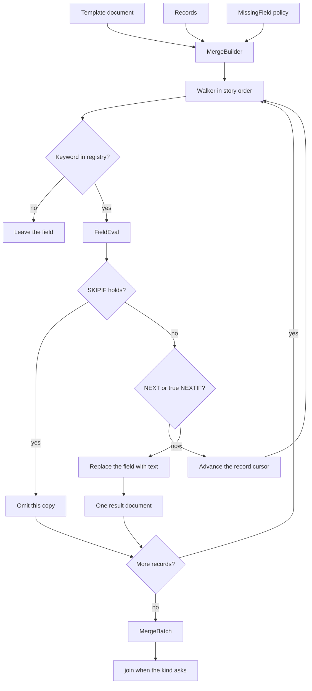

# Field merge for letters, directories, and labels.

> Part of the EdgeDoc specification. Date: 2026-11-04. Requirement ids are normative. See [the index](README.md).

## 11. Field merge

### 11.1 State

`ED-M-01`. Records are not fields of `Document`. The caller passes them to `MergeBuilder`. WordCraft stores `MergeState` on the session for the same reason.

`ED-M-02`. `template.merge()` borrows the template. `finish` returns a `MergeBatch`. The template is unchanged. This corrects WordCraft `refresh`, which writes results into the open document.

```rust
let batch = template
    .merge()
    .records(records)
    .kind(MergeKind::Letters)
    .missing(MissingField::Error)
    .range(RecordRange::all())
    .map_value("Amount", |row| format_money(row.get("Amount")))
    .finish()?;
let letters = batch.join(Join::Auto)?;
```

### 11.2 Records

`ED-M-03`. `Records` is an owned table of named strings. Headers are unique under ASCII case-fold. The default duplicate policy is `Error`. The load report lists the header and both indexes.

`ED-M-04`. CSV input follows RFC 4180. The parser accepts LF and CR LF. A leading UTF-8 BOM is ignored. A caller may set an encoding. When the caller does not set one, the parser uses the `encoding_rs` detector. WordCraft does this for recipient lists.

`ED-M-05`. Spreadsheet input is read-only. The parser reads the cached cell value. It does not evaluate formulas.

Caps match WordCraft (`docs/file-format-parity.md`):

- 64 MiB for one part, and 64 MiB of cell text in one sheet.
- 100,000 records, 1,000 columns, and 2,000,000 cells.
- 32,767 characters in one cell.

`ED-M-06`. A blank line in CSV is not a record. A short record gets empty strings for the missing cells. A long record returns `merge.extra_column`.

### 11.3 Field evaluation

`ED-M-07`. One walker visits body, headers, footers, and table cells. Nesting stops at depth 24. WordCraft uses depth 32 in `merge_blocks` and 24 in the writer. EdgeDoc uses 24 everywhere.

`ED-M-08`. Each keyword implements `FieldEval`. The walker asks the registry. Version 1 registers the keywords below. An unknown keyword is not a merge field. The walker leaves that field in place.

| Keyword | Result |
|---|---|
| `MERGEFIELD` | The record value. The name match is ASCII case-insensitive |
| `ADDRESSBLOCK` | Lines from the address map. Empty parts are omitted |
| `GREETINGLINE` | `Dear {first} {last},` or `Dear Sir or Madam,` when both names are empty |
| `MERGEREC` | The 1-based record index |
| `NEXT` | Advance the record cursor. The field text is empty |
| `NEXTIF` | Advance only when the condition holds |
| `SKIPIF` | Drop this result document when the condition holds |
| `IF` | Then-text or else-text when the test is a merge field |
| `DATE`, `TIME`, `CREATED`, `AUTHOR`, `TITLE` | Values from `CoreProps` and a caller-supplied clock |
| `QUOTE` | The quoted text |

`ED-M-09`. Address column names use the WordCraft map in `address_map`: first name, last name, company, address, city, state, postal code, country, and title. A caller may replace the map.

`ED-M-10`. Comparisons follow WordCraft `condition`. When both sides parse as `f64`, the comparison is numeric, so `7` equals `7.0`. Otherwise the comparison is byte order of the strings. Operators are `=`, `<>`, `<`, `>`, `<=`, and `>=`.

`ED-M-11`. `MissingField::Empty` writes an empty string. `MissingField::Placeholder` keeps `«Name»`. `MissingField::Error` aborts the batch and returns `merge.unknown_field`. The default is `Error`. WordCraft writes an empty string. EdgeDoc is stricter because a silent blank amount is a bad invoice.

`ED-M-12`. `\* MERGEFORMAT` stays on the instruction and does not change the value. The run that held the field keeps its character properties. Other switches stay on the instruction and do not change the value.

### 11.4 How copies are joined

`ED-M-13`. `MergeBatch` holds one document per kept record. `SKIPIF` omits a record. `NEXT` moves the cursor inside that copy. The next copy starts at the following record. WordCraft `finish` defines this cursor rule.

`ED-M-14`. `Join::Auto` for `Letters` inserts a page break between copies. When a header or a footer contains a merge field, `Join::Auto` gives each copy its own section and its own header and footer parts. WordCraft `finish` does this when `per_record` is true.

`ED-M-15`. `Join::Auto` for `Directory` does not insert a page break. `Emails` does not join. The batch is the result. `Labels` builds one table. Each kept record fills the next cell.

`ED-M-16`. A joined document that would pass 200,000 blocks returns `merge.limit`. The function does not return a truncated document. WordCraft stops the loop and still returns a partial document. EdgeDoc refuses that partial result.

`ED-M-17`. `preview(index)` returns one new document for that record. It does not change the template.

### 11.5 Label and envelope data

`ED-M-18`. The envelope table starts with the WordCraft sizes: #10 (684 by 297 points), #9, Monarch, DL, C4, C5, C6, and B5. Unknown names return `merge.unknown_label`.

`ED-M-19`. Label text longer than 2,000 characters returns `merge.limit`. WordCraft uses `MAX_LABEL_TEXT`.

### 11.6 Filter and sort

`ED-M-20`. `Records` accepts a filter before the merge. Each rule names a header, an operator, and an optional value. Operators are `equal`, `notEqual`, `less`, `greater`, `lessOrEqual`, `greaterOrEqual`, `blank`, `notBlank`, `contains`, and `notContains`. WordCraft parses these operators in `mailings.filterRecipients`.

`ED-M-21`. A rule joins the previous rule with `and` or `or`. `and` binds more tightly than `or`. An empty filter keeps every record. `sort` orders the kept records by header. The default order is the file order. WordCraft stores this pair on `MergeState` as `filter` and `sort`.

```rust
let records = Records::from_csv(&bytes, &CsvOptions::default())?
    .filter([
        Rule::new("City", Op::Equal, "London").and(),
        Rule::new("Amount", Op::Greater, "0"),
    ])?
    .sort([SortKey::new("Name")])?;
```


