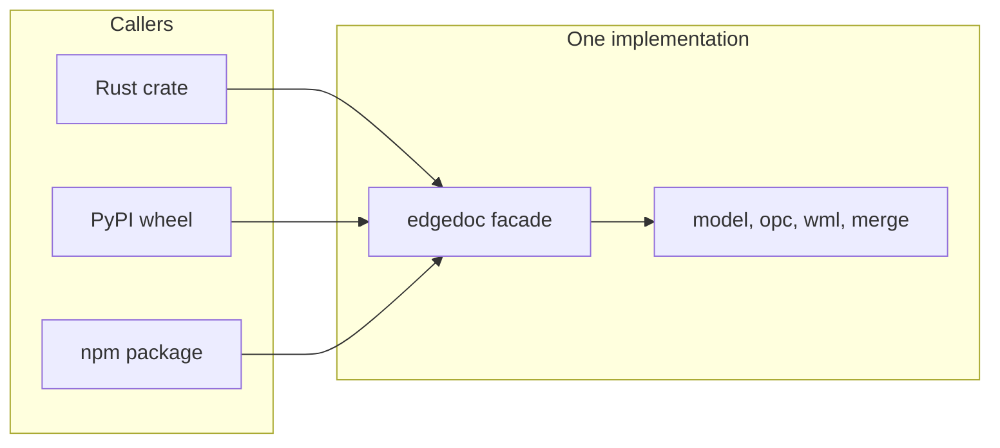

# Errors, the PyPI wheel, and the WebAssembly module.

> Part of the EdgeDoc specification. Date: 2026-11-04. Requirement ids are normative. See [the index](README.md).

## 12. Errors

`ED-E-01`. The facade error type is `edgedoc::Error`. It implements `std::error::Error + Send + Sync`. Each variant carries a stable `code` string. Adapters expose that string. They do not match on display text.

| Code | When |
|---|---|
| `package.not_zip` | The bytes are not a ZIP package |
| `package.missing_part` | A required part is absent |
| `package.not_word` | The package is not WordprocessingML |
| `package.limit` | A package budget failed |
| `package.password_required` | The package is encrypted and no password was given |
| `package.wrong_password` | The password did not open the package |
| `package.encrypted_unsupported` | Encryption is off, or the method is unknown |
| `xml.malformed` | A part is not well-formed XML |
| `xml.limit` | Depth, element count, or attributes passed the budget |
| `model.bad_offset` | The offset is not a character boundary |
| `model.bad_path` | The path does not name a block |
| `model.needs_drop_consent` | The edit would drop retained markup |
| `model.limit` | A model budget failed |
| `merge.no_records` | The range is empty |
| `merge.unknown_field` | A merge field has no header and the policy is `Error` |
| `merge.duplicate_header` | Two headers match under ASCII case-fold |
| `merge.extra_column` | A CSV record has more cells than headers |
| `merge.unknown_label` | The label or envelope name is not in the table |
| `merge.limit` | The merge budget failed |
| `io.destination` | The save path is a link, a directory, or not writable |
| `unsupported` | The caller asked for a path this version does not write |
| `markdown.limit` | The Markdown is larger than 32 MiB |
| `markdown.read` | The Markdown file could not be read |
| `markdown.utf8` | The Markdown file is not UTF-8 |
| `markdown.image_missing` | An image has no bytes and no file in the image directory |
| `markdown.image_dir` | The image path leaves the directory, is a link, or the build has no filesystem |
| `markdown.image_bytes` | The WebAssembly image buffer does not match the path list |
| `markdown.image_write` | An exported image could not be written |

`ED-E-02`. Display text names the fact and the next action. Example: `The field "Amount" has no header. Add the header or set MissingField::Empty.`

`ED-E-03`. The Python adapter releases the GIL during read, write, and merge. A panic at the boundary becomes `edgedoc.Error` with code `internal.panic`. That code means a defect, not a bad file.

## 13. Python package

`ED-Y-01`. The PyPI project name is `edgedoc`. The import name is `edgedoc`. The version equals the facade crate version ([Semantic Versioning](https://semver.org/)).

`ED-Y-02`. `edgedoc-py` is a `cdylib`. Maturin builds it. `pyproject.toml` sets `bindings = "pyo3"`. The extension module is `edgedoc._native`. A small Python file re-exports the public names. Callers do not import `_native`.

`ED-Y-03`. PyO3 0.29 or a later compatible release is the binding. The wheel set is:

| Wheel tag | CPython |
|---|---|
| `cp311-abi3` | GIL build, 3.11 and newer |
| `cp314-cp314t` | Free-threaded 3.14 only |
| `cp315-abi3.abi3t` | GIL and free-threaded 3.15 and newer |

Build the `abi3` wheel and the `abi3t` wheel with separate `maturin build` commands. One build selects one ABI family. Maturin 1.14.1 or newer is required for that split. pip 26.1 or newer understands the `abi3t` tag.

`ED-Y-04`. Linux wheels are manylinux2014 and musllinux for `x86_64` and `aarch64`. macOS wheels are `arm64` and `x86_64`. Windows wheels are `x64` and `ARM64`. Publish with `compatibility = "pypi"`.

`ED-Y-05`. The Python API is a projection of the facade. The methods are `read`, `write`, `Document.builder`, `edit`, `merge`, `open`, and `save`. Keyword names match the Rust policy names. A Python exception class exists for each code prefix: `PackageError`, `XmlError`, `ModelError`, `MergeError`, and `IoError`. Each instance has a `code` attribute.

`ED-Y-06`. The package ships `py.typed` and a stub file generated from the Rust signatures. A test fails when the stub and the facade method list differ.

`ED-Y-07`. The Python `Document` holds the Rust document behind a mutex. Two Python threads may call one document. The mutex is not in the Rust model.

```python
import edgedoc

template = edgedoc.read(path)
batch = template.merge(
    edgedoc.Records.csv(csv_bytes),
    kind="letters",
    missing="error",
)
letters = batch.join("auto")
letters.write_bytes()
```

## 14. WebAssembly package

`ED-W-01`. `edgedoc-wasm` targets `wasm32-unknown-unknown`. The npm package name is `edgedoc-wasm`. The version equals the facade version. The npm name `edgedoc` belongs to a different project, so this module does not use it.

`ED-W-02`. The module exports `readDocument`, `writeDocument`, `merge`, `preview`, `markdownToDocument`, and `markdownToDocumentWithImages`. Arguments and results are bytes, strings, and plain objects. The module does not export the crate graph. `markdownToDocumentWithImages` takes the image paths, one concatenated byte buffer, and one length per path. It does not read a file.

`ED-W-03`. The caller passes a `Uint8Array`. The module copies those bytes into WASM memory and frees the copy after `writeDocument` returns. The module does not touch the filesystem.

`ED-W-04`. `panic = "abort"` for this target. The `fs` and `crypt` features are off unless the caller enables `crypt`. Random numbers for encryption use `getrandom` with the `wasm_js` feature. WordCraft sets that feature in `crates/docx/Cargo.toml`.

`ED-W-05`. The uncompressed WASM file for the default features has a budget of 2 MiB. The gzip budget is 800 KiB. CI fails when the artifact passes the budget. This budget is a limit, not a measurement of a build that does not exist yet.

`ED-W-06`. The module does not require `SharedArrayBuffer`. It does not require cross-origin isolation headers. WordCraft documents the same constraint in `packaging/web/README.md`.

`ED-W-07`. TypeScript types come from wasm-bindgen. A second target, `wasm32-wasip2`, is out of version 1. Add it only as another adapter that calls `read_bytes` and `write_bytes`.


