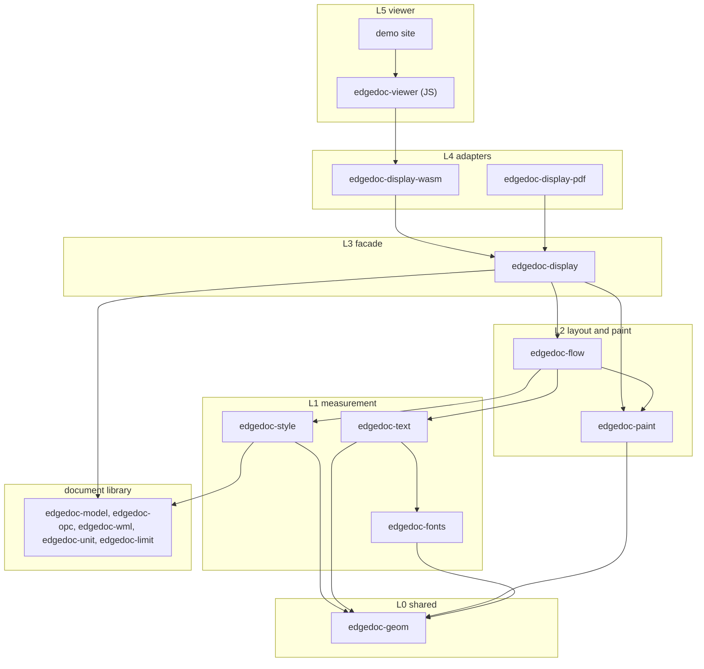
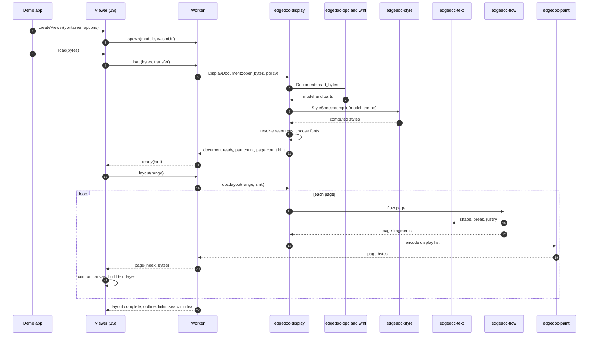
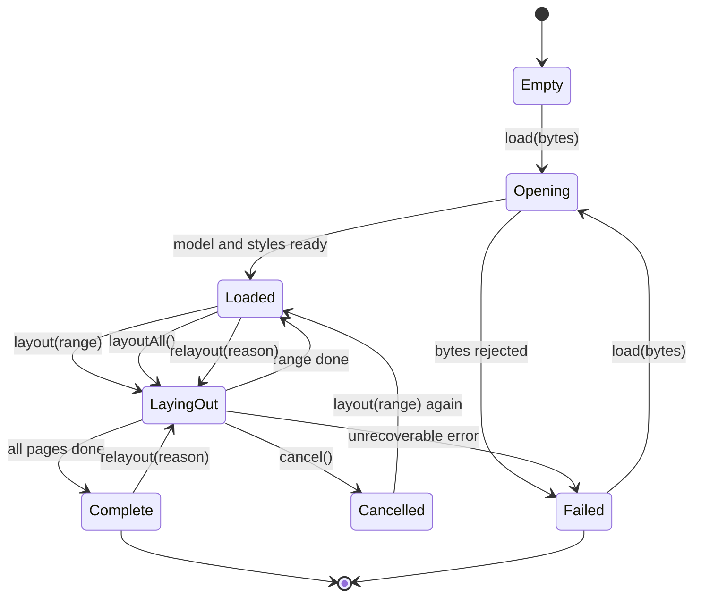
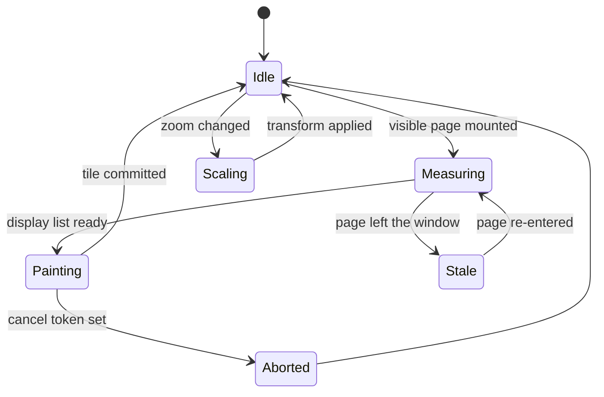

# Crates, layers, traits, and the call sequence.

> Part of the EdgeDoc Display specification. Date: 2026-11-04. Requirement ids are
> normative. See [the index](README.md).

## 13. Where this library sits

The document library reads and writes the package. The display library reads a model and
paints pages. It never writes a package.

`DP-A-01`. A crate depends only on a lower layer, or on a crate in the same layer. The
test `layer_rules` reads each `Cargo.toml` and rejects a reverse edge. This is the same
rule as `ED-A-01`.

`DP-A-02`. The display crates do not depend on `edgedoc-wml` or `edgedoc-opc`. They take a
`Document` from `edgedoc-model` and a `ResourceStore` of bytes. The display library does
not parse XML, and does not know a ZIP from a folder.

`DP-A-03`. `edgedoc-paint` does not depend on `edgedoc-flow`. The flow crate produces a
display list. The paint crate consumes one. A test constructs a display list by hand and
paints it, with no layout.

## 14. Crates

| Layer | Crate | Responsibility | Must not |
|---|---|---|---|
| L0 | `edgedoc-geom` | `Pt`, `Rect`, `Affine`, `PageSize`, twips and EMU bridges | Know about documents |
| L1 | `edgedoc-fonts` | Font database, font faces, shaping through `Shaper`, fallback chain. Shaping uses `harfrust` and font parsing uses `skrifa` | Touch layout |
| L1 | `edgedoc-text` | Grapheme, bidi, line-break classes, hyphenation, justification | Place a line on a page |
| L1 | `edgedoc-style` | Cascade, theme, numbering, computed properties | Measure text width |
| L2 | `edgedoc-flow` | Fragment model, page filling, sections, columns, tables, footnotes | Rasterize |
| L2 | `edgedoc-paint` | Display list, encoder, canvas, SVG, and PDF painters, tiles | Change a page break |
| L3 | `edgedoc-display` | Facade: open, resolve, layout, page access, search, selection | Expose a crate graph |
| L4 | `edgedoc-display-wasm` | wasm-bindgen exports, worker protocol, memory transfer | Do layout |
| L4 | `edgedoc-display-pdf` | Display list to PDF for print and for test reference | Do layout |

`DP-A-04`. The facade is the only crate that a caller names. The other crates are
`pub(crate)` in spirit. Their public items exist for tests and for the facade. The facade
re-exports the few types that a caller needs.

## 15. Traits, and the one reason each exists

Every trait below exists for one reason, and one reason only. A trait with no second
implementation and no test double is a struct.

| Trait | Lives in | Why it exists | Implementations in version 1 |
|---|---|---|---|
| `Shaper` | `edgedoc-fonts` | The layout calls shaping thousands of times, and a test needs a fixed advance table | `HarfrustShaper`, `FixedShaper` (tests) |
| `FontSource` | `edgedoc-fonts` | A font can arrive from the package, from a CDN, or from memory | `PackageFonts`, `MemoryFonts`, `NullFonts` |
| `ResourceStore` | `edgedoc-display` | An image, a font, or a hyperlink target arrives through a policy | `PackageResources`, `DataUriResources`, `DenyResources` |
| `Painter` | `edgedoc-paint` | One display list paints on canvas, SVG, PDF, or a test recorder | `CanvasPainter`, `SvgPainter`, `PdfPainter`, `RecordPainter` |
| `LayoutSink` | `edgedoc-flow` | Pages arrive during layout, so the caller can paint page 1 before page 99 | `VecSink`, `ChannelSink`, `CallbackSink` |
| `Clock` | `edgedoc-display` | A time budget must be testable | `StdClock`, `ManualClock` |
| `ObjectRenderer` | `edgedoc-paint` | A chart, an equation, or a drawing is not modeled in version 1 | `PlaceholderRenderer`, plus a caller-registered renderer |
| `TextMeasurer` | `edgedoc-text` | Line breaking needs widths, and a test needs exact widths | `ShapedMeasurer`, `FixedMeasurer` (tests) |

`DP-A-05`. A trait has one method group per reason. `Shaper` does not expose a font
database. `ResourceStore` does not decode an image. This is the interface segregation
rule: a caller that loads hyperlinks does not implement image decoding.

`DP-A-06`. The flow crate depends on the `TextMeasurer` and `LayoutSink` traits. It does
not depend on a concrete shaper or a concrete sink. This is dependency inversion, and it
is what lets a headless test run layout with a 500-unit advance per character.

## 16. The call sequence

`DP-A-07`. `load` returns after the model and the styles compile, not after layout. The viewer
shows the page count hint and starts layout at once.

**Correction to an earlier draft of this clause.** The draft promised a display list per page
before the layout pass ended. WordCraft lays out the whole document in one call that returns
a `DocLayout`. It must work that way, because a page total and a note number are unknown
until the last page. The promise is therefore narrower and honest. Each page leaves through
the `LayoutSink` as the pass produces it, so the viewer paints page 1 while pass 1 continues.
A document with no `NUMPAGES` field and no per-page note restart takes one pass, and the
first-page budget of `DP-I-16` applies to it. A document with `NUMPAGES` takes up to three
passes, and the layout report states the count. The detail is in
[17-wordcraft-map.md](17-wordcraft-map.md), requirement `DP-L-51`.

`DP-A-08`. A caller that needs a page count before paint calls `layoutAll`. A caller that
needs page 1 fast calls `load` and then `layout` with a range. The range form still runs the
passes of `DP-L-52`, and it does not emit a page whose geometry a later pass would change.

## 17. Job state machine

The display document moves through the states below. Every public call states the states
that it accepts. A call in the wrong state returns `display.bad_state`.

`DP-A-09`. `Cancelled` keeps every page that finished. A later `layout` continues from the
first page that has no display list. The state is not an error, and it does not raise.

`DP-A-10`. A `relayout` happens on a font swap, a zoom change that needs new glyph
subpixel positions, a `prefers-reduced-motion` change, or a page-size override. The
document keeps its page identity where the reason does not change the break points.

`DP-A-11`. The viewer paints from a cache. A page that leaves the window keeps its tile
while memory allows ([12-performance.md](12-performance.md)). A page that re-enters with a
live tile paints with no layout and no raster work.

## 18. SOLID

| Principle | Rule in this library | Requirement |
|---|---|---|
| Single responsibility | `edgedoc-style` never measures. `edgedoc-text` never places a line on a page. `edgedoc-flow` never rasterizes | `DP-A-12` |
| Open/closed | A new paint target is a new `Painter`. A new object type is a new `ObjectRenderer`. No `match` in the flow crate grows | `DP-A-13` |
| Liskov | Every `Shaper` returns glyphs in visual order with the same contract for a null glyph | `DP-A-14` |
| Interface segregation | `ResourceStore`, `FontSource`, and `Painter` stay separate. No "god" context object | `DP-A-15` |
| Dependency inversion | Flow depends on `TextMeasurer` and `LayoutSink`. Paint depends on `Painter` | `DP-A-16` |

`DP-A-12`. A change to the cascade does not touch a test of pagination. A change to
justification does not touch the display list format. The test `crate_ownership` lists
each module and the crate that may change it.

`DP-A-13`. The flow crate has no `match` on a concrete object kind. It calls
`ObjectRenderer::measure` and `ObjectRenderer::emit`. A caller adds a chart renderer with
no change to `edgedoc-flow`.

`DP-A-14`. A missing glyph from every font in the fallback chain returns the `.notdef`
glyph with a diagnostic. It does not return `Err`, because one bad character must not
fail a page.

## 19. DRY

`DP-A-17`. One geometry type. `Rect`, `Pt`, and `Affine` live in `edgedoc-geom`. No crate
declares a second rectangle or a second transform.

`DP-A-18`. One unit bridge. Twips to points and EMU to points exist once, in
`edgedoc-geom`. The flow crate does not write `* 20` or `/ 635` anywhere.

`DP-A-19`. One text direction resolver. Bidi resolution happens once, in `edgedoc-text`,
and every consumer takes visual-order runs. The flow crate does not reverse a run.

`DP-A-20`. One line breaker. `edgedoc-text` owns the fit and the penalty rules. The table
fit, the footnote area, and the text box all call the same function.

`DP-A-21`. One style resolution. `edgedoc-style` owns the cascade. The flow crate reads
`ComputedPara` and `ComputedRun`. It does not read a `Style` or a `StyleSheet`.

`DP-A-22`. One display list encoder and one decoder. The worker writes the bytes. The
viewer reads the bytes. Both call `edgedoc-paint::codec`. A round-trip test locks the
format.

`DP-A-23`. One hit-test function. A click on the canvas, a selection drag, a keyboard
move, and a search result all call `DisplayPage::hit_test`. There is no second geometry
path in JavaScript.

`DP-A-24`. One source of page geometry. The viewer asks the worker for page sizes. It does
not compute a page size from the zoom and the container width. This keeps the scroll
height correct.

## 20. Determinism

`DP-A-25`. Layout is a pure function of the model, the computed styles, the font faces,
and the options. It reads no clock, no random number, and no locale beyond the one in the
options. Two runs on two machines return equal page geometry.

`DP-A-26`. A test fails when a layout run reads the system clock during a page. Time
budgets are checked between pages, through the `Clock` trait.

`DP-A-27`. Float arithmetic uses `f32` for glyph positions and `f64` for accumulated
heights. A page height accumulates in `f64` and converts to `f32` once per fragment, so a
5000-line page does not drift.
