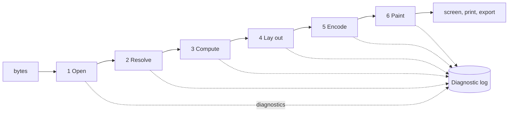
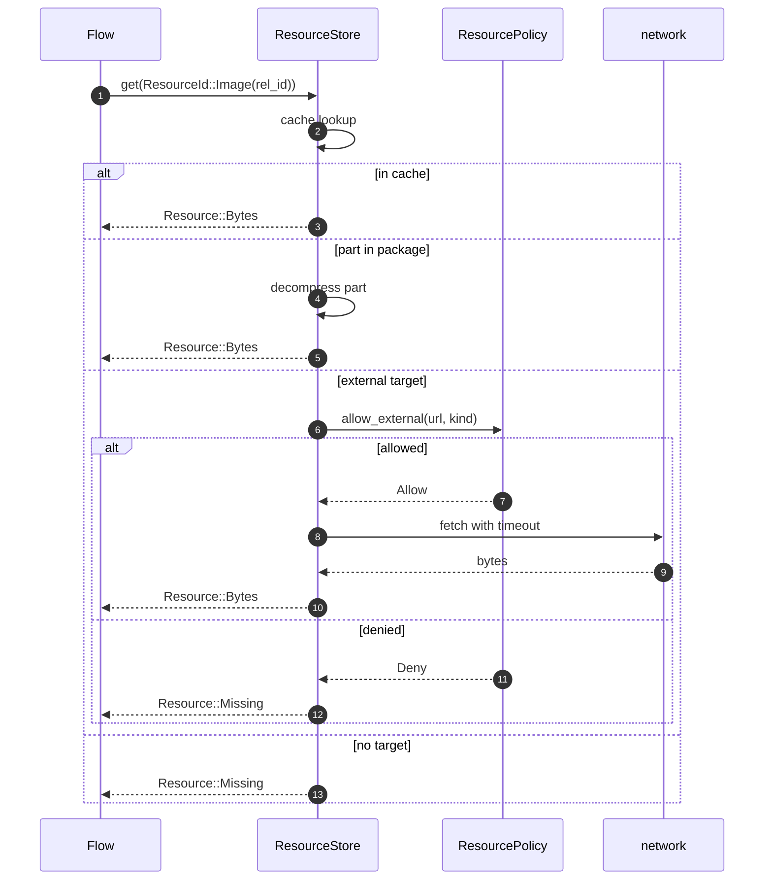
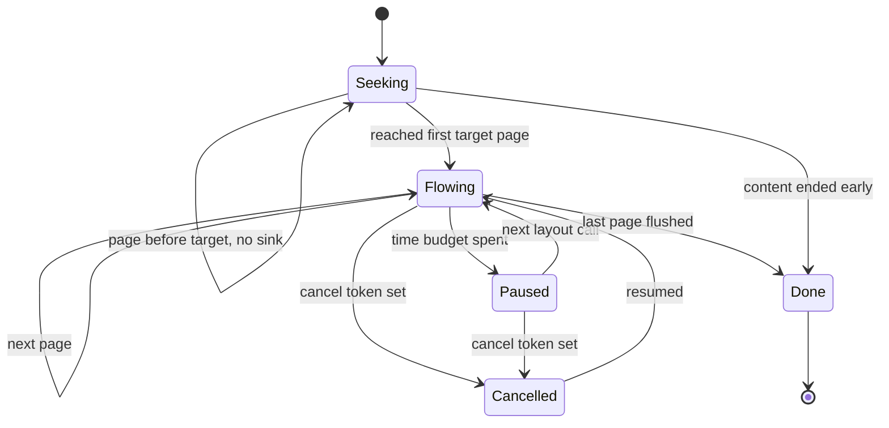

# From bytes to a painted page: the pipeline, resources, and diagnostics.

> Part of the EdgeDoc Display specification. Date: 2026-11-04. Requirement ids are
> normative. See [the index](README.md).

## 21. The six stages



| Stage | Input | Output | Owner crate | Can fail a page |
|---|---|---|---|---|
| 1 Open | package bytes | `Document` model, part table | `edgedoc-display` over `edgedoc-opc` | Whole document only |
| 2 Resolve | model, policy | `ResourceSet`: images, fonts, profiles, links | `edgedoc-display` | No |
| 3 Compute | model, resources | `ComputedDoc`: styles, numbering, section list, font faces | `edgedoc-style` | No |
| 4 Lay out | `ComputedDoc`, font faces | `Vec<PageGeometry>` with fragments | `edgedoc-flow` | Per page, marked |
| 5 Encode | page geometry | display list bytes | `edgedoc-paint` | Per page, marked |
| 6 Paint | display list bytes | pixels, SVG, PDF, text layer | `edgedoc-paint` | No |

`DP-P-01`. A failure in stage 1 fails the document. A failure in stage 2 or 3 becomes a
diagnostic, and the document still lays out. A failure in stage 4 or 5 marks one page.

`DP-P-02`. Stage 2 runs once per document. Stage 3 runs once per document. Stage 4 runs
per page range. Stage 5 runs per page. Stage 6 runs per visible page.

## 22. Stage 1: open

`DP-P-03`. `open` accepts a `.docx`, `.docm`, `.dotx`, or `.dotm` package in Transitional
or Strict markup. It rejects a Flat OPC package with `display.flat_opc_unsupported` in
version 1, and it names the next action.

`DP-P-04`. `open` reads the parts that paint needs and no others:

- the main document part, and every header and footer part that a section references
- `styles.xml`, `numbering.xml`, `theme/theme1.xml`, and `fontTable.xml`
- `settings.xml`, for `evenAndOddHeaders`, `defaultTabStop`, and `compat`
- the note parts, when the body references them
- `customXml` item props, when a content control binds to one

`DP-P-05`. `open` does not read `word/vbaProject.bin`, `word/embeddings/*`, or
`docProps/thumbnail.*`. It reports their presence in `DisplayDocument::unpainted_parts`.

`DP-P-06`. `open` enforces the `Budget` from the document library. A hostile package
returns `package.limit` with the limit name and the observed value. The display library
adds three limits of its own:

| Limit | Value | Reason |
|---|---|---|
| Pages | 20,000 | A generated document can declare a huge page count |
| Fragments per page | 200,000 | A single page must fit in memory |
| Display list bytes per page | 8 MiB | The worker must transfer it |

`DP-P-07`. `open` never panics. The test `hostile_packages_never_panic` feeds truncated
ZIP data, a ZIP bomb, a 300-level nested table, an empty body, and a body with no `sectPr`.

## 23. Stage 2: resolve a resource

A package refers to a resource in four ways. Each way has one policy.



`DP-P-08`. The default policy denies every external resource. It returns
`Resource::Missing` with code `display.resource_denied`. A caller that wants remote images
passes a policy that allows a host allowlist.

`DP-P-09`. An external fetch has a 5 s timeout, a 8 MiB body limit, and no credential. A
fetch failure returns `Resource::Missing`. It never blocks layout for more than 5 s,
because the flow crate treats `Missing` as a placeholder.

`DP-P-10`. A `Resource::Missing` image paints a rectangle with a diagonal cross, the
relationship type as a label, and the size that the markup asked for. It adds one
diagnostic per unique target, not per use.

| Resource | Formats painted in version 1 | Formats with a placeholder |
|---|---|---|
| Image | PNG, JPEG, GIF (first frame), BMP, TIFF (first page), SVG, WEBP | EMF, WMF, PICT, EPS |
| Font | TrueType, OpenType, WOFF, WOFF2, TTC (named face) | Type 1, bitmap |
| Colour profile | sRGB, and any ICC v2 or v4 profile through `lcms2` | CMYK in a format that cannot read a profile |
| Hyperlink | internal bookmark, external URL, mail address | file path, macro |

`DP-P-11`. An SVG image is rasterized to a tile at the current zoom before paint, or
painted as vectors in the SVG painter. It never loads a script, a font, or a stylesheet
from inside the image. The sanitizer removes `script`, `foreignObject`, `on*` attributes,
and every external `href`.

`DP-P-12`. A font that the package embeds is used only when the licence bits permit it. A
font with `fstype` 0x0002 (restricted) is used for layout measurement and not painted. A
font with no embedding permission becomes a diagnostic and a fallback face. The
`FontSource` reports the substitution so the viewer can show it.

`DP-P-13`. An image with an `a:alphaModFix` or a `srcRect` crop keeps both. A crop is
applied in the display list as a clip plus a source rectangle. The decoder does not
resample a cropped region.

## 24. Stage 3: compute

`DP-P-14`. Stage 3 builds one `ComputedDoc` that holds:

- `Theme`: colour scheme, font scheme, effect scheme
- `StyleSheet`: resolved chain for every style id and for the default paragraph style
- `Numbering`: abstract numberings with level text, start, and indent
- `Sections`: page size, margins, headers, footers, columns, and page numbering
- `FontFaces`: the face that each font reference resolves to, or its fallback
- `Tabs`: the default tab stop and each explicit tab set

`DP-P-15`. Stage 3 resolves every `w:rStyle` and `w:pStyle` once. The flow crate sees a
`StyleId` and a `ComputedPara`. It does not look up `styles.xml`.

## 25. Stage 4: lay out

`DP-P-16`. The flow crate receives a `LayoutRequest`:

| Field | Meaning |
|---|---|
| `range` | `All`, `From(page)`, or `Pages(start..end)` |
| `sink` | Where each finished page goes |
| `budget` | Time and page limits for this call |
| `cancel` | A token the caller can set |
| `options` | Widow control, hyphenation, compatibility flags |

`DP-P-17`. A page leaves the flow crate as a `PageGeometry`. The encoder turns it into
bytes in stage 5. The flow crate never allocates a raster buffer.

`DP-P-18`. The layout is restartable. A `layout` with `Pages(50..60)` first lays out pages
1 to 49 without a sink, and keeps only the small state that the page break needs. This is
the "resume" mode, and it costs one pass over the content before page 50.



## 26. Stage 5: encode

`DP-P-19`. The encoder writes one display list per page in the binary format of
[08-display-list-and-paint.md](08-display-list-and-paint.md). It writes into a reused
buffer, so a 100-page document does not allocate 100 buffers.

`DP-P-20`. The encoder deduplicates glyph runs. A line of text with one font, one size, and
one colour becomes one `GlyphRun`. That run holds a string of character indices and a string
of advances. The encoder does not emit one operation per glyph.

## 27. Stage 6: paint

`DP-P-21`. A painter consumes bytes and returns nothing. The canvas painter, the SVG
painter, the PDF painter, and the test recorder implement the same trait. A page paints
twice with two painters and the two outputs must agree on every rectangle in the
`RecordPainter` log.

## 28. Diagnostics

`DP-P-22`. A diagnostic is one record. It has a stable code, a severity, a page, a block
path, and a short message. It has no document text, unless the code says so.

| Severity | Meaning | Viewer behavior |
|---|---|---|
| `info` | A substitution with no visual change | Silent, counted in the panel |
| `warning` | A substitution that a reader can see | Counted in the panel |
| `error` | A page is incomplete | Badge on the page, entry in the panel |
| `fatal` | The document cannot open | Message replaces the viewer |

```rust
pub struct Diagnostic {
    pub code: &'static str,
    pub severity: Severity,
    pub page: Option<u32>,
    pub path: Option<BlockPath>,
    pub detail: String,
}
```

`DP-P-23`. The code set is closed and stable. A new behavior is a new code. The table
below is the version 1 set.

| Code | Severity | When |
|---|---|---|
| `display.flat_opc_unsupported` | fatal | A Flat OPC package is given |
| `display.encrypted_unsupported` | fatal | The package is encrypted and no password is supplied |
| `display.font_substituted` | warning | A font is missing and a fallback is used |
| `display.font_not_embeddable` | warning | The font metrics are used, and the face is not painted |
| `display.font_vertical_metrics_missing` | info | A face has no vertical metrics, so ascent and descent are estimated |
| `display.glyph_missing` | warning | No face in the chain has the code point |
| `display.image_unsupported` | warning | The image format has no decoder |
| `display.image_denied` | warning | The policy denied an external image |
| `display.image_decode_failed` | warning | The bytes are not a valid image |
| `display.link_target_missing` | info | A bookmark target does not exist |
| `display.style_undefined` | info | A style id has no definition, so the default applies |
| `display.numbering_missing` | warning | A list has no abstract numbering, so it paints as text |
| `display.table_too_wide` | warning | A table is wider than the page area and is clamped |
| `display.float_unplaced` | warning | A floating object has no room and is placed on the next page |
| `display.field_no_cached_result` | info | A field has no result and cannot be evaluated |
| `display.object_placeholder` | info | A chart, equation, or drawing paints as a placeholder |
| `display.revision_shown` | info | Tracked changes are shown in their final form |
| `display.content_control_locked` | info | A locked content control is painted read-only |
| `display.page_overflow` | error | Content does not fit the page area and was cut |
| `display.layout_budget` | error | The time budget stopped layout for this page |
| `display.bad_state` | error | A call arrived in the wrong state |
| `display.cancelled` | info | The caller cancelled, and the pages so far are kept |

`DP-P-24`. Every diagnostic appears once per unique `(code, page, path)`. A document with
10,000 missing glyphs from one font does not fill the panel.

`DP-P-25`. A caller reads diagnostics through `DisplayDocument::diagnostics()` and through
the `onDiagnostic` callback. The panel in the demo shows the count by severity, and the
list when the reader opens it.

```ascii
+--------------------------------------------------------------+
| Diagnostics                                          3 !  1 x |
+--------------------------------------------------------------+
| ! p2  font_substituted     Calibri -> Inter                  |
| ! p7  glyph_missing        U+1F5D1 in "DejaVu Sans"          |
| ! p9  table_too_wide       table clamped from 21.4 to 18.0 cm|
| x p12 page_overflow        content cut at the page bottom    |
+--------------------------------------------------------------+
| The page count and the page breaks can differ from Word when |
| a font is substituted. Install the font to remove this note. |
+--------------------------------------------------------------+
```
