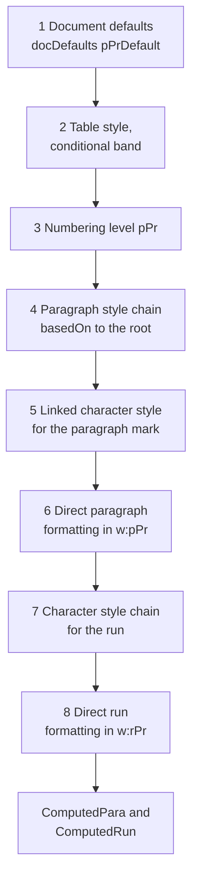
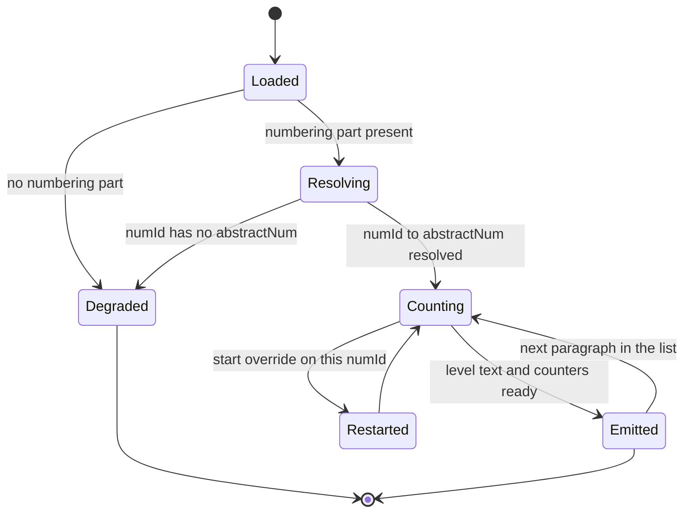

# The cascade, numbering, themes, and computed properties.

> Part of the EdgeDoc Display specification. Date: 2026-11-04. Requirement ids are
> normative. See [the index](README.md).

## 29. Why the cascade is a separate crate

A Word paragraph has one effective value for each property. Word takes that value from these
sources, in this order of precedence:

1. The document defaults.
2. The table style, with its conditional band.
3. The numbering level.
4. The paragraph style chain.
5. The direct paragraph formatting.
6. The character style chain.
7. The direct run formatting.

Word resolves this chain in a fixed order. A library that reads direct formatting only paints
the wrong font, the wrong spacing, and the wrong list.

`DP-S-01`. `edgedoc-style` resolves the chain once per document and produces a
`ComputedDoc`. The flow crate never reads a `Style` value directly.

## 30. The resolution order

The order below is normative. A later source overrides an earlier source.

`DP-S-02`. The style chain follows `w:basedOn` to its root. A chain longer than 32 links
stops with `display.style_undefined` and the last defined style. A cycle stops at the
second visit of a style id.

`DP-S-03`. A missing `w:basedOn` target does not fail. The chain ends, and the id stays in
the computed record for the viewer.

`DP-S-04`. `w:docDefaults` applies even when a style sets a value. A style sets a value
only when the attribute is present. An absent attribute means "not set", not "default".

`DP-S-05`. A table cell takes the table style, then the row conditional format, then the
cell conditional format, then the paragraph style. The conditional parts are
`firstRow`, `lastRow`, `firstCol`, `lastCol`, `band1Horz`, `band2Horz`, `band1Vert`, and
`band2Vert`, with their `w:cnfStyle` mask on the row or the cell.

`DP-S-06`. A run inside a paragraph with `w:numPr` takes the numbering level properties
before the paragraph style. A numbering level can set indent, font, and tab stops.

`DP-S-07`. `w:pPrChange` and `w:rPrChange` inside tracked changes hold the earlier value.
Version 1 paints the final form and logs `display.revision_shown`. It reads the change
record only to detect the presence of a revision.

## 31. What gets computed

`DP-S-08`. Each property has exactly one owner. The table is the contract between
`edgedoc-style` and `edgedoc-flow`.

| Group | `ComputedPara` fields | Source properties |
|---|---|---|
| Identity | `style_id`, `outline_level`, `is_heading` | `pStyle`, `outlineLvl` |
| Alignment | `align`, `bidi`, `snap_to_grid` | `jc`, `bidi`, `snapToGrid` |
| Indent | `indent_left`, `indent_right`, `indent_first`, `indent_hanging`, `mirror_indent` | `ind` |
| Spacing | `space_before`, `space_after`, `line_spacing`, `line_rule`, `contextual_spacing` | `spacing` |
| Pagination | `keep_next`, `keep_lines`, `page_break_before`, `widow_control` | `keepNext`, `keepLines`, `pageBreakBefore`, `widowControl` |
| Tabs | `tabs`, `default_tab_stop` | `tabs` |
| Borders | `borders`, `shading`, `bar` | `pBdr`, `shd`, `pPrChange` |
| Frame | `frame`, `text_direction`, `vertical_align` | `framePr`, `textDirection`, `textAlignment` |
| List | `list: Option<ListRef>` | `numPr`, numbering part |
| Script | `east_asian_line_break`, `kinsoku`, `word_wrap`, `overflow_punct` | `compat` and `settings` |

| Group | `ComputedRun` fields | Source properties |
|---|---|---|
| Font | `face`, `face_east_asian`, `face_complex`, `fallback` | `rFonts`, `theme` attributes |
| Size | `size`, `size_complex`, `size_east_asian`, `position` | `sz`, `szCs`, `position` |
| Weight and style | `bold`, `bold_complex`, `italic`, `italic_complex` | `b`, `bCs`, `i`, `iCs` |
| Decoration | `underline`, `underline_color`, `strike`, `double_strike`, `caps`, `small_caps` | `u`, `uColor`, `strike`, `dstrike`, `caps`, `smallCaps` |
| Colour | `color`, `highlight`, `shading`, `alpha` | `color`, `highlight`, `shd` |
| Script position | `vert_align`, `spacing`, `scale`, `kern` | `vertAlign`, `spacing`, `w`, `kern` |
| Language | `lang`, `east_asian_lang`, `bidi_lang`, `no_proof` | `lang`, `noProof` |
| Layout | `hidden`, `rtl`, `complex_script`, `emphasis`, `east_asian_layout` | `vanish`, `rtl`, `cs`, `em`, `eastAsianLayout` |
| Border | `border` | `bdr` |
| Effect | `text_effect`, `shadow` | `textEffect`, `shadow` |

`DP-S-09`. `ComputedPara` and `ComputedRun` are plain `Copy` structs of numbers and small
enums. A long string lives in a `Arc<str>` in the document, not in a computed record. A
computed record is therefore cheap to clone and cheap to keep for every fragment.

## 32. Theme resolution

`DP-S-10`. A `w:rFonts` attribute `w:asciiTheme` names a font scheme entry, not a font. The
resolver maps it through `theme1.xml`:

| Theme attribute | Theme path |
|---|---|
| `asciiTheme="minorHAnsi"` | `minorFont/latin` |
| `asciiTheme="majorHAnsi"` | `majorFont/latin` |
| `eastAsiaTheme="minorEastAsia"` | `minorFont/ea` |
| `cstheme="minorBidi"` | `minorFont/cs` |

`DP-S-11`. A colour value can be `w:themeColor="accent1"` with `w:themeTint` or
`w:themeShade`. The resolver applies the theme colour, then the tint, then the shade. The
order is fixed, because Word applies tint before shade and a reversed order gives a
different colour.

`DP-S-12`. A missing theme part falls back to the Office default scheme. It logs
`display.style_undefined` once. It does not fail the document.

`DP-S-13`. A `w:style` with `w:default="1"` and no other style named in the document is the
default for its type. A document with two default paragraph styles uses the last one in
the part and logs one diagnostic.

## 33. Numbering

A list is the hardest style feature, because it changes the text on the page. The level
text can hold a counter, a bullet character, and a picture.

`DP-S-14`. Counters live per `numId`, not per `abstractNum`. Two `numId` values that point
to one `abstractNum` have separate counters. This is the most common cause of a wrong
list number.

`DP-S-15`. `w:lvlOverride` with `w:startOverride` resets the counter at that level. It also
resets every deeper level, as Word does.

`DP-S-16`. A level with `w:isLgl` formats every counter as a decimal number, even when the
level format is a letter or a roman number.

`DP-S-17`. `w:legacy` and `w:legacySpace` add the older indent rule. A document with
`compatSetting name="compatibilityMode" val` below 15 uses the legacy rule.

`DP-S-18`. A numbered paragraph that starts inside a table cell counts in the same series
as the body. Word does this. A test locks it.

`DP-S-19`. Bullet characters come from the `Symbol` and `Wingdings` mapping tables. The
tables are data in `edgedoc-style::bullets`, not a `match`. A bullet with no mapping paints
the code point from the document font chain.

`DP-S-20`. A picture bullet is an image resource. It is resolved through the same
`ResourceStore` as a body image, and its size comes from the level `w:pictureBullet`
properties.

`DP-S-21`. The level text `%1.%2.%3` with a `w:numFmt="lowerLetter"` at level 2 gives
`1.a.1` for counters 1, 1, 1. A test locks each `numFmt` value:

| `numFmt` | 1 | 2 | 27 | 0 |
|---|---|---|---|---|
| `decimal` | 1 | 2 | 27 | 0 |
| `decimalZero` | 01 | 02 | 27 | 00 |
| `upperRoman` | I | II | XXVII | - |
| `lowerRoman` | i | ii | xxvii | - |
| `upperLetter` | A | B | AA | - |
| `lowerLetter` | a | b | aa | - |
| `ordinal` | 1st | 2nd | 27th | 0th |
| `cardinalText` | one | two | twenty-seven | zero |
| `ordinalText` | first | second | twenty-seventh | zeroth |
| `chicago` | * | † | - | - |
| `ideographDigital` | 一 | 二 | 二十七 | 零 |
| `decimalEnclosedCircle` | ① | ② | - | ⓪ |

`DP-S-22`. A `numFmt` value with no table entry logs `display.numbering_missing` and paints
a decimal number. It does not paint the raw text.

## 34. Section properties

`DP-S-23`. `w:sectPr` appears at the end of the last paragraph of a section, or in the
body properties as the last section. The resolver builds one `Section` per `sectPr`, in
document order, with the block range that each one covers.

`DP-S-24`. A `sectPr` inside a paragraph applies to that paragraph. The paragraph is the
last block of the section. This rule matters for a section break that carries a paragraph
mark.

`DP-S-25`. `w:type` with `continuous`, `nextPage`, `oddPage`, or `evenPage` sets the break
before the section. `evenPage` and `oddPage` can add one blank page. The flow crate owns
that blank page, not the style crate.

`DP-S-26`. A section with no `w:pgSz` takes the previous section size. The first section
takes A4 portrait with 2.54 cm margins when the document sets nothing.

## 35. Compatibility flags

`DP-S-27`. Some layout rules change with `compatSetting`. The version 1 set is below.

| Setting | Effect |
|---|---|
| `doNotExpandShiftReturn` | A line break does not justify the line |
| `doNotUseHTMLParagraphAutoSpacing` | Paragraph spacing uses the literal value |
| `balanceSingleByteDoubleByteWidth` | East Asian width rule for a narrow glyph |
| `doNotWrapTextWithPunct` | Punctuation may start a line |
| `doNotUseEastAsianBreakRules` | Kinsoku is off |
| `useWord2002TableStyleRules` | The older table cell padding rule |
| `growAutofit` | A table can grow past the page area |
| `doNotVertAlignCellWithSp` | A cell vertical alignment does not apply to spacing |

`DP-S-28`. A setting that version 1 does not read logs `display.compat_ignored` at `info`
level once per setting name. The viewer counts it, and the fidelity report lists it.
