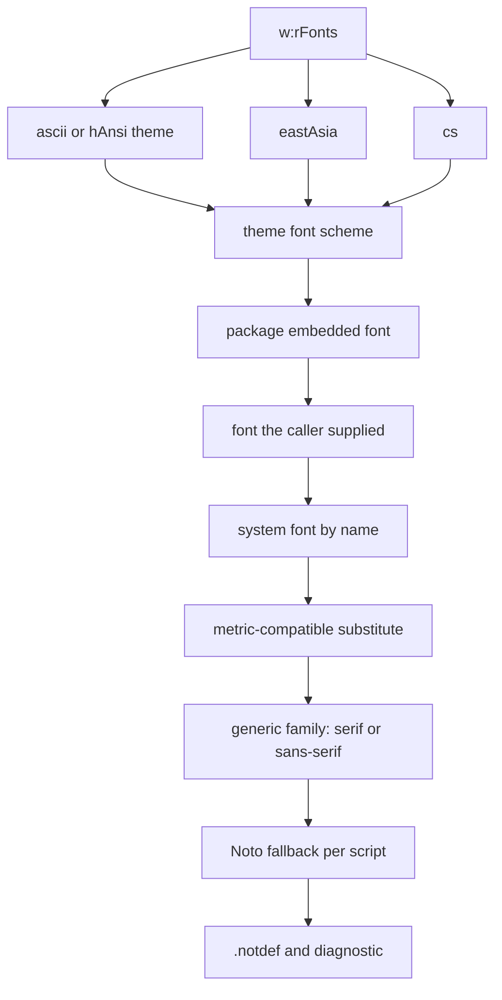

# Fonts, shaping, bidi, line breaking, and justification.

> Part of the EdgeDoc Display specification. Date: 2026-11-04. Requirement ids are
> normative. See [the index](README.md).

## 36. Why text is the critical path

A page is mostly text. A 0.5 pt error on one line moves the line. A moved line can move the
page break. A page break moves every page after it. Text measurement is therefore the
first thing to make exact, and the last thing to change.

`DP-F-01`. One function measures text, and every caller uses it. The flow crate, the table
fit, the footnote area, and the header area call `TextMeasurer::measure`. No caller adds
its own approximation.

## 37. Font resolution chain

A run names up to four font slots. Each slot falls back through a chain.



`DP-F-02`. The chain above is evaluated once per unique `(face, bold, italic)` triple. The
result is a `FaceId`. The flow crate does not resolve a font.

`DP-F-03`. The substitution table is data, and it lives in `edgedoc-fonts::substitutes`.
The table maps a common Windows and Office face to a metric-compatible free face:

| Document face | Substitute | Metrics |
|---|---|---|
| Calibri | Carlito | Compatible |
| Cambria | Caladea | Compatible |
| Arial | Liberation Sans | Compatible |
| Times New Roman | Liberation Serif | Compatible |
| Courier New | Liberation Mono | Compatible |
| Symbol | Noto Sans Symbols 2 | Similar, not equal |
| Wingdings | No free equivalent | Fallback, diagnostic `warning` |

`DP-F-04`. A face that no font provides keeps its metrics from the closest family, so the
line breaks stay near Word. The painted glyphs come from the fallback face. The viewer
shows the diagnostic. This is the only way to keep pagination close when a font is absent.

`DP-F-05`. The font database loads faces lazily. A document that uses two faces loads two
faces. The database keeps a map from a face name to the loaded bytes, and it reports
`FontDb::bytes_loaded`.

`DP-F-06`. An embedded font arrives as an `.odttf` obfuscated file. The deobfuscation key is
the first 32 bytes of the font part GUID, with the dashes removed. The XOR runs from the end
of the file backwards. A test locks this against a known file.

`DP-F-07`. The module ships with a small built-in face for the fallback path, so a document
with no available font still paints. The face covers Latin, Greek, Cyrillic, and the common
punctuation marks. Other scripts load on demand.

## 38. Shaping

`DP-F-08`. Shaping maps a character string and a `FaceId` to a `GlyphRun`:

```rust
pub struct GlyphRun {
    pub face: FaceId,
    pub size: f32,
    pub glyphs: Vec<u16>,
    pub cluster: Vec<u32>,
    pub advances: Vec<f32>,
    pub offsets: Vec<(f32, f32)>,
    pub bidi_level: u8,
    pub direction: Direction,
}
```

`DP-F-09`. `Shaper::shape` never splits a cluster. A grapheme cluster from
[UAX #29](https://www.unicode.org/reports/tr29/) goes to one shaping call, so a combining
mark and its base share a cluster index.

`DP-F-10`. A ligature is painted as one glyph with several cluster indices. Selection and
search use the cluster map, so a click on the second character of `fi` still resolves to
the right character.

`DP-F-11`. Kerning comes from the font `GPOS` table. The library does not apply its own
pair table. A face with no `GPOS` table gets no kerning, as Word does with an older face.

`DP-F-12`. The feature set is `kern`, `liga`, `clig`, `calt`, plus `locl` for the run
language and `frac` when the run is inside a `EQ` field result. A document setting
`w:noKerning` turns `kern` off.

`DP-F-13`. A variable font paints at the weight and width that the name resolves to. The
library does not synthesize a bold face when a face has a bold sibling. It synthesizes
bold only when no sibling exists, with an embolden of 0.02 em.

`DP-F-14`. Synthetic italic uses a 12 degree shear, as Word does. A test locks the
transform matrix.

`DP-F-15`. A missing glyph returns `.notdef` with the advance of a space in that face, and
one diagnostic per code point. It does not stop the line.

## 39. Bidi

`DP-F-16`. The paragraph direction comes from `w:bidi` and from the first strong
character. Resolution follows [UAX #9](https://www.unicode.org/reports/tr9/) rules P2 and
P3.

`DP-F-17`. The library resolves the bidi levels once per paragraph, before line breaking.
Line breaking then works on visual runs, so a line never splits a visual run in the wrong
place.

`DP-F-18`. A line break inside a right-to-left paragraph keeps the logical order in the
display list. The `bidi_level` field tells the painter to draw right to left. The painter
does not reverse a glyph list.

`DP-F-19`. A number inside Arabic text takes an even level, so its digits paint left to
right. The test `arabic_number_order` locks this.

`DP-F-20`. Mirrored characters follow the `Bidi_Mirrored` property. The parenthesis in a
right-to-left run paints as the other parenthesis. A test locks the common pairs.

`DP-F-21`. Bracket pairs follow rule N0. The library applies the simple bracket algorithm
and does not implement the full stack for more than 63 pairs. A deeper stack logs once.

## 40. Line breaking

`DP-F-22`. The break opportunities come from [UAX #14](https://www.unicode.org/reports/tr14/),
with the class table generated from Unicode 16.0. The table is data, not a `match`.

`DP-F-23`. The library adds the Word rules on top of UAX #14:

| Word rule | Effect |
|---|---|
| Kinsoku | A closing punctuation mark cannot start a line |
| `w:overflowPunct` | A trailing punctuation mark can hang past the margin |
| `w:autoSpaceDE` and `w:autoSpaceDN` | Insert 1/4 em between CJK text and Latin text or digits |
| `w:doNotExpandShiftReturn` | A manual line break does not justify |
| `w:kinsoku` off | Allow a break before any CJK character |
| Compatibility 15 or later | Use the newer hyphenation rule |

`DP-F-24`. Hyphenation is off unless the section or the paragraph asks for it. The
language dictionary comes from the run language. A language with no dictionary logs
`display.hyphenation_unavailable` once and skips hyphenation.

`DP-F-25`. A break is a first-fit decision. The breaker takes the next item that fits and
breaks after it. It does not compute a global optimum, and it does not re-break a paragraph
to balance the lines.

This decision corrects an earlier draft of this specification, which proposed the
Knuth–Plass optimum. WordCraft measured Word's behavior against its own layout and records
the result: the source comment in `crates/layout/src/para.rs` says "break lines (first-fit,
as word processors do)". A global optimum places a break at a different word on a justified
paragraph, and the page break then moves. The measurement wins over the theory. See
[17-wordcraft-map.md](17-wordcraft-map.md), `DP-F-47`.

`DP-F-26`. A paragraph too long for one page is broken into fragments at a line boundary.
The fragment carries the line range and the height. The flow crate owns the fragment
split. The text crate never knows the page height.

`DP-F-27`. A single word wider than the line overflows the right margin. It does not break,
unless the paragraph sets `w:wordWrap="0"`, which allows a CJK break anywhere. The overflow
logs `display.page_overflow` when it passes the page area.

## 41. Justification

`DP-F-28`. Justification distributes the free space across the break opportunities on the
line, in proportion to the stretch of each opportunity. A fixed-width space stretches at
half the rate of an inter-word space.

`DP-F-29`. `w:jc="distribute"` adds the space between every character, including inside a
word. `w:jc="thaiDistribute"` uses the Thai cluster boundary rule.

`DP-F-30`. The last line of a justified paragraph is left-aligned. One case differs. A
paragraph that sets `w:jc="justify"` with `w:kinsoku` off justifies every line, including the
last one. That is a CJK rule.

`DP-F-31`. Justification never moves a glyph by more than 3 pt from its natural position
on a single line. Past that limit the line is left-aligned and logs
`display.justify_clamped`. This guards against a line with two words across a wide margin.

## 42. Tabs

`DP-F-32`. A tab stop has one of five alignments and one of four leaders. The stop
positions come from `w:tabs`, and the default stop comes from `w:defaultTabStop`.

| Alignment | Position of the following text |
|---|---|
| `left` | The text starts at the stop |
| `center` | The text is centered on the stop |
| `right` | The text ends at the stop |
| `decimal` | The decimal separator sits at the stop |
| `bar` | A vertical rule paints at the stop, and the text continues |

`DP-F-33`. A tab past the last stop goes to the next default stop, and then to the right
indent. A tab in a table cell stops at the cell edge. A tab in a header stops at the right
margin, and a centered tab centers on the page.

`DP-F-34`. A tab leader paints the leader character from the text after the tab to the tab
position, at the run size. A leader of `none` paints nothing.

## 43. Special text

| Markup | Paint |
|---|---|
| `w:tab` | Advance to the next stop |
| `w:br` | Line break inside the paragraph |
| `w:cr` | Line break, same as `w:br` |
| `w:noBreakHyphen` | A non-breaking hyphen glyph |
| `w:softHyphen` | A visible hyphen only at a break, and a soft hyphen otherwise |
| `w:sym` | A symbol from a code page, mapped to a code point |
| `w:ptab` | Absolute, relative, or middle position tab |
| `w:lastRenderedPageBreak` | Ignored for paint. Used only as a hint (see `DP-X-08`) |
| `w:dayShort`, `w:monthShort` | The field result, if cached |

`DP-F-35`. `w:sym` names a font and a code point in a private code page. The mapping tables
for `Symbol` and `Wingdings` are data in `edgedoc-style::symbols`. A code point with no
mapping paints the private-use glyph and logs once.

`DP-F-36`. A soft hyphen paints a hyphen only when the line breaks at that point. The
display list carries the break position, so the painter needs no decision.

`DP-F-37`. A `w:ptab` with `alignment="center"` centers the following text on the page
center, not on the column. It is used in headers and footers. A test locks it.

## 44. Text runs across a fragment boundary

`DP-F-38`. A paragraph can continue on the next page, the next column, or the next text
frame. The fragment carries:

| Field | Meaning |
|---|---|
| `para` | The paragraph id |
| `line_range` | The line indices in this fragment |
| `continues_before` | True when a line is missing above |
| `continues_after` | True when a line is missing below |
| `first_line_indent` | Applied only on the first fragment |

`DP-F-39`. The first-line indent applies once. A continuation fragment has no first-line
indent, and no space before. A test locks the height of a split paragraph.

`DP-F-40`. A `keepLines` paragraph that cannot fit one page moves whole to the next page. If
it still cannot fit, it splits at the last line that fits and logs `display.page_overflow`.
The rule prefers a visible paragraph to a blank page.

## 45. Font metrics and line height

`DP-F-41`. Line height comes from four numbers: the font ascent, the font descent, the font
line gap, and the paragraph rule.

| `w:spacing` rule | Line box height |
|---|---|
| `auto` with `line=240` | `1.0 * single` |
| `auto` with `line=360` | `1.5 * single` |
| `exact` with `line=280` | 14 pt, glyphs may clip |
| `atLeast` with `line=280` | The larger of 14 pt and the natural height |

`DP-F-42`. `single` is `(ascent + descent + line_gap) / units_per_em` times the run size.
A face with no `lineGap` adds zero, and the difference from Word is at most 0.5 pt for a
10 pt face. A face with no `hhea` table falls back to `OS/2` `sTypoAscender` and
`sTypoDescender`, then to 0.8 em and 0.2 em, and logs
`display.font_vertical_metrics_missing`.

`DP-F-43`. `w:contextualSpacing` removes the space between two paragraphs of the same
style. The flow crate checks it, not the text crate.

`DP-F-44`. A superscript or subscript run scales the face to 65% and offsets the baseline by
33% or 14% of the run size. A `w:position` value moves the baseline by half a point per
unit. A test locks the transform for both.
