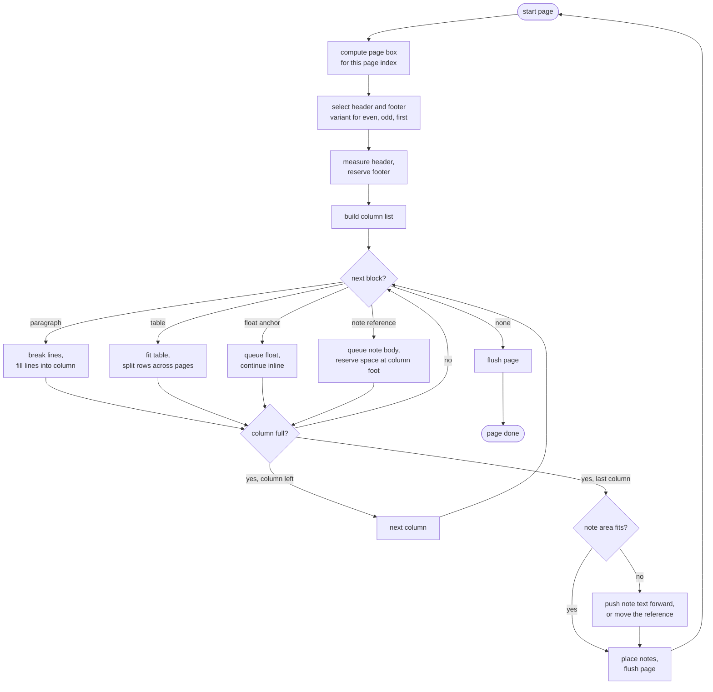
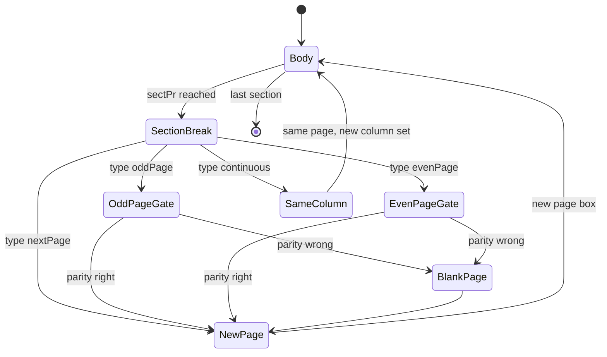
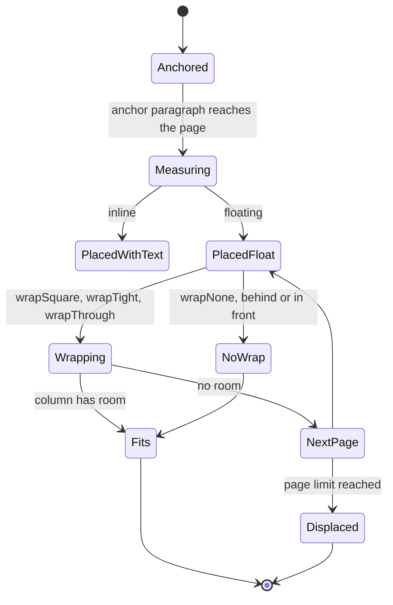
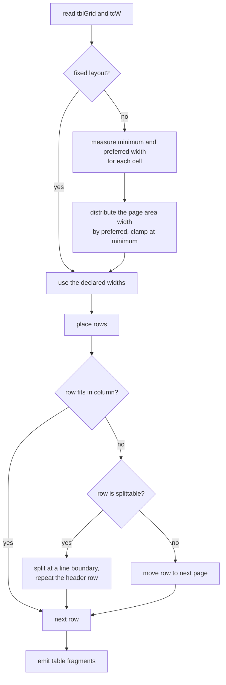

# Page filling: sections, columns, headers, footnotes, floats, and tables.

> Part of the EdgeDoc Display specification. Date: 2026-11-04. Requirement ids are
> normative. See [the index](README.md).

## 46. The page model

A page is a rectangle. Inside the margins sits one or more columns. Each column is a
vertical band. A header and a footer sit in the top and bottom margins.

```ascii
 page: 595.3 x 841.9 pt (A4 portrait)
 +--------------------------------------------------------------+  y = 0
 |                                                              |
 |  +--------------------------------------------------------+  |  margin top 70.9
 |  | HEADER  (first / even / default variant)                |  |
 |  +--------------------------------------------------------+  |  header area 35.4
 |  |  ^  margin from page to header top: 35.4 pt             |  |
 |  +========================================================+  |  page area top 70.9
 |  |                                                        |  |
 |  |  BODY COLUMN 1            BODY COLUMN 2                |  |
 |  |  +--------------------+   +--------------------+       |  |
 |  |  | text               |   | text               |       |  |
 |  |  | text               |   | text               |       |  |
 |  |  | text               |   | text               |       |  |
 |  |  +--------------------+   +--------------------+       |  |
 |  |        ^ column gap (w:space)                          |  |
 |  |                                                        |  |
 |  +========================================================+  |  page area bottom 771.0
 |  |  v  footnote separator (w:footnotePr)                  |  |
 |  |  [1] note text                                          |  |
 |  +--------------------------------------------------------+  |  footer area 771.0
 |  | FOOTER                                                  |  |
 |  +--------------------------------------------------------+  |  y = 841.9
 |                                                              |
 +--------------------------------------------------------------+
   x = 0      left margin 70.9                    right margin 70.9
```

`DP-L-01`. All geometry is in points, with the origin at the top left of the page, `y`
growing downward. A twips value divides by 20. An EMU value divides by 12,700.

`DP-L-02`. The page box carries `page_w`, `page_h`, `margin_top`, `margin_bottom`,
`margin_left`, `margin_right`, `header_dist`, `footer_dist`, `gutter`, and `gutter_at_top`.
A landscape page swaps the width and the height. It does not rotate the content.

`DP-L-03`. `w:vAlign` moves the body content inside the page area. `top` is the default,
`center` centers the block stack, `bottom` aligns it to the bottom, and `both` distributes
the free space between the block stacks. A page with `both` and no free space behaves as
`top`.

`DP-L-04`. `w:gutter` adds space to the inner margin. `w:rtlGutter` puts the gutter on the
right on an odd page. A document with `mirrorMargins` swaps the left and right margins on
an even page. A test locks the two rules together.

## 47. The flow algorithm

The flow crate fills one page at a time. It keeps a cursor into the block stack, and a
cursor into the current text flow.



`DP-L-05`. A block is never split when `keepNext` or `keepLines` forbids it, unless the
block alone is taller than the page area. In that case the block splits, and one
diagnostic `display.page_overflow` carries the block path.

`DP-L-06`. The flow keeps a stack of "open" blocks: a paragraph being filled, a table row
being filled, and a cell being filled. The stack has a fixed depth limit of 32, and a
deeper stack returns `display.limit`. Word has no such case in practice, and a crafted
file could.

`DP-L-07`. A page flush writes the header, the body fragments, the notes, and the footer
into one `PageGeometry`. A header taller than the space between the page top and the page area
top moves the body down. The header does not overlap the body. Word does the same.

## 48. Sections

A section changes the page box, the header set, the column count, the note settings, and
the page numbering.



`DP-L-08`. A blank page from `oddPage` or `evenPage` has a header and a footer. It has no
body. Word paints the header and not the body. A test locks it.

`DP-L-09`. A continuous section break keeps the page. It changes the column count in the
middle of an open column set. When the column count falls, the flow continues in the new
narrower set from the current vertical position. This is the hardest case in the section
model, and `DP-X-14` covers it.

`DP-L-10`. Page numbering continues across sections unless `w:pgNumType` sets `w:start`.
The `w:fmt` value changes the painted number in a header or footer field. The library
evaluates `PAGE`, `NUMPAGES`, and `SECTIONPAGES` when the field has no cached result, and
the result depends on the section.

`DP-L-11`. The library evaluates four page fields. Every other field paints the cached
result:

| Field | Evaluated |
|---|---|
| `PAGE` | Yes |
| `NUMPAGES` | Yes |
| `SECTIONPAGES` | Yes |
| `SECTION` | Yes |
| `DATE`, `TIME` | Only when the document asks for update on open, using `options.clock` |
| `TOC`, `REF`, `PAGEREF`, `SEQ` | Cached result only |

`DP-L-12`. An evaluated field can change the page count, which changes `NUMPAGES`. The flow
resolves this with a two-pass rule. Pass 1 lays out with the hint count. Pass 2 lays out with
the real count, and it runs only when a `NUMPAGES` or `SECTIONPAGES` field exists. A document
with no such field takes one pass.

## 49. Columns

```ascii
 one column                      two columns, unequal
 +----------------------+        +----------------------+
 | text..............   |        | text....... | text.. |
 | text..............   |        | text....... | text.. |
 |                      |        |             |        |
 +----------------------+        +----------------------+
                                 | text....... | text.. |
                                 +----------------------+
```

`DP-L-13`. `w:cols` with `w:num` sets the column count. `w:space` sets the gap.
`w:equalWidth` with `w:col` entries sets unequal widths. The last column takes the
remaining space.

`DP-L-14`. A `w:br w:type="column"` moves to the next column. On the last column it moves
to the next page, first column.

`DP-L-15`. A footnote area spans the whole page width, not one column. Word places the note
area across all columns at the bottom of the page area. A test locks the width.

`DP-L-16`. A floating object with `wrapSquare` or `wrapTight` inside a column wraps within
that column only.

## 50. Headers and footers

`DP-L-17`. A section can hold up to six header and footer parts: default, first, and even
for each of header and footer. The selection rule is:

| Page | Condition | Part |
|---|---|---|
| First page of the section | `w:titlePg` is set | `first` |
| Even page | `settings.evenAndOddHeaders` is set | `even` |
| Other pages | Always | `default` |

`DP-L-18`. A missing part inherits from the previous section, then from the default
variant, then paints nothing. An inherited part keeps its own field results.

`DP-L-19`. A header area has a fixed height: the distance from the page top to the page
area top, unless the header content is taller. A taller header pushes the body down, and
the page area shrinks. The flow crate measures the header before it fills the body.

`DP-L-20`. A header is laid out with the same engine as the body. It can hold a table, an
image, a field, or a floating object. A header cannot hold a footnote. A note in a header
logs `display.header_note_ignored` and paints inline.

`DP-L-21`. A `PAGE` field in a header paints the current page number. The header is laid
out per page, not once. This is a real cost: for a 1000-page document, the header lays out
1000 times. The flow crate caches a header layout when the header holds no page field.

`DP-L-22`. A header or footer with `w:linkToPrevious` off in a later section replaces the
previous part. The library resolves the inheritance once, in stage 3.

## 51. Footnotes and endnotes

```ascii
 page area bottom
 +------------------------------------------+
 | body text ....                           |
 | body text with a reference (1) ..........|
 |                                          |
 |            (separator line, 1/3 width)   |
 | (1) note text, smaller size, indented    |
 |                                          |
 +------------------------------------------+
 footer area top
```

`DP-L-23`. A footnote reference reserves the note body height at the bottom of the page
area, plus a separator. When the space is not enough, the flow moves the reference
paragraph to the next page. When the paragraph alone is taller than the page, the note
text continues on the next page.

`DP-L-24`. A note body that continues carries the same number and no new reference. The
continuation marker comes from `w:footnotePr w:continuationSeparator`. A test locks it.

`DP-L-25`. Notes are numbered by `w:numFmt` and `w:numRestart`. `restart="eachSect"` resets
at a section. `restart="eachPage"` resets on a page, and the flow must know the page number
when it assigns a number. The numbering therefore happens inside the flow, not in the
style crate.

`DP-L-26`. An endnote collects at the document end, or at the section end when
`w:endnotePr w:pos="sectEnd"`. Its numbering is separate from footnotes.

`DP-L-27`. A note that holds a table, a picture, or a list lays out through the same
engine. A note inside a note is not legal in Word, and the library logs
`display.note_nested` and flattens it.

## 52. Floating objects and anchoring

A floating object has an anchor paragraph, a position, and a wrap mode.



`DP-L-28`. A floating object position comes from `wp:anchor` attributes `relativeFrom` and
`posOffset`, or from `wp14:pctPosHOffset` in percent of the column, margin, or page. The
library supports the offsets that Word writes: `page`, `margin`, `column`, `paragraph`,
`line`, `character`, `topMargin`, `bottomMargin`, `insideMargin`, `outsideMargin`.

`DP-L-29`. A wrap mode reserves space on the side of the object. The flow reduces the line
width for the lines in the object's vertical range. A tight wrap uses the alpha outline of
the image when it is available, and a rectangular box otherwise, with one diagnostic
`display.tight_wrap_approximated`.

`DP-L-30`. An object with `wrapNone` and `behindDoc="1"` paints before the text. With
`behindDoc="0"` it paints after the text. The display list order carries this, and the
painter needs no rule.

`DP-L-31`. An object that cannot be placed on the page moves to the next page, and its
anchor paragraph stays where it is. A document whose floats chase each other is capped at
one page of displacement, then the object is placed at the page top with
`display.float_unplaced`.

`DP-L-32`. A text box is a floating object with a text body. Its content lays out through
the same flow engine, with its own page area equal to the box. A text box that overflows
grows, unless `w:autoFit` says `none`. A box that grows past the page area is clipped and
logs `display.page_overflow`.

`DP-L-33`. An inline object takes one line box. Its height is its scaled height, and its
baseline sits on the text baseline. A picture taller than the line makes the line taller.

## 53. Tables

A table is the most complex block, because column widths depend on content, and content
depends on column widths.



`DP-L-34`. A table with `w:tblLayout w:type="fixed"` uses the `w:gridCol` widths. A table
with `autofit` measures the content. A table with `growAutofit` can pass the page area, up
to `options.max_table_overflow`, and then clamps with `display.table_too_wide`.

`DP-L-35`. A cell width comes from `w:tcW`, then the grid column, then an equal share. A
cell with `w:gridSpan` merges columns. A cell with `w:vMerge` continues from above, and the
continued cell holds no content and no border on the merged edge.

`DP-L-36`. A row height comes from `w:trHeight`. A row with `hRule="exact"` clips its
content. A row with `atLeast` grows. A row that grows past the page area splits.

`DP-L-37`. `w:tblHeader` repeats the header rows after a page break. The row height counts
against the page area, and a header row taller than half the page limit logs
`display.table_header_too_tall` and repeats once.

`DP-L-38`. `w:cantSplit` keeps a row on one page. A row that cannot fit moves to the next
page, and if it still cannot fit, it splits with a diagnostic.

`DP-L-39`. Borders collapse. A shared edge between two cells paints once, at the wider width,
with the colour of the winning cell. The Word rule picks the winner in this order: the cell
that sets a border, then the bottom or right cell, then the heavier weight. A test locks the
rule on a 3 by 3 grid with mixed borders.

`DP-L-40`. A cell margin comes from `w:tblCellMar` then `w:tblCellSpacing`. A cell with
`w:tcMar` overrides both on that side. The flow subtracts the margins before it fits text.

`DP-L-41`. A nested table lays out in its cell width. The nesting depth is limited to 24,
as in `ED-T-11`. A deeper table paints a placeholder.

`DP-L-42`. `w:tblInd` moves the table right. A negative indent on a centered table is
clamped to zero, and the flow logs once.

`DP-L-43`. A row of a table inside a header repeats per page, and its height counts against
the header area. A table in a footnote is legal and lays out in the note width.

## 54. The fragment model

`DP-L-44`. Every fragment is one of:

| Fragment | Fields |
|---|---|
| `ParagraphFragment` | `para`, `lines`, `rects`, `continues` |
| `TableFragment` | `table`, `rows`, `rects`, `repeated_header` |
| `ImageFragment` | `resource`, `rect`, `crop`, `rotation` |
| `ShapeFragment` | `shape`, `rect`, `text_body` |
| `PlaceholderFragment` | `kind`, `rect`, `label` |
| `RuleFragment` | `rect`, `width`, `colour`, `style` |

`DP-L-45`. A fragment holds rectangles, not a mutable cursor. The page owns an ordered list
of fragments, so paint order is list order.

`DP-L-46`. A fragment records the block path from the document library
(`BlockPath`), so a diagnostic, a link, and a click all name the same source block.

`DP-L-47`. The page records `page_index`, `section_index`, `page_number`, `label` (the
painted page number), `parity`, and the source block range. A viewer uses these to sync a
scroll position with a printed page.

## 55. Line-level layout contract

`DP-L-48`. The text crate returns a `LineLayout` for a paragraph and a width:

```rust
pub struct LineLayout {
    pub lines: Vec<Line>,
}

pub struct Line {
    pub start: usize,
    pub end: usize,
    pub width: f32,
    pub ascent: f32,
    pub descent: f32,
    pub runs: Vec<PlacedRun>,
}
```

`DP-L-49`. The flow crate converts a line to a rectangle and a run list. It does not
re-measure. A test asserts that the sum of the run advances equals the line width.

`DP-L-50`. A line is laid out against a width that can change per line, because a floating
object may narrow it. The text crate therefore accepts a range of widths, and the flow
crate calls it with the width of the current band. The flow crate groups consecutive lines
that share one width, so a paragraph under a float takes two calls, not one per line.
