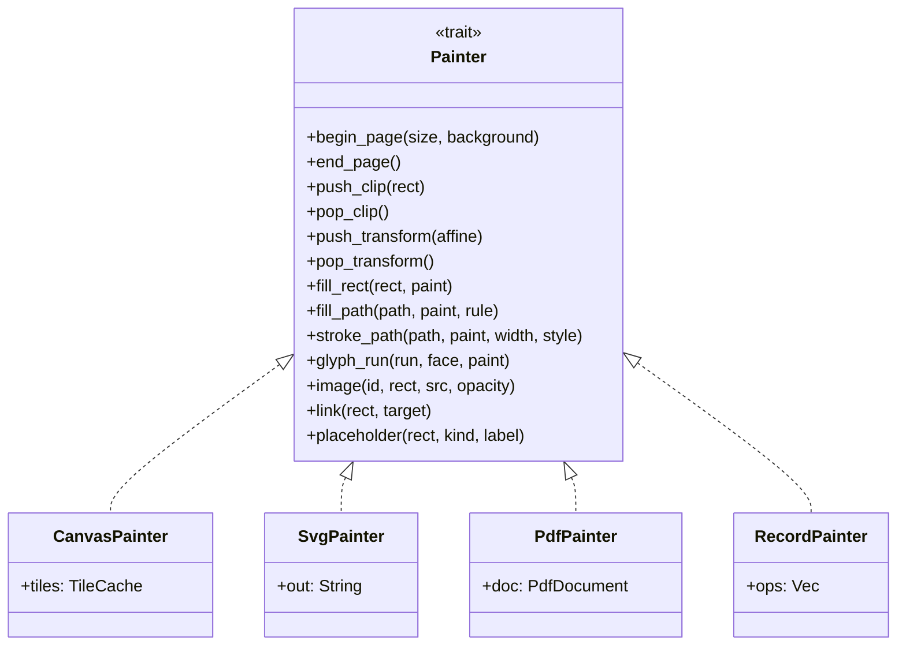

# The display list, its encoding, the painters, and the text layer.

> Part of the EdgeDoc Display specification. Date: 2026-11-04. Requirement ids are
> normative. See [the index](README.md).

## 56. Why a display list

A display list is the contract between layout and paint. It exists for five reasons:

1. Layout runs in a worker. Paint runs on the main thread, or on a canvas in another
   worker. A list of bytes crosses that boundary.
2. One page paints on a canvas at one scale, and again at another scale, without a
   second layout.
3. A test compares a display list with a stored list. Pixels are slow and
   platform-dependent.
4. Print needs vectors. A display list produces a PDF page, and a canvas does not.
5. Hit testing and the text layer read the same list that the painter reads.

`DP-G-01`. The flow crate never touches a canvas, a font raster, or an image decoder. It
produces a `PageGeometry`. The encoder turns it into a display list.

## 57. The operation set

`DP-G-02`. The operation set is closed for a format version. A new operation changes the
version. Each operation paints within the current clip and the current transform.

| Op | Name | Fields |
|---|---|---|
| 0x01 | `BeginPage` | `w`, `h`, `background`, `bleed` |
| 0x02 | `EndPage` | |
| 0x03 | `PushClip` | `rect` |
| 0x04 | `PopClip` | |
| 0x05 | `PushTransform` | `Affine` |
| 0x06 | `PopTransform` | |
| 0x07 | `FillRect` | `rect`, `paint` |
| 0x08 | `StrokeRect` | `rect`, `paint`, `width`, `style` |
| 0x09 | `FillPath` | `path`, `paint`, `fill_rule` |
| 0x0A | `StrokePath` | `path`, `paint`, `width`, `cap`, `join`, `dash` |
| 0x0B | `GlyphRun` | `face`, `size`, `glyphs`, `advances`, `offsets`, `clusters`, `paint`, `level` |
| 0x0C | `Image` | `resource`, `rect`, `src_rect`, `interpolate`, `opacity` |
| 0x0D | `Link` | `rect`, `target`, `index` |
| 0x0E | `NamedDest` | `name`, `point` |
| 0x0F | `Layer` | `role`, `index` |
| 0x10 | `BeginGroup` | `alpha`, `composite` |
| 0x11 | `EndGroup` | |
| 0x12 | `Shading` | `rect`, `kind`, `stops`, `angle` |
| 0x13 | `Placeholder` | `rect`, `kind`, `label` |
| 0x14 | `DebugBox` | `rect`, `label` (only in debug builds) |

`DP-G-03`. There is no operation for a table, a paragraph, or a list. Layout lowers every
block to the operations above. A painter therefore cannot disagree about a table border.

`DP-G-04`. A `GlyphRun` carries glyph ids and advances, not characters. The painter maps a
glyph id through the face. A font that the painter cannot load paints with the fallback
face at the same advances, so the layout does not move.

`DP-G-05`. `Link` paints nothing. It exists so the viewer can build an overlay of link
rectangles from the same list. A link over a glyph run therefore has the exact glyph
bounds.

## 58. Paint values

`DP-G-06`. A `Paint` is one of:

| Kind | Fields |
|---|---|
| `Solid` | `rgba` in the page colour space |
| `LinearGradient` | `p0`, `p1`, `stops` |
| `RadialGradient` | `center`, `radius`, `stops` |
| `Picture` | `resource`, `rect`, `tile` |

`DP-G-07`. A colour in the document is `w:val` in `RGB`, `themeColor`, `auto`, or an indexed
value from a legacy palette. The encoder converts every colour to sRGB with an alpha byte
before it writes the display list. The painter never resolves a theme colour.

`DP-G-08`. A colour with `w:themeColor` and a tint or shade converts with the Word formula.
`tint` mixes toward white in HLS. `shade` mixes toward black in HLS. A test locks the round
trip of 12 sample colours against values from Word screenshots.

`DP-G-09`. A CMYK JPEG decodes through its embedded profile to sRGB. A JPEG with no profile
uses the `options.default_cmyk_profile`. The default is a plain conversion, and it logs
`display.image_no_profile` once.

## 59. Binary encoding

`DP-G-10`. The format is little-endian, with variable-length integers for counts. A page
list starts with a header:

```ascii
offset  size  field
0       4     magic "EDDL"
4       2     version (1)
6       2     flags (bit 0: has glyph ids, bit 1: has clusters, bit 2: debug)
8       4     page index
12      4     body byte length
16      4     page width in 1/100 pt
20      4     page height in 1/100 pt
24      4     resource table offset
28      4     link table offset
32      4     text index offset
36      4     crc32 of the body
40      ...   body
```

`DP-G-11`. A float is stored as `f32`. A coordinate is stored as `i32` in 1/100 pt. The
encoder rounds once, at write time. A round-trip test asserts that a coordinate within
0.005 pt survives.

`DP-G-12`. A string is a `varint` length and UTF-8 bytes. A resource id is a `varint` index
into the resource table. The resource table holds a kind, a hash, and a length. The viewer
fetches the bytes by id from the worker.

`DP-G-13`. The text index is a compact table that supports selection and search:

| Field | Meaning |
|---|---|
| `run_ordinal` | The index of the `GlyphRun` in the body |
| `char_start`, `char_end` | Character range in the paragraph |
| `para` | The paragraph id |
| `rect` | The run bounding box |
| `baseline` | The baseline y |
| `level` | The bidi level |

`DP-G-14`. The viewer builds the text layer from the text index and the character strings
in a parallel table. It does not parse the body.

`DP-G-15`. A page list has a `crc32` in the header. A mismatch makes the viewer request the
page again, once. A second mismatch paints an error page and logs
`display.page_corrupt`.

`DP-G-16`. The format is versioned. A viewer that reads a higher version refuses the page
and asks the worker to re-encode at a version it knows. This keeps a cached worker script
compatible with a newer viewer.

`DP-G-17`. The uncompressed display list for one A4 page of body text is at most 2 MiB in
the version 1 budget. A page past the budget logs `display.page_too_dense`. The test
`display_list_budget` measures the example corpus.

## 60. Painters



`DP-G-18`. `CanvasPainter` paints through a thin `Canvas2d` trait. The browser backend calls
`CanvasRenderingContext2D`. The native backend calls `tiny-skia`. A test paints with the
native backend and compares with a golden PNG. This is what makes the canvas painter
testable in CI without a browser.

`DP-G-19`. `SvgPainter` writes one `<svg>` with a `<g>` per page. It escapes text and uses
`<path>` for glyphs converted to outlines, or `<use>` against a glyph `<defs>` when the face
is small. SVG output is for export and for a print stylesheet.

`DP-G-20`. `PdfPainter` writes a PDF with one page per document page, a font subset per
face, and the same coordinates. The print path uses it. A test compares the PDF page count
and the text order with the display list.

`DP-G-21`. `RecordPainter` writes a text log. A test compares the log with a stored file.
This is the primary fidelity test for paint, because it is stable across platforms.

`DP-G-22`. A painter may skip an operation. `CanvasPainter` skips `NamedDest`. It must not
skip a visible operation without logging. The test `painter_parity` paints the same page
with `RecordPainter` and `CanvasPainter` and compares the visible operation set.

## 61. Tiles

A tile is a raster region of one page at one scale. Tiles exist so a large page at a high
zoom does not need one huge canvas.

```ascii
 page at zoom 4.0 (A4: 2381 x 3368 device px)
 +--------+--------+--------+
 | 00     | 01     | 02     |   tile 512 x 512 device px
 +--------+--------+--------+   visible tiles only are painted
 | 10     | 11     | 12     |
 +--------+--------+--------+
 | 20     | 21     | 22     |
 +--------+--------+--------+
```

`DP-G-23`. The tile grid is 512 device pixels per side. A page smaller than one tile uses
one tile. The viewer computes the visible tiles from the viewport and the page rectangle.

`DP-G-24`. A tile paints with a device-pixel ratio from `window.devicePixelRatio`, rounded
to the nearest 0.5 between 1 and 3. A 4K display at 200% zoom therefore uses a 4x device
ratio cap, and text stays sharp.

`DP-G-25`. A tile has a lifetime. The cache holds at most `cache_bytes` of tiles, and it
evicts the tile that is furthest from the viewport first. The cache never evicts a tile on
a page that is visible.

`DP-G-26`. A zoom change below 2x uses a CSS transform on the painted canvas while the new
tiles bake. A zoom change above 2x paints a scaled tile at once and replaces it. This
gives an immediate response and a sharp result within one frame batch.

## 62. Hit testing

`DP-G-27`. Hit testing is a pure function of the display list:

```rust
pub fn hit_test(page: &DisplayPage, point: Point) -> Option<Hit>

pub enum Hit {
    Glyph { para: u32, offset: usize, rect: Rect, baseline: f32, level: u8 },
    Image { resource: ResourceId, rect: Rect },
    Link { target: LinkTarget, rect: Rect },
    Cell { table: u32, row: u32, col: u32, rect: Rect },
    Placeholder { kind: ObjectKind, rect: Rect },
    Page { page: u32 },
}
```

`DP-G-28`. A hit test on a glyph returns the nearest character boundary, not the nearest
glyph center. A click in the left half of a glyph goes before the character, and a click in
the right half goes after it. A glyph with a bidi level of 1 reverses the two halves.

`DP-G-29`. A hit test ignores an operation with a fully transparent paint. An invisible
text run for a searchable header does not capture a click.

`DP-G-30`. A hit test in a table cell returns the cell first, then the glyph. A double
click inside a cell selects the word, not the cell, unless the cell is empty.

`DP-G-31`. A hit test uses a spatial index for pages with more than 4096 operations. The
index is a simple uniform grid of 64 pt cells, built on the first hit test and kept with
the page.

`DP-G-32`. The viewer calls the same function for a pointer move, a selection drag, a
keyboard move, a search highlight, and a link hover. There is no second geometry path in
JavaScript.

## 63. The text layer

The text layer makes the page selectable, searchable by the browser, and readable by a
screen reader.

```ascii
 +-----------------------------------+  canvas (pixels)
 |  Invoice number: INV-2026-0418    |
 +-----------------------------------+
 |  transparent div, absolute         |
 |  span at x=51.2 y=132.4            |  text layer (DOM)
 |  font-size: 10.5pt, color:transparent, transform: scale(0.98)
 +-----------------------------------+
```

`DP-G-33`. Each `GlyphRun` in the display list becomes one `<span>` in the text layer. The
span sits at the run rectangle origin and holds the run text, the font size, and a horizontal
scale. The scale makes the span width equal the painted width. This is the pdf.js method, and
it keeps selection rectangles aligned with the paint.

`DP-G-34`. A space in the text layer is a real space character. A run break inside a word
must not add a space. The text index carries the character range per run, so the viewer
joins the runs of one paragraph with no separator.

`DP-G-35`. The text layer is not `contenteditable` unless the caller asks for copy support
on a browser that needs it. In Firefox, a transparent text layer in a `contenteditable`
region copies. The viewer sets `user-select: text` and `-webkit-user-select: text` on the
layer, and no edit handler.

`DP-G-36`. A right-to-left run sits at its painted rectangle and carries `direction: rtl`.
The browser then places the caret correctly.

`DP-G-37`. A run with `w:vanish` (hidden text) is absent from the text layer unless the
caller turns on `options.showHiddenText`. A hidden run is also absent from search results.

`DP-G-38`. A tab is one `<span>` with a non-breaking space of the tab width. A line break is
one `<br>` in the layer. A soft hyphen is a zero-width space with a hidden hyphen.

`DP-G-39`. A paragraph is one `<p>` element in the layer, and a page is one `<div>` with
`role="document"` and `aria-label` naming the page number. A table uses real `<table>`
elements in the layer, so a screen reader reads rows and columns. A picture carries its
`wp:docPr descr` as `alt`.

`DP-G-40`. The layer respects a maximum of 40,000 characters per page. A page past that
limit keeps the paint and drops the layer, with `display.text_layer_dropped`. A screen
reader user then gets a page-level summary. This limit exists because the DOM cost of a
huge layer is higher than its value.

`DP-G-41`. Selection across a page break produces the text of both pages, in document order,
with no duplicate line. The viewer assembles the string from the text index. It does not read
the DOM selection text, because the DOM holds the spans in visual order.

## 64. Accessibility

`DP-G-42`. The viewer exposes a document outline through `aria` landmarks. Each page is a
`<section>` with `aria-label="Page 3"`. The viewer sets `aria-busy` while a page paints.

`DP-G-43`. A reader who uses a screen reader can navigate by paragraph and by heading. The
text layer uses `<h1>` to `<h6>` for a paragraph with an outline level, unless the caller
turns on `options.plainTextLayer`.

`DP-G-44`. A picture with no description gets `role="img"` and
`aria-label="Image, page 4"`. It does not get an empty `alt`, because an empty `alt` hides a
picture that may carry meaning.

`DP-G-45`. The paint itself is not the only carrier of information. A tracked insertion and
a tracked deletion carry a text layer state, so a screen reader announces the change. The
viewer adds `data-revision="insert"` or `"delete"` to the span.

`DP-G-46`. A high-contrast mode replaces the page background with the theme background. It
also forces the text colour to the theme foreground when the document colour sits below a
contrast ratio of 3:1 against the page.

`DP-G-47`. `prefers-reduced-motion` turns off the smooth scroll and the zoom animation. The
zoom then jumps, and the viewer logs no diagnostic.

`DP-G-48`. `forced-colors: active` uses `CanvasText` and `Canvas` system colours, and drops
a background image. A test in the browser checks that text stays readable.
