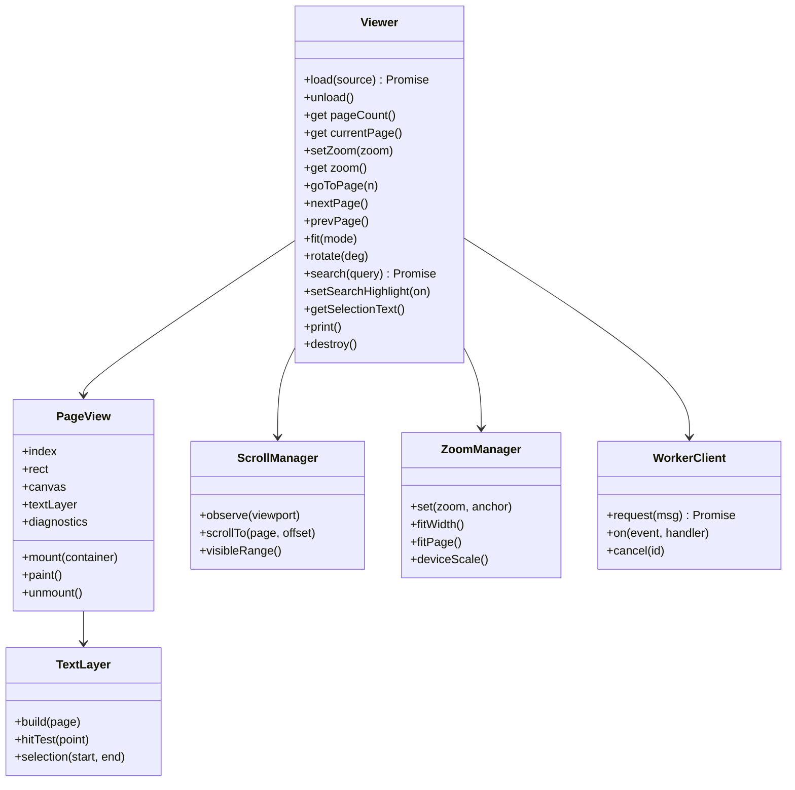
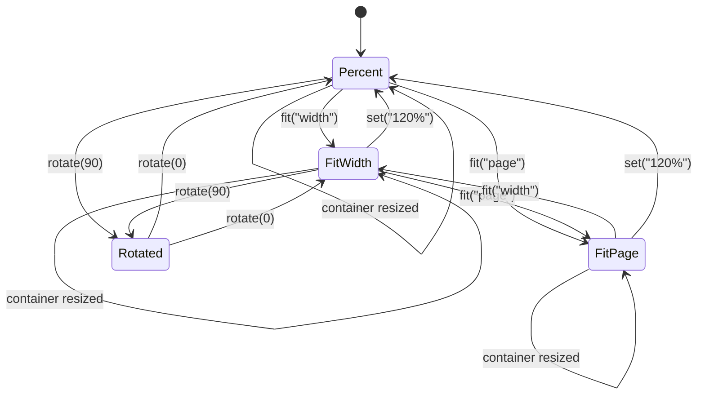

# The Rust API and the viewer API: load, zoom, and page.

> Part of the EdgeDoc Display specification. Date: 2026-11-04. Requirement ids are
> normative. See [the index](README.md).

## 65. The one-call load

`DP-V-01`. The primary Rust entry point takes bytes and returns a document that can lay out:

```rust
use edgedoc_display::{DisplayDocument, OpenOptions, LayoutOptions};

let doc = DisplayDocument::open(&bytes, &OpenOptions::default())?;
let mut pages = doc.layout_all(&LayoutOptions::default())?;
let first = &pages[0];
```

`DP-V-02`. The primary JavaScript entry point takes an element and returns a viewer:

```ts
const viewer = await createViewer({
  container: document.querySelector("#viewer")!,
  workerUrl: new URL("./edgedoc-viewer.worker.js", import.meta.url),
});
await viewer.load(file);        // File, Blob, ArrayBuffer, or URL string
```

`DP-V-03`. `load` accepts a `File`, a `Blob`, an `ArrayBuffer`, a `Uint8Array`, a `URL`, or
a `string` path that the caller turns into bytes. A `URL` load uses `fetch` with the
caller's credentials policy, and it reports progress through `onProgress`.

`DP-V-04`. `load` resolves when the document can paint its first page. It does not wait for
the last page. `viewer.ready` resolves at the same moment. A caller that needs every page
awaits `viewer.layoutComplete`.

## 66. The Rust surface

```rust
pub struct OpenOptions {
    pub password: Option<String>,
    pub resources: ResourcePolicy,
    pub fonts: FontPolicy,
    pub locale: String,
    pub revision_view: RevisionView,
    pub show_hidden_text: bool,
    pub budget: Budget,
}

pub struct LayoutOptions {
    pub hyphenation: bool,
    pub widow_control: bool,
    pub compat_mode: Option<u16>,
    pub max_table_overflow: f32,
    pub clock: ClockKind,
    pub page_limit: u32,
}

impl DisplayDocument {
    pub fn open(bytes: &[u8], options: &OpenOptions) -> Result<Self>;
    pub fn page_count_hint(&self) -> Option<u32>;
    pub fn outline(&self) -> &[OutlineItem];
    pub fn diagnostics(&self) -> &[Diagnostic];
    pub fn layout_all(&self, options: &LayoutOptions) -> Result<Vec<PageGeometry>>;
    pub fn layout_range(&self, range: PageRange, sink: &mut dyn LayoutSink) -> Result<LayoutReport>;
    pub fn page(&self, index: u32) -> Option<&PageGeometry>;
    pub fn encode_page(&self, index: u32) -> Option<&[u8]>;
    pub fn search(&self, query: &SearchQuery) -> Result<SearchResults>;
    pub fn hit_test(&self, page: u32, point: Point) -> Option<Hit>;
    pub fn selection(&self, start: Position, end: Position) -> Selection;
    pub fn text(&self, range: TextRange) -> String;
    pub fn export_pdf(&self, options: &PdfOptions) -> Result<Vec<u8>>;
    pub fn export_svg(&self, page: u32) -> Result<String>;
}
```

`DP-V-05`. `layout_range` sends each page to the sink as it finishes. It returns a
`LayoutReport` with `pages`, `elapsed`, `stop_reason`, and `diagnostics_added`. The sink can
cancel through the token.

`DP-V-06`. `page` and `encode_page` borrow. A caller that needs to keep a page clones the
geometry or copies the bytes. The clone is cheap because a page holds `Arc` values for a
font, a resource, and a text string.

`DP-V-07`. `DisplayDocument` is `Send + Sync` on native. It is not `Send` on wasm32, which
is a property of the target. The worker owns one document per thread.

`DP-V-08`. The error type is `edgedoc_display::Error` with a stable `code`, a `message`, a
`page: Option<u32>`, and a `source: Option<Box<dyn Error>>`. The code set extends the
document library set with the `display.*` codes of
[04-pipeline.md](04-pipeline.md).

## 67. The viewer model

The viewer is the JavaScript layer. It owns the container, the pages, and the scroll
position. It does not own layout.



`DP-V-09`. `Viewer` owns one `WorkerClient`, one `ScrollManager`, one `ZoomManager`, and a
pool of `PageView` objects. A `PageView` exists only for a page in the window, plus a
prefetch margin of one page above and one below.

`DP-V-10`. Every public viewer method is safe to call before `load` resolves. A call that
needs the document returns a rejected promise with `display.bad_state`, or it does nothing
and logs. `setZoom` before load stores the value and applies it after load.

`DP-V-11`. `destroy` releases the worker, the canvases, the object URLs, and the listeners.
A test calls `createViewer` and `destroy` 100 times and asserts that the heap does not grow
past a threshold.

## 68. Zoom



`DP-V-12`. A zoom value is one of `"auto"`, `"page-actual"`, `"page-fit"`, `"page-width"`,
`"page-height"`, a percentage string such as `"150%"`, or a number that means a scale
factor. The set matches pdf.js, so a reader who knows one viewer knows the other.

| Value | Scale |
|---|---|
| `auto` | `page-width` in a narrow container, `page-fit` otherwise |
| `page-actual` | 1.0 |
| `page-fit` | The scale that fits the whole page in both axes |
| `page-width` | The scale that fits the page width |
| `page-height` | The scale that fits the page height |
| `0.1` to `8.0` | The scale factor, clamped |

`DP-V-13`. The zoom range is 10% to 800%. A value outside the range clamps and no error is
raised. A zoom change keeps an anchor point fixed: the point under the pointer, or the
viewport center for a keyboard zoom.

`DP-V-14`. A zoom change does not change layout. The page geometry is in points, and the
scale multiplies at paint time. A scale change past 2x asks for new tiles at the higher
device ratio. A scale change below 2x uses a CSS transform first.

`DP-V-15`. A `FitWidth` or `FitPage` zoom re-evaluates on a container resize, through a
`ResizeObserver` with a 60 ms debounce. A manual percentage zoom does not change on resize.

`DP-V-16`. A rotation of 90 or 270 degrees swaps the painted width and height. The viewer
rotates the canvas with a CSS transform and keeps hit testing in page coordinates by
inverting the transform. A test locks a click after a 90 degree rotation.

`DP-V-17`. A pinch gesture on a touch device changes the scale between 10% and 800%, and a
two-finger pan scrolls. The viewer sets `touch-action: none` on the page surface and
handles `pointerdown`, `pointermove`, and `pointerup` with pointer capture.

## 69. Pagination and scrolling

```ascii
 +-------------------------------------------------------------+
 | toolbar                                                     |
 +-------------------------------------------------------------+
 | +---------------------------------------------------------+ |
 | |                        page 1                            | |  <- page gap 16 px
 | |                       (canvas)                           | |
 | |                                                          | |
 | +---------------------------------------------------------+ |
 | +---------------------------------------------------------+ |
 | |                        page 2                            | |  <- visible
 | |                       (canvas)                           | |
 | +---------------------------------------------------------+ |
 | +---------------------------------------------------------+ |
 | |                        page 3                            | |  <- prefetch
 | +---------------------------------------------------------+ |
 +-------------------------------------------------------------+
 | status: 2 / 18   120%   [ - ] [ + ] [fit]                   |
 +-------------------------------------------------------------+
```

`DP-V-18`. The viewer paints one continuous column of pages, with a gap of 16 CSS pixels
between pages and 16 pixels of padding. A single-page mode sets `scrollMode: "page"` and
paints one page. A spread mode sets `spreadMode: "odd"` or `"even"` and paints two pages
side by side.

`DP-V-19`. The scroll position maps to a page and an offset. A scroll restore after a
reload restores the page and the fractional offset within the page.

`DP-V-20`. A page that is not laid out yet has the size from the hint, or the size of page
1 when no hint exists. The placeholder has the right height, so the scrollbar does not jump
when the page arrives. When a real size differs from the hint, the viewer adjusts the scroll
offset by the difference above the viewport. The reader then sees no jump.

`DP-V-21`. `goToPage` scrolls the page top to the viewport top, minus the gap. It resolves
after the page is painted, or after a 300 ms timeout, whichever comes first.

`DP-V-22`. The viewer updates `currentPage` on scroll with an intersection observer on the
page elements. The page that covers the viewport center is current. The viewer emits
`pagechange` once per change, not once per scroll event.

`DP-V-23`. Keyboard navigation: `PageDown` and `PageUp` scroll one viewport. `Home` and
`End` go to the first and the last page. `ArrowDown` and `ArrowUp` scroll 40 px.
`Ctrl+Home` and `Ctrl+End` go to the start and the end of the document. The full map is in
[11-demo-site.md](11-demo-site.md).

`DP-V-24`. The viewer lazy-loads layout. It requests layout for the visible pages plus one
page on each side, and it requests more as the reader scrolls. A reader who jumps to page
900 requests a layout from the last known page forward, and the worker seeks without a
sink.

`DP-V-25`. A scroll past the last page stops at the last page bottom plus the padding. A
scroll before the first page stops at the top.

## 70. Search

`DP-V-26`. `search` takes a query and returns every hit with a page, a rectangle list, and
the match kind. The search is case-insensitive by default, and it folds the ASCII range and
the common Latin accents. A caller can set `matchCase`, `wholeWord`, `regex`, and
`diacritics`.

| Option | Default | Effect |
|---|---|---|
| `matchCase` | false | Compare case-sensitively |
| `wholeWord` | false | Match only on a word boundary from UAX #29 |
| `regex` | false | Treat the query as a regular expression |
| `diacritics` | true | A query `cafe` matches `café` |
| `highlightAll` | true | Highlight every hit on a visible page |

`DP-V-27`. Search runs on the plain text of the document, which the document library
already provides, plus a character-to-page map from the layout. A hit that spans a line
break returns two rectangles, and a hit that spans a page break returns rectangles on both
pages.

`DP-V-28`. A search on a document that is not fully laid out returns the hits from the pages
that are laid out. It continues in the background, and the viewer grows the result list.
`search` resolves when the whole document is searched, unless the caller sets
`options.incremental`.

`DP-V-29`. A regular expression that the engine rejects returns `display.bad_query`. A
pattern with catastrophic backtracking is bounded: the search uses a step budget of 10
million steps and stops with `display.search_budget`.

`DP-V-30`. A hit is a `Highlight` with `page`, `rects`, and `ordinal`. The viewer paints a
highlight layer above the page canvas at 20% opacity, and a current hit at 45%. The layer
is a separate canvas, so a highlight does not repaint the page.

## 71. Selection and copy

`DP-V-31`. A pointer drag over the text layer creates a DOM selection. The viewer converts
the selection to a `TextRange` through the text index. It emits `selectionchange` with the
text and the page range.

`DP-V-32`. `getSelectionText` returns the selected text with the paragraph separators of the
document, not with the visual line breaks. A selection across a page break returns one
string with a paragraph separator between pages.

`DP-V-33`. Copy uses the browser `copy` event. The viewer writes `text/plain` with the text
and `text/html` with a `<p>`, `<table>`, and `<strong>` structure from the model. A table
copies as a table with the cell text, not as tabs.

`DP-V-34`. A selection that starts in a floating object and ends in the body returns the
body text only, and the viewer logs `display.selection_float_crossed` at `info`.

`DP-V-35`. A keyboard selection uses `Shift` with `ArrowLeft`, `ArrowRight`, `ArrowUp`,
`ArrowDown`, `Home`, and `End`. The viewer moves a caret through the text index and sets the
DOM selection, so the caret is visible and the screen reader follows.

## 72. Links, outline, and print

`DP-V-36`. A link is an operation in the display list. The viewer builds an overlay of
`<a>` elements at the link rectangles. An internal link scrolls to the named destination.
An external link opens through the `options.linkHandler`, so a host sets `target` and
`rel`. The default handler opens a new tab with `rel="noopener noreferrer"`.

`DP-V-37`. The outline comes from the heading paragraphs. A heading with `w:outlineLvl` or a
built-in heading style becomes an `OutlineItem` with a title, a level, and a destination. A
`TOC` field result is not an outline.

`DP-V-38`. Print builds a PDF from the display lists through `PdfPainter`, and it prints
through a hidden `iframe`. The print stylesheet hides the toolbar, the highlight layer, and
the diagnostics panel. The page size is the document page size. A test compares the printed
page count with `pageCount`.

`DP-V-39`. A print of a document with a placeholder page prints the placeholder with its
label, so the reader sees that a page is incomplete.

## 73. Events

`DP-V-40`. The viewer emits these events. A listener receives one object.

| Event | Payload |
|---|---|
| `ready` | `{ pageCount, outline, diagnostics }` |
| `pagepainted` | `{ page, ms }` |
| `pagechange` | `{ page, previous }` |
| `zoomchange` | `{ zoom, scale }` |
| `diagnostic` | `Diagnostic` |
| `searchprogress` | `{ found, scanned }` |
| `selectionchange` | `{ text, start, end }` |
| `error` | `{ code, message }` |
| `layoutcomplete` | `{ pages, ms }` |
| `linkclick` | `{ target, event }` |

`DP-V-41`. An event handler that throws does not stop the viewer. The viewer catches the
error, logs it once, and continues. A broken handler costs one console entry.

## 74. Configuration

```ts
export interface ViewerOptions {
  container: HTMLElement | string;
  workerUrl: URL | string;
  wasmUrl?: URL | string;
  zoom?: ZoomValue;
  scrollMode?: "vertical" | "page" | "horizontal";
  spreadMode?: "none" | "odd" | "even";
  rotation?: 0 | 90 | 180 | 270;
  theme?: "light" | "dark" | "auto";
  pageColors?: { background?: string; foreground?: string };
  textLayer?: boolean;
  annotations?: boolean;
  allowExternalResources?: boolean;
  externalHosts?: string[];
  fontsUrl?: string;
  maxCacheBytes?: number;
  renderer?: "canvas" | "svg";
  linkHandler?: (target: LinkTarget, event: Event) => void;
  onProgress?: (loaded: number, total: number) => void;
  onDiagnostic?: (d: Diagnostic) => void;
}
```

`DP-V-42`. A missing required option throws a `TypeError` with the option name at
`createViewer`. The viewer does not guess a container.

`DP-V-43`. Every option has a default that works with no configuration except `container`
and `workerUrl`. A test creates a viewer with those two options and loads a document. This
is the "one call" promise of `DP-I-08`.
