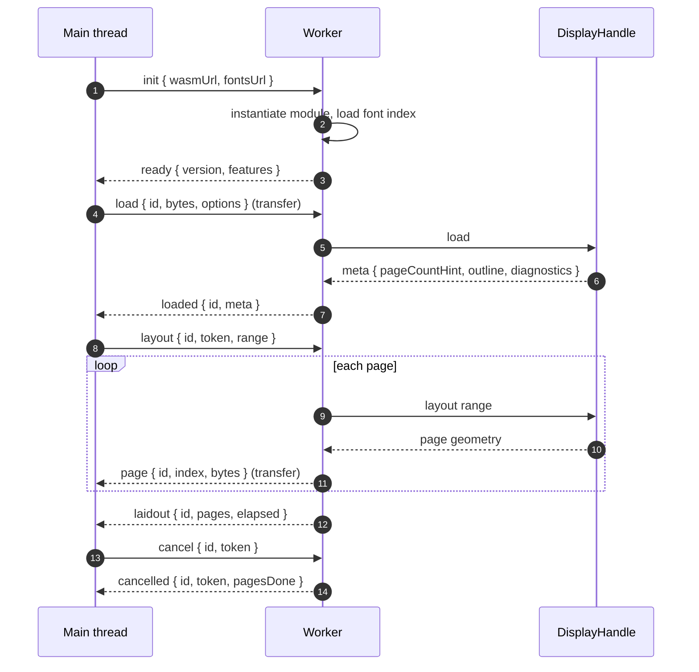

# WebAssembly, the worker protocol, memory, and hosting.

> Part of the EdgeDoc Display specification. Date: 2026-11-04. Requirement ids are
> normative. See [the index](README.md).

## 75. Why the work runs in a worker

Layout of a 100-page report takes hundreds of milliseconds and can take seconds on a slow
device. On the main thread it blocks scroll, input, and paint. The worker keeps the page
responsive.

`DP-B-01`. `edgedoc-display-wasm` runs only inside a dedicated `Worker`. The main thread
calls it through a message protocol. The module does not touch the DOM.

`DP-B-02`. The module requires no `SharedArrayBuffer`, no cross-origin isolation header, and
no thread pool. It runs on a static host with no header control. This is a hard constraint,
because a demo site on GitHub Pages cannot set those headers.

`DP-B-03`. A build option selects a single-threaded shaper. Multi-threaded shaping through
a WASM thread pool is later work, and it must not be required for version 1.

## 76. The module surface

```rust
#[wasm_bindgen]
impl DisplayHandle {
    #[wasm_bindgen(constructor)]
    pub fn new(config: JsValue) -> Result<DisplayHandle, JsValue>;
    pub fn load(&mut self, bytes: &[u8], options: JsValue) -> Result<JsValue, JsValue>;
    pub fn layout(&mut self, request: JsValue) -> Result<JsValue, JsValue>;
    pub fn cancel(&mut self, token: u32) -> bool;
    pub fn page_size(&self, index: u32) -> Option<Box<[f32]>>;
    pub fn page_list(&mut self, index: u32) -> Option<Vec<u8>>;
    pub fn hit_test(&self, page: u32, x: f32, y: f32) -> Option<JsValue>;
    pub fn search(&mut self, query: JsValue) -> Result<JsValue, JsValue>;
    pub fn text_range(&self, start: u32, end: u32) -> String;
    pub fn outline(&self) -> JsValue;
    pub fn diagnostics(&self) -> JsValue;
    pub fn export_pdf(&mut self, options: JsValue) -> Result<Vec<u8>, JsValue>;
    pub fn free(self);
}
```

`DP-B-04`. The module exports one class and a `version` value. A caller does not see the
crate graph, and it does not call a free function on a global.

`DP-B-05`. A result that holds bytes returns `Vec<u8>`, and wasm-bindgen copies it into a
new `Uint8Array`. A result that holds structures returns a plain object or a JSON string
under 1 MiB. A bigger structure is a second call with a paging argument.

`DP-B-06`. Every method that can fail returns `Result<_, JsValue>`, and the error is a plain
object `{ code, message, page }`. The module never throws a bare string.

## 77. Message protocol



`DP-B-07`. A message has `type`, `id`, `seq`, and `payload`. `id` names the document. `seq`
orders a request and its replies. A reply with an unknown `seq` is dropped.

`DP-B-08`. Every message that carries page bytes transfers an `ArrayBuffer`, so the bytes
move without a copy. A transfer of 2 MiB costs under 1 ms.

`DP-B-09`. The worker replies to `layout` with one `page` message per page, in page order,
and then one `laidout` message. A page message that arrives out of order is buffered, so
the viewer paints in order.

`DP-B-10`. `cancel` sets the layout token. The worker stops after the current page, sends
`cancelled`, and keeps the pages it finished. A second `layout` with the same document
continues.

`DP-B-11`. The worker handles one document at a time. A second `load` with a new `id`
releases the first document after the pages in flight finish. The viewer never holds two
documents in one worker, because a second worker is cheaper than a shared memory budget.

`DP-B-12`. A message larger than `maxMessageBytes` (16 MiB) is rejected with
`display.message_too_large` before it allocates. This is a guard against a crafted page.

`DP-B-13`. The protocol has a version. The viewer checks it in `ready` and refuses a
mismatch with a clear message. A stale service worker cache is the common cause, and the
message names that cause.

## 78. Memory

`DP-B-14`. The default WASM heap starts at 16 MiB and grows to 2 GiB. The module sets a
soft ceiling from `config.maxHeapBytes`, and it returns `display.memory_limit` before it
allocates past the ceiling.

`DP-B-15`. The module frees the input bytes after `load` returns. The document holds the
model, not the package. This halves the peak memory against a design that keeps the ZIP.

`DP-B-16`. The module keeps at most `config.maxPagesInMemory` page display lists. Past that
count it drops the oldest page that the viewer does not hold. The viewer can request the
page again, and the module re-encodes it from the cached geometry.

`DP-B-17`. A 100-page report with images has a budget of 96 MiB resident in the worker. A
test measures `performance.memory` where the browser exposes it. The module also reports
`heap_bytes` in `page` messages, so the test can assert the budget without that API.

`DP-B-18`. The module returns every byte buffer it allocates. A leak test loads and unloads
the same document 50 times and asserts that `heap_bytes` returns to the start value plus
10%.

## 79. Fonts in the browser

`DP-B-19`. The worker holds the font database. The main thread never shapes text.

`DP-B-20`. A font arrives from one of three places, in this order: the package, the
`fontsUrl` manifest, the built-in face. The manifest is a JSON index of face files with a
hash, so a font caches across documents.

`DP-B-21`. A font fetch runs in the worker with a 5 s timeout and a 4 MiB limit per face.
A failure logs `display.font_substituted` and uses the fallback.

`DP-B-22`. The built-in face ships inside the WASM file, so the module works offline with no
font fetch. The built-in face covers Latin, Greek, and Cyrillic. It adds about 320 KiB to the
compressed module.

`DP-B-23`. A document that embeds a font and whose licence permits painting needs no
external fetch. This is the offline path, and the demo uses it for the sample documents.

`DP-B-24`. The DOM text layer names a CSS font, so a face that the layer needs must also
exist in the main thread. The viewer adds the face with the `FontFace` API from bytes that
the worker sends once. When the face cannot load, the text layer uses a fallback and a
horizontal scale. Selection rectangles still match.

## 80. Budget and capability detection

`DP-B-25`. The module checks for these features before `load`, and it reports the result in
`ready`:

| Feature | Absent means |
|---|---|
| `WebAssembly` | The viewer shows a message and does not load |
| `WebAssembly.validate` | The module still loads, with no fast validation |
| `OffscreenCanvas` | Tiles paint on the main thread |
| `createImageBitmap` | Images decode on the main thread |
| `ResizeObserver` | Fit zoom uses a window resize listener |
| `PointerEvent` | Input uses mouse and touch events |
| `WebAssembly SIMD` | The scalar path runs, and a measurement records the cost |

`DP-B-26`. A missing `OffscreenCanvas` does not fail the load. It changes the paint path and
it costs frames, so the viewer logs `display.offscreen_unavailable` at `info`.

`DP-B-27`. The module has no fallback to asm.js. A browser without WebAssembly shows the
document as a download link and a clear message.

## 81. Hosting

`DP-B-28`. The demo site is static. It runs on GitHub Pages with no server process and no
custom header. The CSP of the demo is:

```
default-src 'self';
script-src 'self' 'wasm-unsafe-eval';
style-src 'self' 'unsafe-inline';
img-src 'self' data: blob:;
font-src 'self';
connect-src 'self';
worker-src 'self' blob:;
```

`DP-B-29`. `'wasm-unsafe-eval'` is required to instantiate the module. The demo does not
need `'unsafe-eval'`, and a test reads the meta tag and rejects it.

`DP-B-30`. The service worker caches the viewer script, the worker script, the module, and
the built-in font with a content hash in the file name. It does not cache a document. A
version mismatch between the cached worker and the script produces the message of
requirement `DP-B-13`.

`DP-B-31`. The demo serves the module with `Content-Type: application/wasm`. GitHub Pages
does this. A host that serves `application/octet-stream` still works, because the module
uses `WebAssembly.instantiate` on bytes rather than streaming compile. A streaming compile
is a fast path, and its failure is not fatal.

`DP-B-32`. The module file is under the 2 MiB `ED-W-05` budget of the document library, and
the display module has its own budget:

| Artifact | Raw budget | Gzip budget |
|---|---|---|
| `edgedoc-display.worker.wasm` | 6.0 MiB | 1.6 MiB |
| `edgedoc-viewer.js` | 180 KiB | 60 KiB |
| `edgedoc-viewer.worker.js` (glue) | 40 KiB | 12 KiB |
| Built-in font | 700 KiB | 320 KiB |

`DP-B-33`. CI fails when an artifact passes its budget. The check prints the size, the
budget, and the delta, so a reader sees how close the build is.

## 82. Security

`DP-B-34`. The module does not evaluate a script, a macro, a field code that calls a
program, or an OLE action. A document cannot make the module fetch a URL unless the
caller's policy allows the host.

`DP-B-35`. A hyperlink target is data. The viewer passes it to `linkHandler`. The default
handler rejects a `javascript:`, `data:`, or `vbscript:` scheme, and it logs
`display.link_blocked`.

`DP-B-36`. An SVG image is sanitized before paint. The sanitizer removes every element in a
deny list, every `on*` attribute, every `href` that is not a fragment, and every `@import`.
A test feeds an SVG with a script, an external image, and an entity expansion. The test
asserts that the output holds no script and no external reference.

`DP-B-37`. XML parsing rejects a DTD and an external entity, as `ED-S-03` states. The
display library adds no second parser.

`DP-B-38`. A decompressed image is limited to 200 megapixels and 256 MiB. A PNG with a huge
declared size is rejected before allocation. A test feeds a 65,535 x 65,535 IHDR and asserts
`display.image_too_large`.

`DP-B-39`. The module has no network access except the font fetch of `DP-B-21` and the
image fetch of an allowed policy. It does not use `XMLHttpRequest`. `fetch` runs in the
worker, and the demo CSP allows only `connect-src 'self'`.

`DP-B-40`. A password, when supplied, lives in the worker memory for the duration of the
call, and it is cleared with `zeroize`. It is not in a message log, a diagnostic, or an
error string.

## 83. Print in the browser

`DP-B-41`. `print()` sends a request to the worker, which returns one PDF `Uint8Array`. The
viewer creates an object URL, loads it into a hidden `iframe`, and calls `print` on the
frame. The URL is revoked after the print dialog closes or after 60 s.

`DP-B-42`. A browser that blocks a print from an `iframe` falls back to a new tab with the
PDF. The viewer announces the change through `error` with code `display.print_blocked` and
a message that names the fallback.
