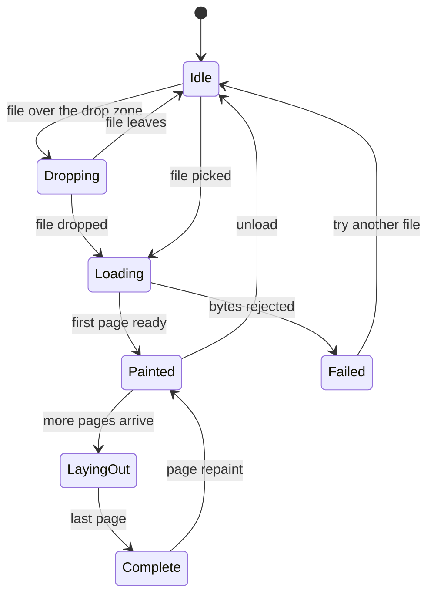

# The demo site: viewport, toolbar, zoom, and page navigation.

> Part of the EdgeDoc Display specification. Date: 2026-11-04. Requirement ids are
> normative. See [the index](README.md).

## 84. What the demo proves

The demo is a test with a screen. It proves five claims:

1. One call loads a `.docx` file from disk and paints it (`DP-I-08`).
2. The page looks like the page Word makes (`DP-N-05`).
3. Zoom and pagination feel like pdf.js (`DP-I-03`, `DP-I-04`).
4. The reader can select, search, and print (`DP-I-05`, `DP-I-06`, `DP-I-07`).
5. The work runs in the browser, with no server (`DP-I-03`).

`DP-U-01`. The demo is a static site with no build step for a reader. The build makes a
folder that a static host serves. No process listens.

## 85. The desktop layout

```ascii
+--------------------------------------------------------------------------------------+
|  EdgeDoc Display                                                    [theme] [docs]  |
+--------------------------------------------------------------------------------------+
| [Open file]  sample-report.docx  v        <  Page 2 / 18  >     [-] 120% [+]  [fit ]|
+------------------+-------------------------------------------------------------------+
| THUMBNAILS       |                                                                   |
| +--------------+ |    +-------------------------------------------------------+      |
| | p1           | |    |                                                       |      |
| |  [preview]   | |    |   Quarterly Report 2026                               |      |
| +--------------+ |    |   ------------------------------                        |      |
| +--------------+ |    |                                                       |      |
| | p2  ACTIVE   | |    |   Revenue grew by 18% against the same quarter of     |      |
| |  [preview]   | |    |   the previous year. The growth came from the         |      |
| +--------------+ |    |   northern region and from two new accounts.          |      |
| +--------------+ |    |                                                       |      |
| | p3           | |    |   Table 1  Revenue by region                          |      |
| |  [preview]   | |    |   +----------------+---------+----------+             |      |
| +--------------+ |    |   | Region         | Q3 2025 | Q3 2026  |             |      |
|                  |    |   +----------------+---------+----------+             |      |
|  [x] outline     |    |   | North          |  1 240  |  1 466   |             |      |
|  1. Summary      |    |   | South          |    980  |  1 120   |             |      |
|  2. Revenue      |    |   +----------------+---------+----------+             |      |
|    2.1 North     |    |                                                       |      |
|    2.2 South     |    |                                                       |      |
|  3. Outlook      |    +-------------------------------------------------------+      |
|                  |                                                                   |
|                  |    +-------------------------------------------------------+      |
|                  |    |                         page 3                        |      |
|                  |    +-------------------------------------------------------+      |
+------------------+-------------------------------------------------------------------+
|  Search  [ revenue            ]   ^ v   3 of 12     [!] 2 warnings   [diag] [print] |
+--------------------------------------------------------------------------------------+
```

`DP-U-02`. The layout has four regions: a top bar, a left rail, the page viewport, and a
status bar. The left rail collapses below 1100 px, and the outline moves into a menu.

`DP-U-03`. The left rail holds two tabs: page thumbnails and the document outline. The
thumbnails paint at 96 px wide from the page display list, lazily. A thumbnail past 300
pages renders as a plain rectangle with the page number until the reader scrolls to it.

`DP-U-04`. The top bar holds the document name, the page control, the zoom control, and the
fit control. The page control accepts a typed number. A number past the page count clamps.

`DP-U-05`. The status bar holds the search field, the hit counter, the diagnostic badge, and
the print button. The diagnostic badge is hidden when there is no diagnostic.

## 86. The narrow layout

```ascii
+--------------------------------+
| EdgeDoc     [menu]   [search]  |
+--------------------------------+
|                                |
|  +--------------------------+  |
|  |                          |  |
|  |    page content          |  |
|  |    at fit-width          |  |
|  |                          |  |
|  +--------------------------+  |
|                                |
+--------------------------------+
| < p2/18 >   120%   [+]  [fit]  |
+--------------------------------+
```

`DP-U-06`. Below 700 px, the page is fit-width and the toolbar collapses to a floating bar at
the bottom. The menu button opens the thumbs rail as a sheet. The floating bar respects the
safe area of a phone, with `env(safe-area-inset-bottom)`.

`DP-U-07`. A touch device paints one page per screen in `scrollMode: "page"` by default.
The reader can switch to a continuous scroll in the settings sheet.

## 87. The load flow on screen



`DP-U-08`. While the document loads, the viewport shows one skeleton page of the hinted
size, at 30% opacity, with a progress bar under the top bar. The bar reports bytes when the
size is known, and it reports "reading" when the size is not known.

`DP-U-09`. A drop anywhere in the viewport loads the file. The drop zone shows a dashed
outline during a drag, and it accepts a `.docx` file only. Another file type shows a clear
message and keeps the current document.

`DP-U-10`. A failed load replaces the viewport with a panel that holds the error code, the
message, and one action. The action is "Choose another file" for every code except
`display.encrypted_unsupported`, where the action is "Enter password".

## 88. Controls

`DP-U-11`. Every control has a keyboard path, a visible focus ring, and an accessible name.
The zoom control is a group of buttons with `aria-label`. The page field is an `<input
type="number">` with `aria-label="Page number"`.

`DP-U-12`. The toolbar buttons have a minimum target of 24 by 24 CSS pixels. The primary
controls have 32 by 32. Both meet the WCAG 2.2 target size of 24 (D27).

`DP-U-13`. The zoom control offers these values in a menu: 50%, 75%, 100%, 125%, 150%,
200%, 400%, 800%, fit width, fit page. The `+` and `-` buttons step through the list. A
`Ctrl` and wheel gesture zooms, and a plain wheel scrolls.

`DP-U-14`. The page control shows the current page and the page count. A page field that
holds a non-number restores the current page on `Enter`.

## 89. Keyboard map

| Key | Action |
|---|---|
| `O` | Open a file |
| `G` | Go to page (focus the page field) |
| `N` | Next page |
| `P` | Previous page |
| `Ctrl` `+` | Zoom in |
| `Ctrl` `-` | Zoom out |
| `Ctrl` `0` | Page actual |
| `Ctrl` `1` | Fit width |
| `Ctrl` `2` | Fit page |
| `Ctrl` `F` | Focus search |
| `F3` | Next hit |
| `Shift` `F3` | Previous hit |
| `Ctrl` `S` | Save the original file |
| `Ctrl` `P` | Print |
| `T` | Toggle thumbnails |
| `Ctrl` `Shift` `D` | Toggle the diagnostics panel |
| `?` | Show the key map |
| `Escape` | Close a panel, or clear the search |

`DP-U-15`. A shortcut does not act while the focus is in a text field, except `Escape` and
`Enter`. The key map is data, so a host can override an entry.

## 90. Search on screen

```ascii
+---------------------------------------------------------------+
| Search [ revenue         ]   ^   v   3 of 12   [Aa] [ab] [.*] |
+---------------------------------------------------------------+
   Aa  match case      ab  whole word      .*  regular expression
```

`DP-U-16`. A hit paints with a 20% yellow overlay, and the current hit with a 45% orange
overlay. A hit that spans a page break paints on both pages. The viewer scrolls the current
hit to the middle of the viewport, not to the top.

`DP-U-17`. The hit counter shows "3 of 12" and updates as the search continues. A search
with no hit shows "0 of 0" and a short note.

## 91. Diagnostics on screen

`DP-U-18`. The diagnostic badge shows a warning triangle with the count, and it turns red
when the count holds an `error`. A click opens a panel that lists each diagnostic with the
page, the code, and the detail. A click on a row goes to the page.

`DP-U-19`. A diagnostic panel header states the effect on fidelity, with one sentence. For
example: "Two fonts are missing. The page breaks can differ from Word." The sentence comes
from a table keyed by the first diagnostic code, so it is stable.

## 92. Accessibility of the demo

`DP-U-20`. The demo passes WCAG 2.2 level AA on the shell: contrast, focus order, target
size, and labels. The page content is an image of the document, and the text layer carries
the accessible text.

`DP-U-21`. A skip link goes to the page viewport. The left rail is a `nav` with a label. The
status bar is a `status` region, so a page change is announced once.

`DP-U-22`. A reader can operate the whole viewer with a keyboard from the first paint. A
test runs `axe-core` on the demo with a loaded document and fails on a critical issue.

`DP-U-23`. The demo respects `prefers-color-scheme` and `prefers-reduced-motion`. The dark
theme keeps the page paper white unless the reader chooses a page tint.

## 93. The sample documents

`DP-U-24`. The demo ships five sample documents, and each one exercises one part of the
fidelity story:

| Sample | Pages | Proves |
|---|---|---|
| `invoice.docx` | 2 | Table borders, a logo, a header, a right tab |
| `report.docx` | 18 | Sections, columns, floats, a chart placeholder, a TOC |
| `letter.docx` | 1 | Fields, a merge field, a signature image |
| `catalog.docx` | 24 | A long table with repeating header rows |
| `rtl.docx` | 3 | Arabic and Hebrew text, bidi with numbers, a mirrored table |

`DP-U-25`. The demo has a "compare" mode that paints the reference PNG next to the page
with a split handle. The reference images come from the corpus of
[14-testing-and-quality.md](14-testing-and-quality.md), so the demo shows the same truth
that CI checks.

```ascii
+---------------------------+---------------------------+
| painted page              | reference image           |
|                           |                           |
|   Quarterly Report        |   Quarterly Report        |
|   -------------------     |   -------------------     |
|                           |                           |
|   Revenue grew by 18%..   |   Revenue grew by 18%..   |
|                           |                           |
+---------------------------+---------------------------+
                              ^ drag the split
```

`DP-U-26`. The compare mode reports the gate values for the open page: the break delta, the
glyph delta, and the table delta. A reader sees the number that CI measures, not a claim.

## 94. The demo is a test harness

`DP-U-27`. The demo exposes `window.__edgedoc` with the viewer, the document, and the last
layout report. A browser test drives the demo through this object. It does not screen-scrape.

`DP-U-28`. A URL parameter `?doc=sample/report.docx&page=7&zoom=150%` loads a document and a
position. A screenshot test uses the parameter to reach a state without a click sequence.

`DP-U-29`. The demo site is also the documentation page. It holds a short section on the
architecture, a link to this specification, and the measurement table of
[12-performance.md](12-performance.md).
