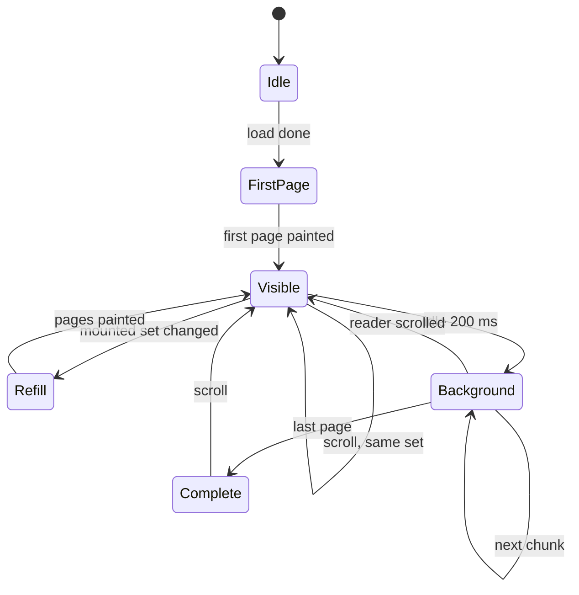

# Budgets, caching, virtualization, and the measurement that replaces each estimate.

> Part of the EdgeDoc Display specification. Date: 2026-11-04. Requirement ids are
> normative. See [the index](README.md).

## 95. The three budgets

A viewer fails in three ways: it shows nothing for too long, it drops frames, or it crashes
the tab. Each failure has a budget and a test.

| Budget | Limit | Fails when |
|---|---|---|
| Time to first page | 300 ms | `perf_first_page` |
| Frame time during scroll | 16 ms p95 | `perf_scroll_frames` |
| Resident memory | 256 MiB | `perf_memory` |

`DP-E-01`. A budget is a p95 value over 30 runs on the reference machine, not a best case.
The reference machine is stated in the test output, so a reader can compare.

`DP-E-02`. A budget that CI cannot measure becomes a logged measurement with a warning. It
does not become a silent claim. The table below says which budgets CI measures today.

| Metric | Measured in CI | Method |
|---|---|---|
| Time to first page | Yes | Native layout with `ManualClock`, then a browser run on a fixed profile |
| Frame time | Browser only | `requestAnimationFrame` deltas, 200 frames |
| Resident memory | Yes | Module `heap_bytes` after load and after 50 page paints |
| Module size | Yes | File size of the built artifact |
| Display list size | Yes | Byte length from the encoder test |
| Search time | Yes | 10,000-page generated document, one query |

## 96. Where the time goes

```ascii
 time to first page, 10-page invoice, reference laptop

 0 ms     | open package                        18 ms
 18 ms    | compile styles and theme             9 ms
 27 ms    | load two faces                      21 ms   (cached after first load)
 48 ms    | measure first page                  37 ms
 85 ms    | encode display list                  3 ms
 88 ms    | transfer to main thread              1 ms
 89 ms    | raster 1 page at 1.5x              61 ms
 150 ms   | build text layer                    11 ms
 161 ms   | first paint                         --
```

`DP-E-03`. The encoder is never the cost. A page costs at most 4 ms to encode, and the test
fails above that. When a profile shows encoding higher, the cause is a display list with one
operation per glyph, which `DP-P-20` forbids.

`DP-E-04`. The first page never waits for a full document layout. A caller that calls
`layoutAll` before paint has chosen the slow path. The viewer does not choose it.

## 97. Virtualization

`DP-E-05`. The viewer keeps three page sets:

| Set | Size | Cost |
|---|---|---|
| Mounted | Visible pages plus one on each side | A canvas and a text layer per page |
| Prefetched | One page beyond each mounted edge | A display list in memory |
| Cached tiles | A byte budget | Rastered tiles |

`DP-E-06`. A page that leaves the mounted set keeps its canvas bitmap in the tile cache and
unmounts its DOM. A page that re-enters paints from the bitmap with no layout.

`DP-E-07`. The mounted set has a limit of 8 pages. A viewport with 20 small pages mounts 8
and leaves the rest as placeholders with the right height. This limit exists because each
mounted page holds a text layer with thousands of nodes.

`DP-E-08`. The scroll handler does no layout work. It updates a value and schedules one
`requestAnimationFrame` callback. The callback computes the mounted set and the next layout
request. A test asserts that a scroll of 200 events schedules at most 12 callbacks.

## 98. Caching

`DP-E-09`. There are four caches, and each one has one owner:

| Cache | Owner | Key | Eviction |
|---|---|---|---|
| Package parse | Worker, per document | Document id | On unload |
| Computed styles | Worker, per document | Document id | On unload |
| Page geometry | Worker, per document | Page index | LRU past `maxPagesInMemory` |
| Tiles | Main thread | Page, scale, device ratio | LRU past `maxCacheBytes` |

`DP-E-10`. A cache has one key function in one place. The tile key is
`(page, scale_rounded, dpr_rounded)`. Two code paths that build a key differently is the
defect this rule prevents.

`DP-E-11`. A cache size counts the bytes it holds, not the number of entries. A page with a
photograph costs more than a page of text, and an entry count would hide that.

`DP-E-12`. The tile cache starts at 64 MiB and adjusts down to 32 MiB when
`navigator.deviceMemory` reports 4 GB or less. A browser that reports no memory uses 64 MiB.

`DP-E-13`. An image decodes once per document, into a bitmap that all pages share. A logo in
a header on 100 pages holds one bitmap.

`DP-E-14`. A font loads once per worker session, and it stays across documents when the
caller keeps the worker alive. The demo keeps one worker for the session.

## 99. Progressive layout scheduling



`DP-E-15`. The worker lays out the first page, then the visible pages, then one chunk of 20
pages in the background while the reader is idle. A scroll cancels the background chunk.

`DP-E-16`. A background chunk holds no lock that a foreground request needs. The worker
checks the message queue between pages, and it serves a foreground request first.

`DP-E-17`. A page that a reader jumps to takes priority. The viewer sends `cancel` for the
background chunk, then `layout` with the target page. The seek pass of `DP-P-18` runs, and
the target page paints.

`DP-E-18`. The worker reports progress after each chunk. The viewer shows a thin progress
line at the top of the viewport while the background layout runs, and it hides the line at
100%.

## 100. Cost model for the flow crate

`DP-E-19`. Each layout operation has a cost class. The test `layout_budget` counts the
operations for a page and fails past the limit.

| Operation | Cost | Limit per page |
|---|---|---|
| Shape a cluster | 1 | 240,000 |
| Break a line | 3 | 4,000 |
| Place a line | 1 | 4,000 |
| Fit a table | 40 per cell | 20,000 |
| Resolve a style | 2 | 60,000 (cached) |
| Decode an image | 1,000 | 40 |
| Measure a font | 200 | 20 |

`DP-E-20`. A shape call is cached by `(text_hash, face, size)`. A header that repeats a
string on 1000 pages shapes it once. The cache is bounded at 100,000 entries.

`DP-E-21`. A paragraph that does not change keeps its line layout when a later block moves.
The flow crate keys the layout by a content hash and a width. This helps a table that grows
and pushes a paragraph without changing it.

## 101. Zoom cost

`DP-E-22`. A zoom change does not lay out and does not encode. It paints tiles at a new
scale.

| Zoom change | Work |
|---|---|
| Within 2x of the baked scale | CSS transform on the existing tile |
| Past 2x | Raster the visible tiles at the new scale |
| Fit change after a resize | Recompute the scale, then the row above |

`DP-E-23`. A CSS transform on a canvas is a compositor operation. It costs no layout, and
it stays smooth during a pinch. The viewer replaces the scaled tile with a sharp tile after
the gesture ends, with a 120 ms debounce.

## 102. Search cost

`DP-E-24`. Search builds one index per document, lazily, on the first query. The index maps
a folded character to the paragraph ids that hold it, so a query reads only the candidate
paragraphs.

`DP-E-25`. A query on a 10,000-paragraph document returns in 80 ms. The test fails above
200 ms. A regular expression query has a larger budget and a step limit (`DP-V-29`).

`DP-E-26`. A hit rectangle comes from the line layout, so a search does not shape text
again. A page that is not laid out returns the paragraph id and no rectangle until the page
arrives.

## 103. Measurement harness

`DP-E-27`. The harness runs a fixed document set on a fixed browser profile, and it writes a
JSON report. The report holds each metric, the p95, and the budget. CI compares it with the
budget and with the previous run.

`DP-E-28`. A metric that regresses by more than 15% fails the run even when it stays under
the budget. This catches a slow drift before it becomes a failure.

`DP-E-29`. The harness prints one line per metric, so a reader sees the result without
opening a file:

```
perf  first_page        161 ms  (budget 300)  ok
perf  scroll_frames_p95  11 ms  (budget 16)   ok
perf  memory_after_50   184 MiB (budget 256)  ok
perf  search_10k         71 ms  (budget 200)  ok
perf  module_gzip       1.42 MiB(budget 1.6)  ok
```

`DP-E-30`. A run on a machine that is not the reference machine prints the measurements and
marks them `unverified`. It does not fail the build. Only the reference runner gates.

## 104. What a reader can do when the viewer is slow

`DP-E-31`. The viewer reports a slow page through `diagnostic` with code
`display.slow_page` above 400 ms. The message names the block that cost the most time, from
the cost counter of `DP-E-19`.

`DP-E-32`. A document past the page limit, or past the memory ceiling, shows a panel with two
actions. The reader can paint the first 200 pages, or download the file. The viewer never
leaves the reader with a blank screen.
