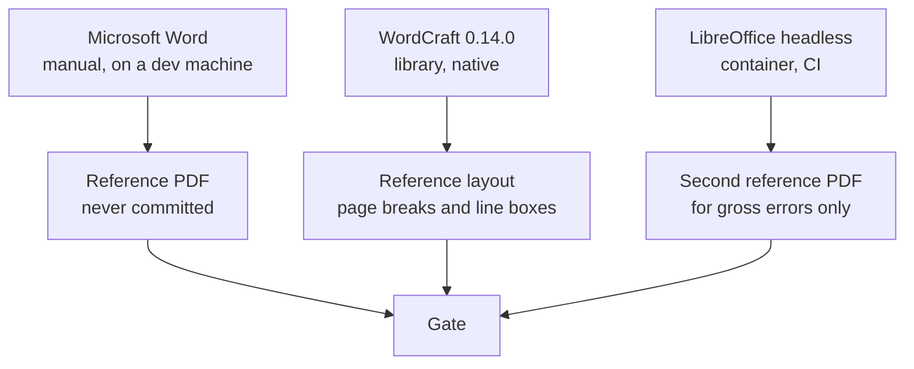
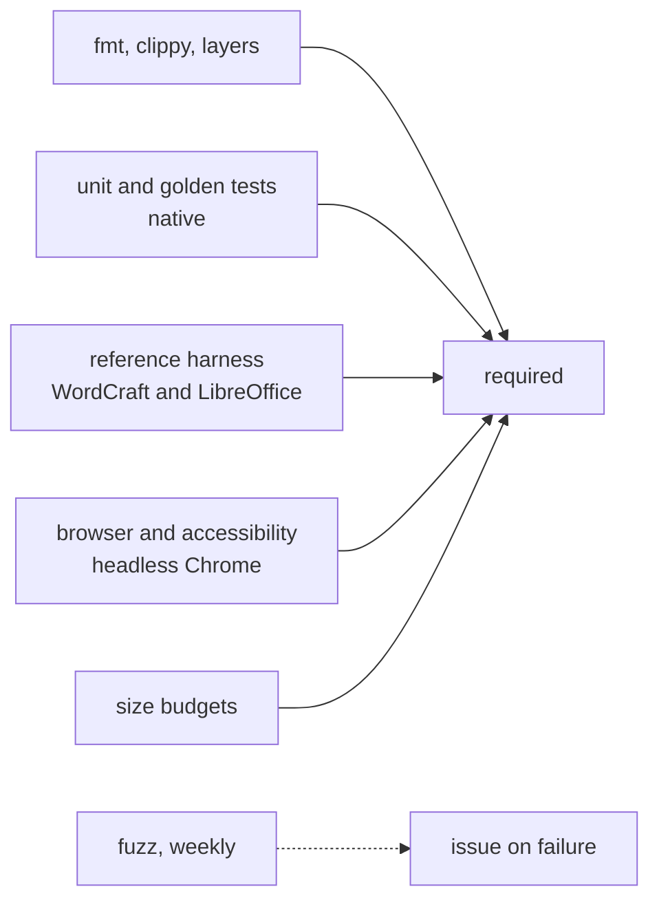

# The corpus, the gates, the reference, and CI.

> Part of the EdgeDoc Display specification. Date: 2026-11-04. Requirement ids are
> normative. See [the index](README.md).

## 123. Why a gate is not a screenshot

A screenshot test says "this page changed". It does not say "this page is right". A layout
engine needs a reference that states what right means, and it needs a measure that names the
distance from the reference.

`DP-Q-01`. Three levels of test exist, and each answers one question:

| Level | Question | Tool |
|---|---|---|
| Unit | Does this rule hold? | `cargo test` per crate |
| Golden | Did this page change from the last accepted page? | Display list or PNG compare |
| Reference | Is this page right against another Word renderer? | The diff harness of clause 127 |

`DP-Q-02`. A unit test locks a behavior. A golden test catches a regression. A reference test
measures fidelity. A design with only the second level drifts. A design with only the third
level cannot say which change broke it.

## 124. The corpus

`DP-Q-03`. The corpus has four sets. Every test names the set it reads.

| Set | Documents | Purpose | In CI |
|---|---|---|---|
| `synthetic` | 60 generated packages, one feature each | One behavior per file, so a failure names the feature | Yes |
| `real` | 25 business documents, redacted and public | The shapes that a generator does not make | Yes |
| `hostile` | 200 mutated packages | A refusal, not a panic | Yes |
| `stress` | 12 large documents: 1,000 pages, 100 MB, 300 fonts | Budgets and time | Weekly |

`DP-Q-04`. A `synthetic` document is built by code, so it has no licence question and no
binary in the repository. The builder is `edgedoc-display-testkit`. Each document is a
function that calls the `edgedoc` builder and returns bytes.

`DP-Q-05`. A `real` document is stored as bytes with a note that states its origin, its
licence, and its page count from Word. A document without those three facts is not added.
The set is capped at 20 MiB in the repository, and the rest downloads from a release asset.

`DP-Q-06`. The `hostile` set is generated by a mutation function from the `synthetic` set, so
a new synthetic document adds mutations with no new work. The seed is fixed, so a failure
reproduces.

`DP-Q-07`. The `stress` set exists for the budgets of [12-performance.md](12-performance.md).
It is not a fidelity set, and a page break in it is not compared with Word.

`DP-Q-08`. Each document has a manifest entry with the features it holds. A report lists, for
every feature of T0 to T2, the documents that hold it. A feature with no document is a gap
that CI reports by name.

```json
{
  "id": "columns-unequal",
  "set": "synthetic",
  "features": ["cols.unequal", "cols.space", "section.continuous"],
  "pages": 2,
  "tiers": ["T1", "T2"],
  "note": "Two columns 40/60, continuous break mid-page"
}
```

## 125. What a golden test stores

`DP-Q-09`. A golden test stores the display list in its text form, not only a PNG. The
`RecordPainter` writes one line per operation, and a diff of two files names the operation
that changed.

```
page 3  BeginPage 595.28 841.89 ffffffff
push Transform 1.0000 0.0000 0.0000 1.0000 0.00 0.00
glyphrun face=4 size=10.50 color=1a1a1aff glyphs=27 "Quarterly Report 2026" x=70.90 y=112.40
fillrect 70.90 128.30 453.50 0.75 color=1f4e79ff
...
end page 3
```

`DP-Q-10`. The PNG is a second artifact for a reviewer, not the gate. A PNG diff reports
"12% of pixels differ" and gives no cause. A display-list diff reports "line 214 changed from
10.50 pt to 11.00 pt".

`DP-Q-11`. A tool accepts a golden file: `cargo xtask display-golden --accept`. The tool
writes a summary of what changed into the commit message body. A silent accept hides a
regression, so the tool prints one line per changed page with its first difference.

## 126. The reference renderer

The reference is the hardest decision in this specification.

`DP-Q-12`. Word is the only true reference, and Word is not available in CI. The library
therefore uses three references, and each one covers a different part of the truth:



| Reference | Covers | Trust | In CI |
|---|---|---|---|
| Word, manual | The truth | High | No |
| WordCraft layout | Page breaks, line boxes, and item positions | High, with the gaps of clause 120 | Yes, as a dev dependency |
| LibreOffice PDF | Gross errors: a blank page, a missing table, a lost picture | Low for line breaks | Yes, in a container |

`DP-Q-13`. The WordCraft reference is not a dependency of the library. It is a dev harness in
`xtask`, and it lays out the same document with WordCraft. It then compares the page count,
the line count, and the item rectangles. A difference past a tolerance opens a review item.
That item names the WordCraft test that covers the behavior.

`DP-Q-14`. A difference against WordCraft is not automatically a defect. Clause 120 lists the
behaviors where WordCraft is known to be wrong. The harness reads that list from a data file,
so a known gap is a warning and not a failure.

`DP-Q-15`. The LibreOffice reference reads a PDF and compares three coarse facts per page.
The facts are the page count, the text content in document order, and the position of each
picture. The reference catches a lost part. It does not catch a moved line, and the harness
does not claim that it does.

`DP-Q-16`. The tolerance values are:

| Measure | Tolerance | Gate |
|---|---|---|
| Page count | Exact, or a note that names the cause | `DP-I-15` G1 |
| Page break block | The same block index, or within one line | `DP-I-15` G1 |
| Line top | 0.5 pt | `DP-I-15` G2 |
| Glyph x | 0.5 pt for 99% of glyphs | `DP-I-15` G2 |
| Character sequence | Exact, per page, in document order | `DP-I-15` G3 |
| Picture rectangle | 1 pt | `DP-I-15` G4 |
| Cell rectangle | 1 pt | `DP-I-15` G5 |

`DP-Q-17`. The tolerance is a design value, and a document that misses it is a known gap in
the fidelity report. The report is generated, so a reader sees the current number, not a
claim from a design document.

## 127. The diff harness

`DP-Q-18`. `cargo xtask display-diff` reads two layout reports and writes one JSON file and a
one-line summary per page. It is a port of the WordCraft tool `xtask/src/visual_diff.rs`, and
it keeps the same measures.

| Measure | Meaning |
|---|---|
| `page_count_delta` | Pages in the test result minus pages in the reference |
| `break_delta` | Number of pages whose first block index differs |
| `line_match` | Share of reference lines found with the same text |
| `line_dy_median` | Median vertical distance of a matched line |
| `line_dx_max` | Largest horizontal distance of a matched line |
| `text_order` | Whether the character sequence is equal |
| `picture_delta` | Rectangles that moved past 1 pt |

`DP-Q-19`. The harness prints a reader-facing line:

```
display-diff  report.docx   18 pages  (=)  breaks 0/18 (!)  lines 99.2%  dy 0.21pt  dx 1.4pt  text ok
display-diff  catalog.docx  24 pages  (+1) breaks 3/24 (!)  lines 96.1%  dy 0.88pt  dx 4.2pt  text ok
```

`DP-Q-20`. A page whose `text_order` is not `ok` fails hard, with no tolerance. A lost or
reordered character is a defect, and no metric makes it acceptable.

## 128. The fidelity report

`DP-Q-21`. CI generates a report that holds one row per corpus document with its gate values
and one row per feature with its coverage. The demo site shows the same report (`DP-U-26`).

| Column | Meaning |
|---|---|
| Document | The corpus id |
| Pages | Word count against library count |
| Breaks | Pages with a different first block |
| Glyphs | Share within 0.5 pt |
| Tables | Cells within 1 pt |
| Text | `ok`, or the first difference |
| Tiers | The claimed tiers that the document exercises |

`DP-Q-22`. The report is a build artifact, and it is committed as a Markdown file so a
reviewer sees the change in a pull request. A regression shows as a number that moved.

## 129. Test types and their number

`DP-Q-23`. The table below is the test plan. A row is a requirement on the test suite.

| Type | Count target | Runs in | Fails on |
|---|---|---|---|
| Unit, per crate | 800 | CI, every commit | A broken rule |
| Golden display list | 180, one per feature and page shape | CI | A changed page |
| Golden PNG | 60, a subset of the display list set | CI, native rasterizer | A paint regression |
| Reference, WordCraft | 60, one per synthetic document | CI, dev harness | A break difference past tolerance |
| Reference, LibreOffice | 25, the real set | CI, container | A lost part or a blank page |
| Hostile | 200 mutations and 12 named cases | CI | A panic or an over-budget allocation |
| Browser | 40, over the demo site | CI, headless Chrome | A viewer defect |
| Accessibility | 10, `axe-core` on the demo states | CI | A critical issue |
| Determinism | Every golden, run twice | CI | A difference |
| Fuzz | 3 targets, 24 h per week | Weekly | A panic |

`DP-Q-24`. A golden test that a developer disables is a requirement that nobody checks. CI
fails when a `#[ignore]` appears without a linked issue in the same line.

`DP-Q-25`. Every requirement in [16-traceability.md](16-traceability.md) names a test. A
requirement with no test is a documentation defect, and the test `traceability_complete` reads
the table and fails.

## 130. The native test path

`DP-Q-26`. A browser test is slow and needs a container. Most behavior is therefore tested
natively, with the same crates.

| Concern | Native test | Browser test |
|---|---|---|
| Line breaking | `cargo test -p edgedoc-text` | Not repeated |
| Pagination | `cargo test -p edgedoc-flow` | Not repeated |
| Display list | `cargo test -p edgedoc-paint` | Parity check once |
| Raster | `tiny-skia` golden PNG | Canvas parity check once |
| Hit test | `cargo test -p edgedoc-display` | Click test over the demo |
| Zoom | Arithmetic and transform test | Pinch and wheel test |
| Memory | Module `heap_bytes` | Browser heap once |
| Layout parity | WordCraft harness | Not repeated |

`DP-Q-27`. The native raster and the canvas raster must agree within 2% of pixels. The test
`canvas_native_parity` runs on three pages: one with text, one with a table, and one with a
picture. Antialiasing differs between the two rasterizers, so an exact match is not a fair
test.

## 131. Determinism

`DP-Q-28`. A test runs each corpus document twice in one process and twice in two processes,
and compares the display list bytes. Any difference is a defect, and the usual cause is a hash
map iteration order or a float accumulation order.

`DP-Q-29`. The library uses an ordered map where an order can reach the output. It uses a
`HashMap` only where the order is not observable, and a test states which one of the two a
module uses.

`DP-Q-30`. Native layout and WASM layout must agree within 0.01 pt on every rectangle
(`DP-X-162`). The two targets use the same code, so a difference means a floating-point
setting or a feature flag differs. The test prints the largest difference and the block that
holds it.

## 132. CI

`DP-Q-31`. The pipeline has four jobs. A job that is not required cannot gate a merge, so all
four are required.



`DP-Q-32`. The jobs run in this order of cost: static checks, unit and golden, browser, then
the reference harness. A cheap failure stops the run before the expensive jobs start.

`DP-Q-33`. The job that checks the format writes two artifacts: the fidelity report and the
size table. A reader then opens the number that the pull request produced.

`DP-Q-34`. A dependency update runs the golden suite. A font crate update can move every
glyph, and the suite names the pages that moved.

## 133. What a failure looks like

`DP-Q-35`. The output of a failed layout test names the document, the page, the block path,
and the first difference. It does not print a pixel count.

```
FAIL break_parity columns-unequal
  document  corpus/synthetic/columns-unequal.docx
  page      2 of 2
  block     body[7] "Table 1 Revenue by region"
  expected  page 2, line 4, y=318.40
  found     page 2, line 5, y=331.90
  delta     +13.50 pt, one line
  cause     the table above is 13.50 pt taller than the reference
  hint      compare cell margins with tblCellMar at body[5]
```

`DP-Q-36`. The last two lines exist so a reader starts at the cause. A message that names
only the symptom costs an hour of bisection.

`DP-Q-37`. A test that fails on a font substitution prints the face that was used and the face
that was requested. The common cause of a page break difference is a missing font, and the
message says so.

## 134. Manual checks

`DP-Q-38`. Four checks need a person and Word. They run before a release, and the result goes
into the release note with the Word version.

| Check | Procedure | Pass |
|---|---|---|
| Word opens a library page | Export a synthetic document to PDF, open both in Word and the viewer | The page count is equal, and no line sits on a different page by more than one line |
| Font substitution | Open a document whose font is absent | The diagnostic names the face, and the page break moves by at most one line |
| Print | Print a 3-page document from the demo | The paper matches the screen, and no page is blank |
| Screen reader | Read a 2-page document with a screen reader | Every paragraph is read, once, in order |

`DP-Q-39`. A manual check writes its result into `docs/display/report/manual-<date>.md`, so
the next release compares with it.

## 135. Coverage of the fidelity tiers

`DP-Q-40`. A tier is claimed when its features are covered by a document and a test. The
report prints the claim, and a tier with an uncovered feature is stated as partial.

| Tier | Claim in version 1 | Evidence |
|---|---|---|
| T0 | Complete | Every field of `Page` and the body flow |
| T1 | Complete | Styles, lists, tables, images, links, sections, headers |
| T2 | Partial: floats and notes are covered, charts and equations are placeholders | The placeholder path of `DP-P-22` |
| T3 | Placeholder only | `display.object_placeholder` |

`DP-Q-41`. A reader who needs a feature outside the claim reads the report, and the report
names the placeholder that appears instead. This is the honest contract that `DP-N-06`
describes.
