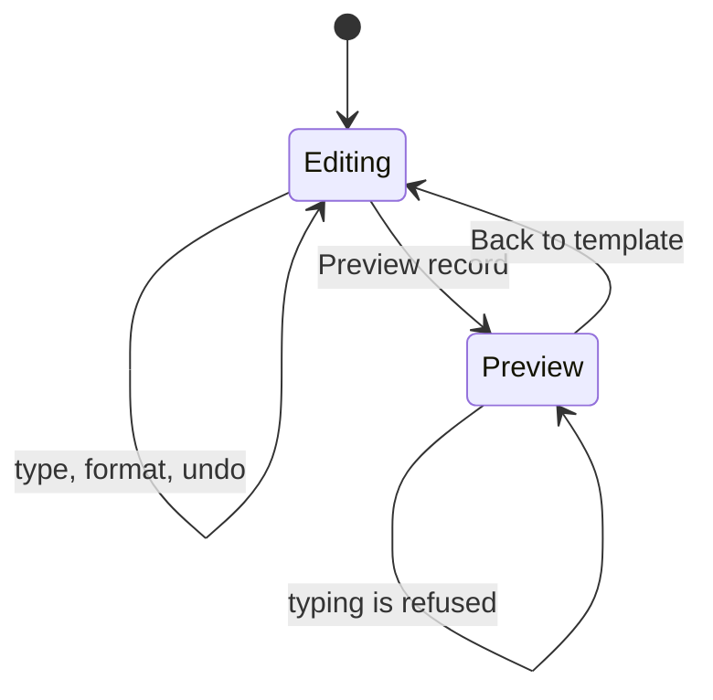

# 02 — Experience

Lenses: UX, UI, and front. Intent is [01](01-intent.md). How a click becomes a source offset is [04](04-editing.md).

The control should feel like Word in the places people already know: a ribbon, a page, a caret, and a status bar. It should be calmer than Word where Word is noisy. One document is open. Preview is a mode, announced in a banner, and it is the only mode that refuses typing.

## Screen

```
+------------------------------------------------------------------+
| EdgeDoc     Invoice                          Open    Download    |
+------------------------------------------------------------------+
| Home | Insert | Layout | Mailings                                |
| [Undo] [B I U] [Font] [Size] [Left Center Right Justify]         |
+------------------------------------------------------------------+
| Preview is on. Leave preview before you edit the template.      |  (only in preview)
+----------------------------------------------+-------------------+
|                                              | Merge fields      |
|              +------------------+            | «Customer»        |
|              |                  |            | «InvoiceNo»       |
|              |     the page     |            |                   |
|              |                  |            | Templates         |
|              +------------------+            | Blank             |
|                                              | Invoice           |
+----------------------------------------------+-------------------+
| Page 1 of 2     128 words            Field Customer      110%    |
+------------------------------------------------------------------+
```

## Navigation

```
Open
  |-- Blank document
  |-- Invoice / Letter / Price list / Report
  |-- A .docx from disk
  +-- Download the package

Ribbon
  |-- Home      undo, font, marks, color, highlight, align, lists
  |-- Insert    table, picture, merge field
  |-- Layout    fit width, fit page, 100%
  +-- Mailings  one value per field, Preview record, Back to template

Page
  |-- Click            place the caret, or select a field
  |-- Shift+click      extend the selection
  |-- Type             insert, replacing a selection
  |-- Enter            split the paragraph
  |-- Shift+Enter      soft break
  |-- Backspace        delete, or join with the previous paragraph
  +-- Ctrl/Cmd Z, Y, A, B, I, U
```

## States



## Front rules

- The ribbon is the only chrome. The display viewer is mounted with `chrome: false`, so the page stack is not wrapped in a second toolbar.
- A pressed button reflects the caret: bold, italic, underline, alignment, list.
- The caret blinks. Selection rectangles use the brand blue at low opacity. Both sit in page coordinates times the current zoom.
- Merge fields in the side panel insert at the caret. They show the same `«Name»` placeholder the page paints.
- Colors are the existing brand `#1f4e79` on white. Fonts in the ribbon are the faces the module actually carries: Carlito, Arimo, Tinos.
- The status bar names the page, the word count, the field under the caret, and the zoom.
- A failure is a short toast with the message the editor returned. The document does not change.

## Keyboard and pointer

| Action | Command |
| --- | --- |
| Click on a page | `editCaret(page, x, y, shift)` |
| Character | `editInsert` |
| Backspace / Delete | `editDelete` |
| Enter / Shift+Enter | `editEnter` |
| Arrows, Home, End | `editMove` |
| Ctrl/Cmd+B I U | `editMark` |
| Ctrl/Cmd+Z / Y | `editUndo` / `editRedo` |
| Ctrl/Cmd+A | `editSelectAll` |
| Paste | `editInsert` of the plain text, capped at 100,000 characters |

Keys typed into a ribbon field stay in that field. The page viewport takes keys only when it is focused.
