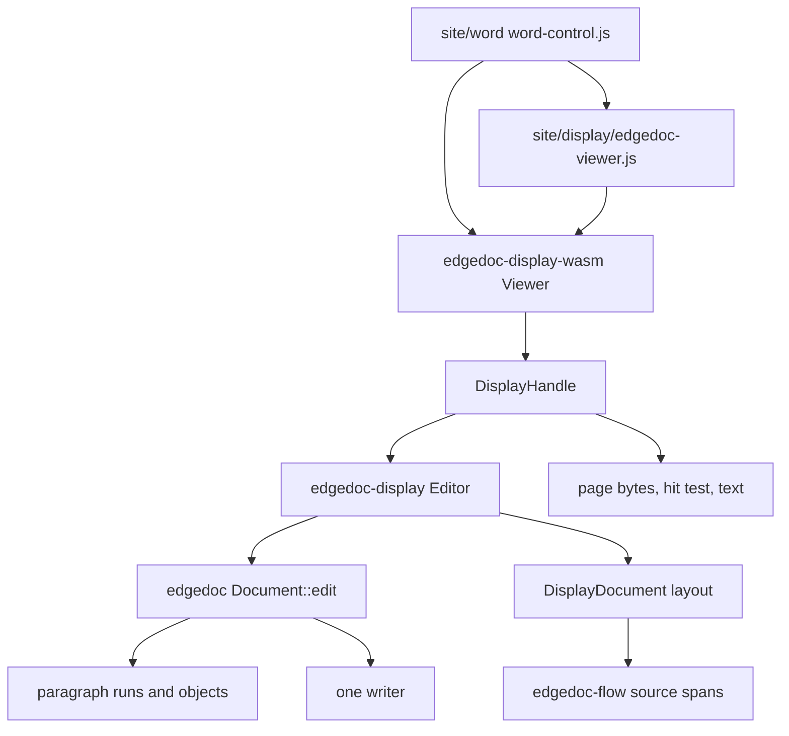
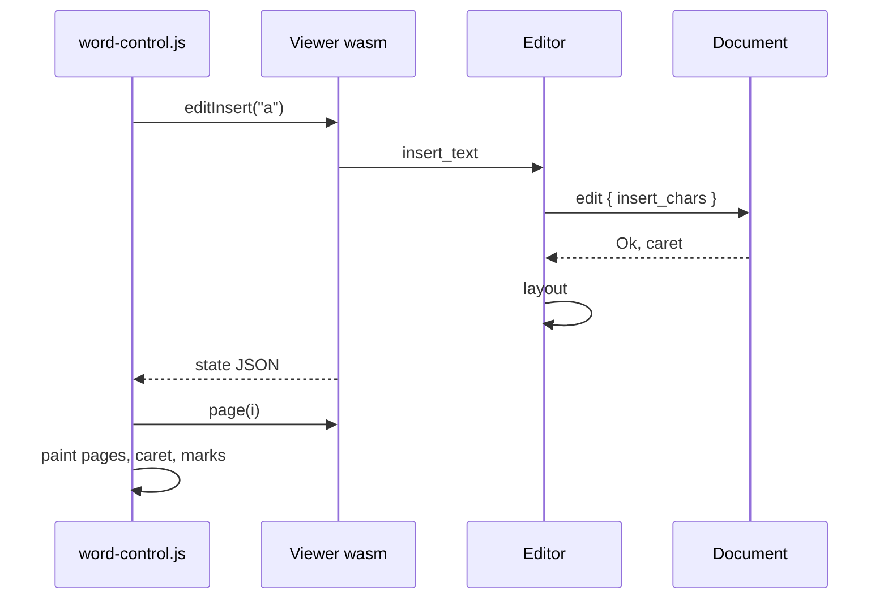
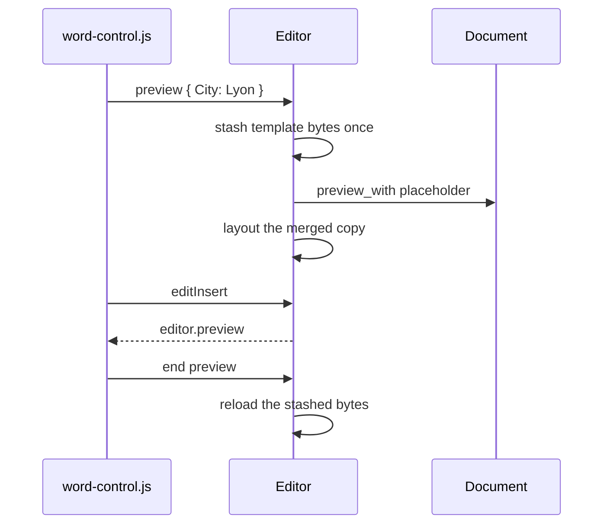

# 03 — Architecture

Lens: full stack. Editing rules are [04](04-editing.md). The host's stored object is [05](05-merge-and-documents.md).

## What each layer owns

The page never builds a document model. It sends a command and paints the pages the module returns. The viewer already knows how to decode a display list. The Word page adds the ribbon, the caret, and the field panel.

## SOLID and DRY

| Principle | How it shows up |
| --- | --- |
| Single responsibility | `Editor` owns the session. `DisplayHandle` owns the bytes a viewer fetches. The page owns the ribbon. The writer owns XML. |
| Open/closed | A new ribbon command is a method on `Editor` plus one wasm wrapper. The paint path does not change. |
| Liskov | Read methods on `DisplayHandle` use `view()`, which is the editor's document while a session is open and the plain document otherwise. `open` clears the session, so a viewer cannot half-edit. |
| Interface segregation | The display demo calls `open` and `layout`. The Word page calls `editOpen` and the `edit*` commands. Neither is forced through the other's methods. |
| Dependency inversion | The page depends on the wasm class. The wasm class depends on `DisplayHandle`, which has no `wasm-bindgen` types, so the same commands run in a native test. |
| DRY | One layout, one writer, one caret map. The Word page does not reimplement zoom math; it reuses the viewer and asks it to repaint. |

## Sequence: a keystroke

## Sequence: preview

## Modules touched

| Module | Change |
| --- | --- |
| `edgedoc-model` | Insert, delete, split, join, format, table, field, picture. Object markers stay in their own runs. |
| `edgedoc-flow` | `SourceSpan` on a paragraph and on a fragment. `with_fields` remaps spans when a page number grows. |
| `edgedoc-display` | `Editor`, caret hit testing, source spans recorded while a paragraph is expanded. |
| `edgedoc-display-wasm` | `editOpen`, `editInsert`, and the rest of the command surface. `open` stays read-only. |
| `site/display/edgedoc-viewer.js` | `chrome: false` and `repaint({ keepView })`. |
| `site/word` | The control. |

## What the host embeds

A host serves `site/word/` or mounts the same script in its own frame. It stores the `ArrayBuffer` from `documentBytes()`. There is no second database of paragraphs. See [05](05-merge-and-documents.md).
