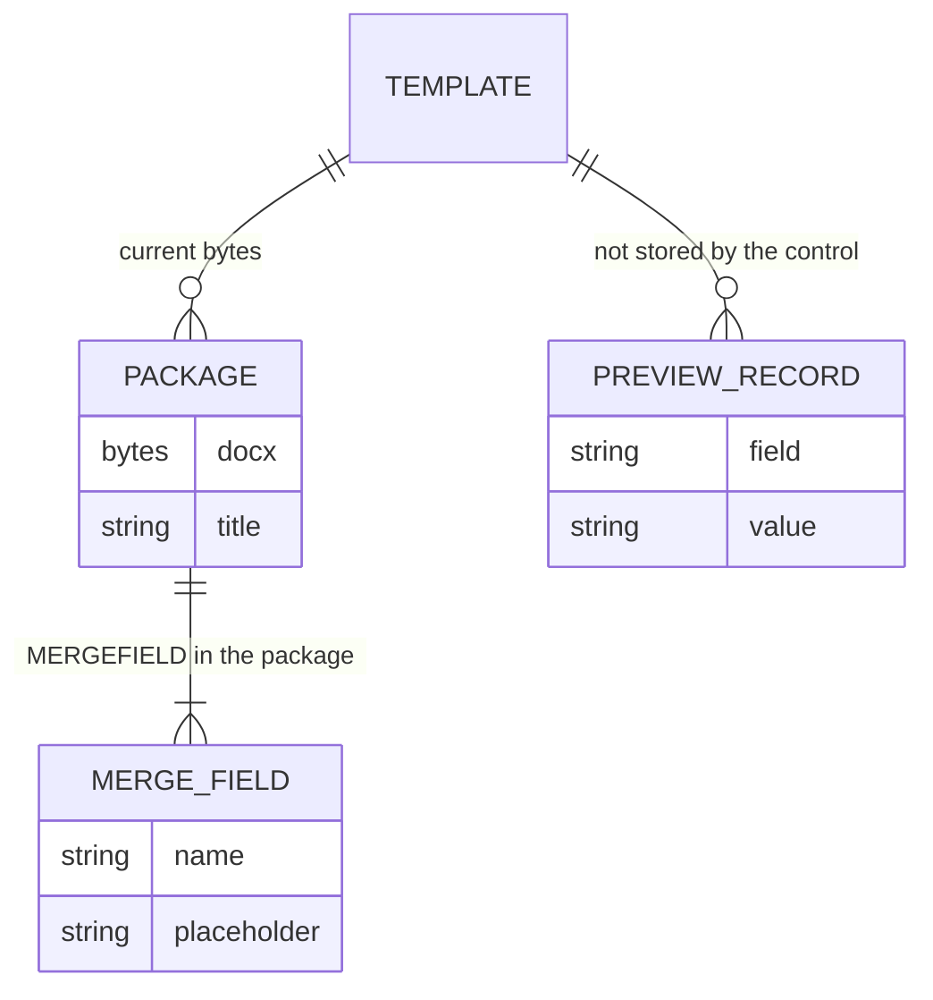

# 05 — Merge fields and the stored document

Lenses: database and SaaS. The preview mode is [02](02-experience.md). The command sequence is [03](03-architecture.md).

## What is stored

The host stores one package per template. That blob is the document. There is no paragraph table beside it.

`PREVIEW_RECORD` is a form on the page. The control does not write it into the package. A host that wants to remember the last preview keeps that JSON itself.

## Field shape

A merge field is `InlineObject::Field`. The instruction comes from `quote_name` (`MERGEFIELD Name`, quoted when the name needs it). The cached result is `«Name»`. `merge_field_names` collects fields whose keyword is `MERGEFIELD`.

Preview builds `Records::from_rows` from the form and calls `preview_with(..., MissingField::Placeholder)`. A missing value stays as the placeholder. The template bytes sit on the session until `end_preview` reloads them. Undo is not a way to leave preview. The banner and the Back to template button are.

## SaaS embed

| Host concern | Control behavior |
| --- | --- |
| Where do bytes live | `documentBytes()` after each save the host wants. The control does not upload. |
| Who may edit | The host. The control has no accounts. |
| Concurrent editors | Out of scope. One session owns one package in one module instance. |
| Unedited save | `write_bytes` returns the original bytes when the document is clean, so a host can store them without a false diff. |
| Encrypted package | Detected and refused by the existing opener. The control shows the error. |
| Binary `.doc` | Refused by the opener. The toast shows the message. |

## Complex tables

A merge field in a cell is the same object as a field in a paragraph. The caret path is `.../row[R]/cell[C]/block[B]`. Insert table builds a single-border grid (`BFBFBF`, size 4) and moves the caret to `row[0]/cell[0]/block[0]`. It does not mark a header row. A template that already has a header row keeps it, because opening a package does not rewrite untouched parts.
