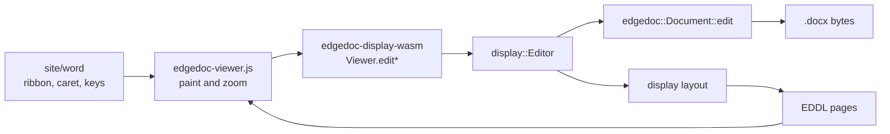
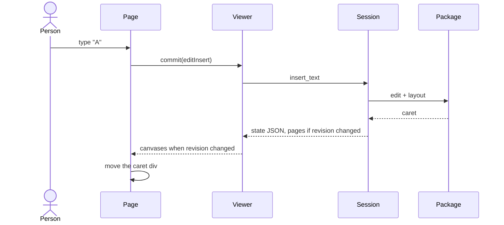
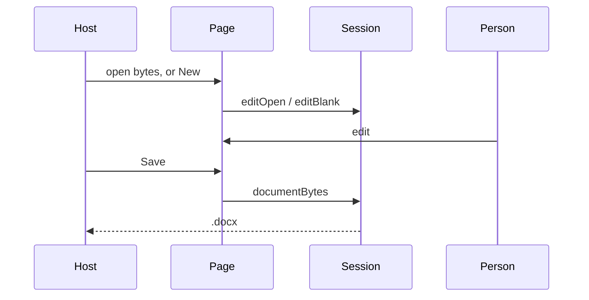

# Architecture

Lens: full stack. Related: [editing rules](editing.md), [the page](ux.md), [data](merge.md).

## The cut

The page never parses a package. The viewer never mutates one. The session is the only writer. That is the DRY cut: one painter (`site/display/edgedoc-viewer.js`), one session (`Editor`), one package API (`Document::edit`).

| Module | Owns | Does not own |
| --- | --- | --- |
| `site/word/word-control.js` | Chrome, keys, caret divs, field form | Layout, package bytes |
| `site/display/edgedoc-viewer.js` | Canvases, zoom, scroll | The caret model |
| `edgedoc-display-wasm` | JSON state and page bytes | Ribbon state |
| `edgedoc-display::Editor` | Caret, selection, undo, preview | How a button looks |
| `edgedoc-model` | Runs, objects, paths | Pages |
| `edgedoc-flow` | `SourceSpan` on each fragment | Mutations |

## SOLID

- **Single responsibility.** `Editor` mutates and lays out. The viewer paints. The page decides which command a key means.
- **Open/closed.** A new command is a method on `Editor` plus a `Viewer.edit*` binding. The painter does not change.
- **Liskov.** Read-only `DisplayHandle::open` still returns pages for the display demo. `edit_open` is a separate session. Calling `open` clears the session, so a viewer that only reads cannot be edited by accident (tested in `an_edit_session_types_and_keeps_the_read_only_open_path`).
- **Interface segregation.** The page asks for state JSON and page bytes. It does not receive the crate graph.
- **Dependency inversion.** The page depends on the viewer module. The viewer depends on the wasm class. Neither depends on `wordcraft`.

## A keystroke

`revision` increments only when the pages change (`transact`, `reload`). A caret move returns new coordinates and the canvases stay. That keeps arrow keys on the UI thread without a second layout (WC-04, WC-16).

## Commands

`DisplayHandle` exposes one method per command (`edit_insert`, `edit_field`, `edit_table`, `edit_preview`, …). The wasm `Viewer` uses the same names in camel case. The page calls those methods. There is no second command parser.

After a command that changes pages, `finish_edit` encodes every page into the handle so `page(i)` matches the state the page just received.

## What stays shared

- Glyph paint, zoom, and the text layer stay in the viewer. The Word page passes `chrome: false` and `editing: true`, which hides the viewer's toolbar and leaves keys to the page.
- `SourceSpan` is recorded while the display builder expands fields. An empty span list means identity, so existing flow tests keep their meaning (WC-02).
- Object markers stay in their own runs (`Paragraph::isolate_objects`) because the writer emits a field only when a run's text is exactly U+FFFC (WC-10).

## Host boundary

The host that embeds the control uses the same page, or the same wasm class. It does not link the Rust crates into the browser by hand. See [SaaS](saas.md).
