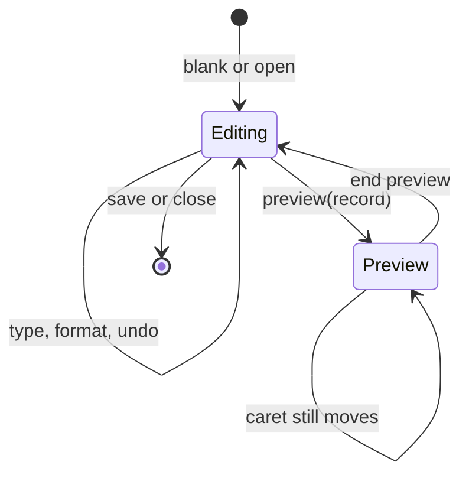
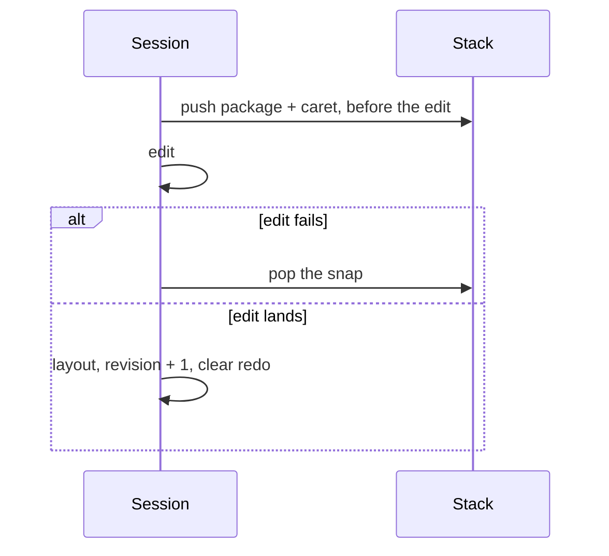

# Editing model

Related: [architecture](architecture.md), [fields](merge.md), [keyboard](ux.md).

## State

Preview refuses mutations with `editor.preview`. Undo is refused the same way. The template bytes sit in `preview_of` until the person returns (WC-06).

## Where a caret is

A painted line is expanded text: «Name» is many bytes, the source is the three-byte object marker. `SourceSpan` records `(expanded_start, len, source_start, atomic)` for each chunk.

| Click | Result | Id |
| --- | --- | --- |
| On a character | Caret at the nearest source boundary | WC-02 |
| On a field, a picture, or a note | Selection of the 3 source bytes, caret never inside | WC-03 |
| Home / End | Source offset of that line's expanded edges | WC-18 |
| Up / Down | Same horizontal goal on the next line | WC-18 |
| Ctrl+Left / Right | Previous or next word, then the neighbouring paragraph | WC-18 |

`line_edge` chooses the line by path and by the caret's vertical band, then maps `expanded_start` / `expanded_stop` through the spans. It does not search with `f32::MIN`, whose absolute value is not a useful page coordinate.

## Mutations

Every change goes through `Document::edit` with consent to drop retained revisions, comments, equations, and objects, then `layout()`. `raw_xml` is cleared by the model on text changes, or the writer would emit the old XML and the edit would not show.

| Command | Effect | Id |
| --- | --- | --- |
| Insert | Replaces a selection, then inserts. Pending character properties apply | |
| Enter | Splits the paragraph and copies its properties, including a list | WC-18 |
| Shift+Enter | Inserts a line break | WC-18 |
| Backspace at offset 0 | Joins the previous paragraph in the same block list | WC-09 |
| Delete at the end | Joins the next paragraph | WC-09 |
| Delete a selection | Only when both ends share a block list | WC-09 |
| Format with a selection | Applies to that range. Bold toggles | |
| Format with no selection | Sets pending properties, cleared when the caret moves | |
| Table | Inserts a grid after the paragraph, caret in cell 0 | |
| Picture | PNG or JPEG, at most 8 MB | WC-14 |
| Page break | Inserts U+000C | |

A selection that crosses from the body into a cell returns `model.bad_path` (WC-09). Ctrl+A selects the current paragraph, which is the range formatting can apply to in one call.

## Undo

The stack holds at most 80 packages (WC-05). Redo is the other stack. A failed edit does not leave a snap, because `Document::edit` commits only on success.

## Edge cases

| Case | Mitigation | Test |
| --- | --- | --- |
| Object run coalesced into text, field lost on save | `isolate_objects`, and insert does not coalesce the marker | `a_merge_field_round_trips_into_the_package` |
| Home no-ops because the line test misses | Line chosen by path and vertical band; edge from the span | `backspace_joins_paragraphs` |
| Backspace in the first paragraph | Stay at offset 0 | `join_previous` |
| Offset that is not a char boundary | Refused | `offset_must_be_a_char_boundary` |
| Paste over 100,000 characters | `editor.limit` | WC-13, enforced in `insert_text` |
| Picture that is not PNG or JPEG, or over 8 MB | `editor.limit` | WC-14 |
| Field name empty, over 64, or with a control | `editor.field` | WC-15 |
| Locked paragraph | `model.locked` | WC-12 |
| Preview then type | `editor.preview`, template restored by end preview | `preview_fills_a_field_without_losing_the_template` |
| Open for reading, then edit | `editor.closed` | `an_edit_session_types_and_keeps_the_read_only_open_path` |
| Password-protected package | Existing `package.password_required` | display open path |
| Undo past the cap | Oldest snap dropped | WC-05 |
| Cross-story selection | `model.bad_path` | WC-09 |
| Word motion at the edge of a paragraph | Step into the neighbour | `word_motion_lands_on_the_next_word` |
| Zoom | Caret div uses the new scale, source offset unchanged | e2e `10-zoom` |

## Pending format

With no selection, bold flips `pending` and does not bump `revision`. The next insert reads `pending`. Moving the caret clears it. The ribbon reads `state.bold` from pending or from the caret's run.
