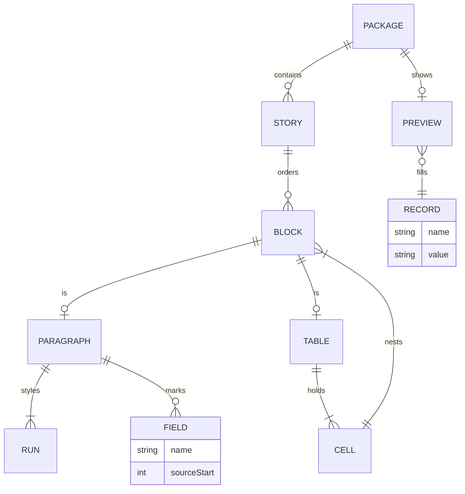
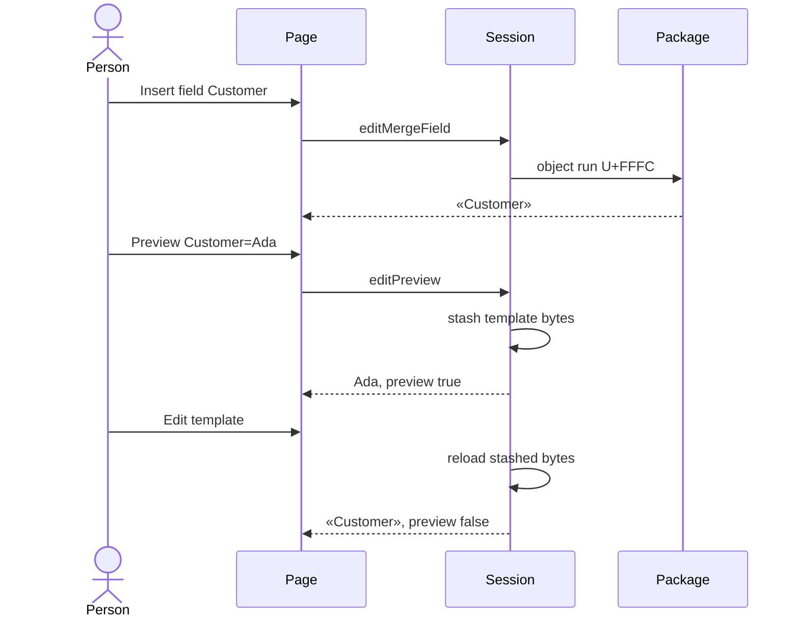

# Merge data

Lens: data. Related: [preview on the page](ux.md), [the session](editing.md), [how a host stores records](saas.md).

## What is stored

The template is a Word package. A merge field is an inline object whose instruction is `MERGEFIELD Name`. The result that paints before a merge is the placeholder «Name».

`FIELD` is not a table in a database. It is the object in the paragraph. `RECORD` is the host's row. The control keeps one record in memory for preview and does not write it into the template (WC-06).

Names come from `Document::merge_field_names`. The invoice sample carries `InvoiceNumber`, `InvoiceDate`, `DueDate`, `Customer`, `Contact`, `Address`, `City`, `Country`, `Reference`, and `Terms`.

## A field's life

`Records::from_rows` builds the one-row set. `Document::preview_with(..., MissingField::Placeholder)` leaves an unfilled field as «Name». The session then opens those bytes as a display document. `end_preview` opens the stashed template again.

## Names

| Rule | Code | Id |
| --- | --- | --- |
| 1 to 64 characters | `editor.field` | WC-15 |
| No control characters | `editor.field` | WC-15 |
| A space is quoted in the instruction | `quote_name` | WC-03 |
| The marker is its own run | `isolate_objects` | WC-10 |

A click selects the marker. The caret does not land between the F and the C of U+FFFC (WC-03).

## What the host owns

The control does not store customers. The host owns the record set. Preview is how a person checks one row before the host merges the saved package with the rest. See [SaaS](saas.md).

A table cell is a nested block list (`body[n]/row[r]/cell[c]/block[b]`). A field inserted there is still a field of the package. The caret after Insert table is the first cell, so the next field lands in the grid.
