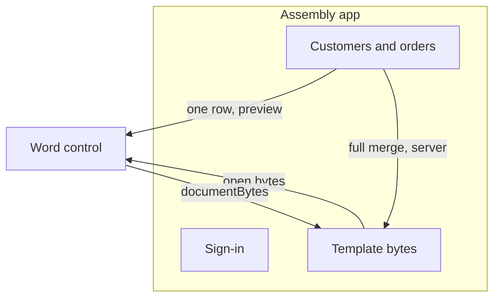

# SaaS and adoption

Lenses: SaaS, marketing, and growth. Related: [the job](product.md), [the embed](architecture.md), [records](merge.md).

## Where it sits

The assembly app already has customers, orders, and templates. The control is the surface where a template is edited. The app stores the package. The control does not.

Preview in the control is one row, so a person can check tone and layout. The full merge of a campaign stays on the server, next to the record set, where a failure can be retried without the browser holding every letter.

## Tenancy

| Concern | Owner |
| --- | --- |
| Who may open a template | The host, before it hands over bytes |
| Where bytes are stored | The host |
| Field names in a template | The package |
| Customer values | The host's records |
| The undo stack | The session, in the tab, gone on reload |

The control has no account and no database. That keeps a tenant boundary in the host, which already has one.

## Why a team switches

| Word today | This control |
| --- | --- |
| Download, edit, upload, hope the fields survived | Edit the package the app already stores |
| A mail-merge wizard apart from the sentence | The field is in the sentence, and preview shows one customer |
| A desktop license per editor | The page, in the app they already pay for |

The promise to market is narrow and checkable: open an invoice template, change it, preview one customer, save a Word file. The end-to-end path in [the plan](plan.md) is that promise.

## Growth, without a second product

- The first template in the product is the invoice sample. A new team sees fields, a table, and a preview on day one.
- Save returns bytes the rest of the app already knows how to store. No new format to migrate.
- The display demo (`site/display`) stays the read-only viewer. Teams that only need to read a file do not load the ribbon.

## What we will not claim

- It is not a full Word replacement. The first hour is the bar. See [product](product.md).
- It does not merge a thousand letters in the browser.
- It does not co-author. Two people need the host's locking, not a hidden lock in the control.
